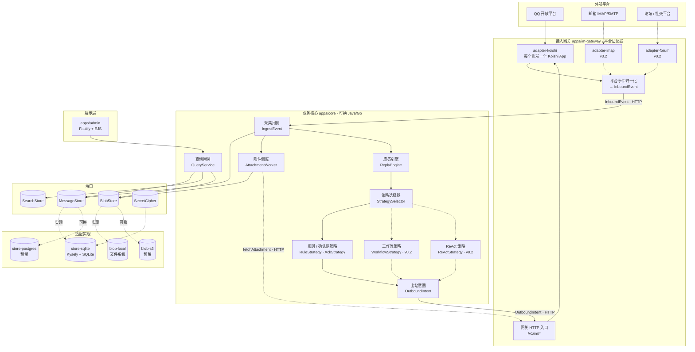
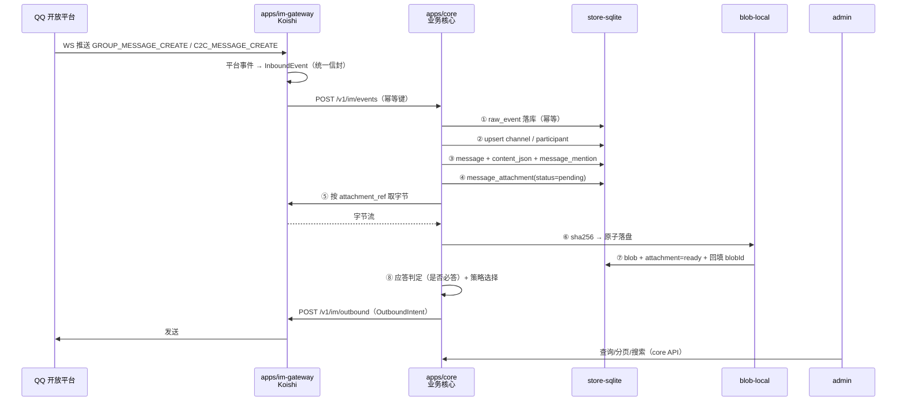

# 消息层 v0.1 实施方案 · IM 接入、统一消息模型与本地留存

> 状态：**方案评审中（本文件只描述设计，不含实现）**
> 归属：DolphinMind · 消息层（Message Layer）
> 关联：[项目中心智能纲领](project-centric-intelligence.md) · [分域受控自举架构](original-2026-paradigm.md)
> 首个落地通道：QQ 官方机器人（appId `1904466648`）

## 0. 一句话

先用 Node/TypeScript + Koishi 打通「QQ 官方机器人 → 接入网关 → 业务核心 → SQLite + 本地文件 → 后台回显 → 关键词应答 + @ 必答」这条最短闭环；**Koishi 只存在于接入网关，业务核心独立进程**，两者只通过语言无关的 JSON 契约通信，以后可以用 Java/Go 重写核心而网关不动。通道（IM / 邮箱 / 论坛）、存储（数据库 / 文件）、对象存储仍然是可替换端口。应答侧同时预埋**策略选择器**层：v0.1 只跑规则与确认语，v0.2 可无缝接入固定编码工作流与大模型 ReAct。

---

## 1. 目标与非目标

### 1.1 v0.1 必须做到

| # | 目标 | 可验证的结果 |
| --- | --- | --- |
| G1 | 接入 QQ 官方机器人，收单聊与群聊（全量模式）消息 | 机器人在线；单聊任意消息、群内**每条**消息进入系统（群管理员在机器人资料页开启「接收所有消息」后） |
| G2 | 消息全量落库 | `message` 表能按会话倒序翻页，字段完整可读 |
| G3 | 富内容保真 | 文字、表情、@、引用、图片、文件、语音、视频都能区分类型并还原 |
| G4 | 附件本地留存 | 图片/文件落到项目目录，按「时间 + hash」分桶，可去重、可下载 |
| G5 | 后台回显 | 浏览器里能看会话列表、消息流、附件预览、全文搜索 |
| G6 | 必答与规则应答 | 群/频道内被 @ 机器人**一定回复**：规则命中按规则，未命中回默认确认语（v0.1 为「你好，我听到了」）；单聊触发关键词规则回复；均可在后台配置 |
| G7 | 多账号可扩展 | 账号配置全在数据库，后台可增删启停，密钥加密存储 |
| G8 | 层可替换 | 数据库、文件存储、消息通道三者都通过端口隔离，各有契约测试 |
| G9 | 业务核心可替换 | Koishi 只存在于接入网关；业务核心独立进程，只消费统一信封；核心可在未安装 Koishi 的环境中通过入站/出站契约测试 |
| G10 | 个人助理账号自助接入 | 企业 Bot 由集团集中配置；个人助理账号由本人在管理页创建，可绑定企业微信/微信/钉钉/飞书等多个平台；账号只进注册表，不产生权限 |

### 1.2 明确不做（v0.1 范围外）

- **不做 AI 应答**：v0.1 只有规则应答与 @ 必答的默认确认语；`ReplyStrategy` / `StrategySelector` 两层已预留，`workflow` 与 `react` 策略 v0.2 再挂。
- **不做无授权的采集**：群内全量消息依赖群管理员在机器人资料页开启「接收所有消息」（`GROUP_MSG_RECEIVE`）；未授权的群只收 `@` 消息——这是权限状态，不是实现缺陷。不做第三方协议端的违规抓取。
- **不做论坛/邮箱的具体实现**：只定契约 + 落库模型，确保骨架能装下（见 §8.5、§8.6）。
- **不做完整权限/审计体系**：中央后台只保留 `admin_audit_log` 与单管理员口令；个人助理自助页先用一次性绑定码/平台 OAuth 验证本人，接主系统后换 AD/SSO；三权分立的治理能力属主系统范围。
- **不做消息归档分区**：先单库单文件，容量到顶再按 §17 演进。

---

## 2. 决策记录（ADR 摘要）

| 编号 | 决策 | 主要理由 | 放弃的替代 | 改判成本 |
| --- | --- | --- | --- | --- |
| ADR-01 | 首版运行时用 **Node 22 + TypeScript**，不用 Java；但网关与业务核心**分两个进程** | Koishi 是 TS；两个 TS 进程可在同仓库快速联调，同时先把进程边界立住。消息层是**独立域**，内部网关/核心、外部主系统都只靠 JSON 契约耦合 | 单进程内用包边界隔离（换语言时仍要拆进程，等于重构）；Java 单体 + Node 网关 sidecar（首版多一套部署） | 低：`apps/core` 是业务组合根，可按契约移植到 Java/Go；网关不动 |
| ADR-02 | 定义自有接入契约与 `ChannelAdapter` 端口，**Koishi 只是网关内的一个实现** | 用户要求「IM 不一定用 Koishi，以后可能换框架」；业务核心不接触 `Context`/`Session` | 直接写 Koishi 插件、业务代码依赖 `Context`/`Session` | 低：换框架只替换 `packages/adapter-*` 与网关装配 |
| ADR-03 | 消息语义**对齐 Satori 元素模型**（`{type, attrs, children}`），但契约用**纯 JSON 类型**，不依赖 `@satorijs/element` 运行时 | 与 Koishi/Satori 同构，网关映射成本最低；业务核心与 Java/Go 侧只认 JSON Schema | 契约直接依赖 Satori 库（Java/Go 无法复用）；自定义一套元素结构（多一层翻译） | 低：入库的是 Satori 形状 JSON，库只在网关内部 |
| ADR-04 | **原始事件先落库**（raw-first），再规范化；归一化在网关，但解析失败也必须把 `raw` 与降级块送达核心 | 规范化会随平台字段变化反复改；raw 落库后可重放、可补算、可排查，天然满足「可审计」 | 解析后直接入库（解析失败即丢消息，无法回溯）；网关解析失败就丢弃 | 极低：`InboundEvent` 始终带 `raw` |
| ADR-05 | 论坛帖建模为 **`forum_post` 频道 + 消息线程**，不并入普通群聊 | 帖子有标题、版块、标签、置顶、楼主等独有元数据，压进普通群聊会丢信息 | 帖子 = group 频道 + title 字段（元数据无处安放） | 低 |
| ADR-06 | 附件采用**内容寻址**：`sha256` + 时间分桶路径，DB 只存逻辑键 | 天然去重；换对象存储时逻辑键不变，DB 不用迁移 | 按会话/消息 id 存路径（重复文件成倍占用，换存储要洗数据） | 极低 |
| ADR-07 | 数据库访问统一走 **Kysely + 端口**，业务层不写 SQL | 方言切换只换 Dialect；SQL 可控、无 ORM 隐式行为 | Prisma（生成物重、方言行为差异大）/ TypeORM（抽象泄漏多） | 低：仓储接口不变 |
| ADR-08 | **一个账号一个适配器实例**（Koishi 账号为一个 App） | 账号之间故障隔离、启停独立；某账号崩溃不拖垮其它账号；个人账号多时按账号分片 | 单 App 装多 bot（共享事件循环与插件状态，故障会串） | 低 |
| ADR-09 | 群/频道内 `at.self=true` **必回**：规则命中按规则，否则回默认确认语「你好，我听到了」 | 「@ 了没反应」与机器人掉线无法区分；用户明确要求必答 | 无匹配就不回（省配额，但违反需求） | 极低：确认语存 `reply.ack_text` |
| ADR-10 | 应答执行拆成 **`ReplyStrategy` + `StrategySelector`** 两层；v0.1 只有 `rule` / `ack`，预留 `workflow` / `react` | 固定编码工作流与大模型 ReAct 是两套编排范式，选择逻辑必须独立于执行逻辑，否则以后只能在引擎里堆 if-else | 在 `ReplyEngine` 内直接分支 / 把 LLM 硬编码进规则 | 低：策略接口不变，新增策略只加实现 |
| ADR-11 | **Koishi 只做接入网关，业务核心独立进程**；两者只通过语言无关契约通信 | 业务层要能随时换 Java/Go；进程边界比包边界硬，能防止 Koishi 类型、生命周期、依赖渗入业务 | 单进程内用包边界隔离（换语言时仍要拆进程）；把 Koishi 当业务框架用 | 中：v0.1 多一个进程与一套契约测试；换来业务核心可独立替换 |
| ADR-12 | **机器人账号分两类管理**：企业 Bot 由集团集中配置；个人助理账号由本人在自助页创建并绑定多个平台；账号只是通道，Agent/沙箱在核心侧 | 企业账号要统一治理；个人账号要自助扩展；两者共用注册表与网关，但管理权限、密钥归属和生命周期不同 | 所有账号由管理员代配（个人无法自助、扩展慢）；个人账号共用企业 Bot（隔离差） | 低：`bot_account` 增加 `account_type/managed_by/owner_id/agent_id`，网关按账号类型拉取 |

---

## 3. 总体架构

### 3.1 分层



> 物理边界：`apps/im-gateway` 只依赖 `contracts`、`adapter-*` 与各平台 SDK，不依赖 `core`；`apps/core` 只依赖 `core`、`store-*`、`blob-*`、`contracts`，不依赖 `koishi`。平台字段归一化在网关完成，核心只认 `InboundEvent`。

### 3.2 各层职责

| 层 | 职责 | 禁止 |
| --- | --- | --- |
| 接入网关 `apps/im-gateway` + `packages/adapter-*` | 连平台、收发消息、把平台事件归一化为 `InboundEvent`、执行 `OutboundIntent`、上报能力与附件字节 | 不写业务库、不含权限/记忆/审批判断、不依赖 `core` |
| 业务核心 `apps/core` + `packages/core` | 消费 `InboundEvent`、身份与主体、权限、记忆、落库编排、附件调度、应答决策、查询 | 不 import `koishi`/`Session`/`Context`/`h()`、不写平台字段分支、不直连平台 SDK |
| 应答策略 `packages/core/src/reply` | `ReplyEngine` 判定是否必答 → `StrategySelector` 产出策略链 → 具体策略生成回复草稿 | 策略不得直接调用网关发送；`react` 的模型调用只经 `LLMClient` 端口 |
| 契约 `packages/contracts` | 数据模型、`ContentBlock`、`InboundEvent`/`OutboundIntent`/`CapabilityManifest`、端口接口 | 零运行时副作用；不依赖 `@satorijs/element`、`koishi` 或任何实现包 |
| 适配实现 `packages/store-*`、`packages/blob-*` | 实现端口，处理方言差异与物理落盘 | 不含业务规则 |
| 网关客户端 `packages/gateway-client` | 实现 `MessageGateway`，把核心的出站意图/取附件请求转成 HTTP | 不含平台协议细节、不 import `koishi` |
| 展示层 `apps/admin` | 查询与渲染、账号与规则管理 | 不直接写 SQL、不绕过 `core` 用例；经 core 查询 API 取数 |
| 组合根 `apps/im-gateway` | 读网关配置、装配平台适配器（v0.1 为 Koishi）、归一化与出站执行 | 不含业务逻辑 |
| 组合根 `apps/core` | 读配置、装配业务核心/存储/策略/后台、启动 HTTP 契约入口 | 不含平台协议细节 |

### 3.3 端口清单

| 端口 | 关键方法 | v0.1 实现 | 未来实现 |
| --- | --- | --- | --- |
| `ChannelAdapter`（网关内部） | `start()` / `stop()` / `send(outbound)` / `onEvent(cb)` / `capabilities` | `adapter-koishi` | `adapter-satori`、`adapter-imap`、`adapter-forum` |
| `MessageGateway`（核心→网关） | `send(intent)` / `fetchAttachment(ref)` / `capabilities(accountId)` | `gateway-client`（HTTP） | gRPC / MQ |
| `MessageStore` | `ingest(event)`（`InboundEvent` + 原始载荷）/ `appendMessage` / `pageByChannel` / `getMessage` / `resolveParticipants` | `store-sqlite` | `store-postgres`、`store-mysql` |
| `BlobStore` | `put(stream, meta)` / `open(key)` / `stat(key)` / `remove(key)` | `blob-local` | `blob-s3`（MinIO/OSS/S3） |
| `SearchStore` | `index(doc)` / `search(q, filter)` | SQLite FTS5（trigram） | PostgreSQL `tsvector` / 兜底 `LIKE` |
| `SecretCipher` | `encrypt(obj) → string` / `decrypt(string) → obj` | AES-256-GCM（`node:crypto`） | KMS / Vault |
| `EventBus` | `publish(event)` / `subscribe(topic, cb)` | 核心进程内 `EventEmitter`；跨进程走 HTTP/Queue | RocketMQ / Redis Stream |
| `StrategySelector` | `plan(ctx) → ReplyStrategy[]`（有序候选，@ 场景链尾必为 `ack`） | `core/reply/selector.ts`（v0.1 固定 rule → ack） | 路由表 / 意图分类 |
| `ReplyStrategy` | `canHandle(ctx)` / `handle(ctx) → OutboundDraft` | `RuleStrategy`、`AckStrategy` | `WorkflowStrategy`、`ReActStrategy` |
| `LLMClient` | `chat(messages, tools) → text \| tool_calls` | —（v0.1 不用） | OpenAI 兼容接口 / 本地模型 |
| `ToolRegistry` | `list(ctx)` / `invoke(name, args)` | —（v0.1 不用） | 工作流步骤与 ReAct 工具白名单 |
| `IdGen` / `Clock` | `next()` / `now()` | ULID / 系统时钟 | 雪花 ID（若接 Java 主系统） |

> `ChannelAdapter` 不再横跨进程：它只存在于 `apps/im-gateway`；核心只依赖 `MessageGateway`。这样换 Koishi 不影响核心，换核心语言也不影响网关。

### 3.4 进程与端口

| 进程 | 监听 | 说明 |
| --- | --- | --- |
| `apps/im-gateway` | `127.0.0.1:8789`（只收核心的出站意图）；平台侧连接方式由适配器决定（QQ 为 WebSocket 出站） | 平台适配器（Koishi / IMAP / Forum）+ 平台归一化；不连业务库；**不需要公网域名** |
| `apps/core` | `127.0.0.1:8788`（收网关入站事件） | 业务核心 + 存储 + 应答引擎 + 策略 + 审批/审计；不含 Koishi |
| `apps/admin` | `127.0.0.1:8787` | Fastify + EJS；v0.1 与 core **同进程启动**，通过 core 查询服务取数 |

> 两个进程都在本机时用 `127.0.0.1` HTTP 互通；将来拆机或换语言时只改基地址与契约版本。admin 与 core 同进程只是 v0.1 的部署简化，不改变代码边界。
>
> 个人助理账号可能较多，网关按平台/账号分片部署；一个进程内仍是一账号一个 App 实例。v0.1 小规模单进程，容量到顶再分片。

### 3.5 接入网关与业务核心的进程边界（ADR-11）

**目标**：Koishi 只负责 IM 接入；业务核心是独立进程，未来可以用 Java/Go 重写，网关不动。

#### 3.5.1 契约对象

| 对象 | 方向 | 关键字段 |
| --- | --- | --- |
| `InboundEvent` | 网关 → 核心 | `event_id`、`account_id`、`account_type`（enterprise/personal_assistant）、`platform`、`event_type`、`occurred_at`、`channel`、`sender`、`content[]`、`mentions[]`、`reply_to`、`attachments[]`、`raw`（可选）、`schema_version` |
| `OutboundIntent` | 核心 → 网关 | `intent_id`、`account_id`、`channel_ref`、`reply_to`、`content[]`、`options`（被动锚点/线程/静默）、`correlation_id`（如 `run_id`）、`idempotency_key`、`schema_version` |
| `CapabilityManifest` | 网关 → 核心 | `threads`、`edit`、`reactions`、`cards`、`supports_full_mode`、`max_message_bytes`、`passive_window_sec`、`probed_at` |
| `AttachmentRef` | 双向 | `ref_id`、`kind`、`name`、`size`、`mime`、`expires_at`；字节由网关按 `ref_id` 提供 |

- `content[]` 是平台中立的 `ContentBlock`（`text` / `at` / `quote` / `img` / `file` / `audio` / `video` / `face` / `br` / `unknown`），不是 Koishi 的 `Element` 实例。
- `account_type` 由账号注册表下发，网关原样回传；核心据此解析主体：企业 Bot 群内=群主体，个人助理账号=主人主体；个人助理默认只服务主人单聊。
- `AttachmentRef` 的字节通过 `GET /v1/im/attachments/{ref_id}` 取；平台鉴权与 URL 过期在网关处理，核心只拿字节。
- 所有 ID 带类型前缀，契约版本走 `schema_version`；网关与核心各自校验，不假设同语言。
- 入站至少一次：网关负责平台侧去重与重连补发，核心按 `(account_id, external_event_id)` / `(account_id, external_message_id)` 幂等。
- 出站可重试：`intent_id` 全局唯一，网关返回 `accepted | duplicate | rejected` 与平台 `message_id` / 错误码。

#### 3.5.2 职责与数据归属

| 项 | 网关 | 核心 |
| --- | --- | --- |
| 平台连接/重连/发送限流/被动窗口 | 是 | 否 |
| 平台事件 → `InboundEvent` | 是 | 否 |
| `OutboundIntent` → 平台消息 | 是 | 否 |
| 平台附件鉴权与字节拉取 | 是 | 否 |
| 账号注册表、启停策略 | 否（启动时向核心拉取并订阅变更） | 是 |
| 密钥密文与轮换 | 否 | 是 |
| 运行期解密后的连接配置 | 是（仅内存） | 是（解密） |
| 业务库、消息/会话/附件元数据 | 否 | 是 |
| 身份映射、主体、AuthContext、PEP | 否 | 是 |
| 群绑定、记忆、分类、同意 | 否 | 是 |
| 应答策略、Agent 编排 | 否 | 是 |
| 审批、审计、后台查询 | 否 | 是 |

> 上表是目标职责边界，不改变 §1.2 的 v0.1 范围：权限、记忆、审批等能力由主系统逐步接入，消息层 v0.1 只做消息落库与应答。
>
> 账号分两类：`account_type=enterprise` 是纯通道账号，由集团集中配置（`managed_by=enterprise_admin`）；`account_type=personal_assistant` 绑定 `PersonalAgent`，账号只是嘴，由本人创建（`managed_by=owner`），一个 Agent 可绑定多个平台账号。网关只负责连接，不判断归属。个人助理 Agent/沙箱的领域定义见 [权限事件风暴](file:///D:/develop/workspace_xcx/DolphinMind/docs/permission-event-storming.md) R15。

三条硬规则：

1. 网关不读业务库、不调用 LLM、不做权限判断；核心不 import `koishi` / `Session` / `Context` / `h()`，不出现 QQ/微信字段分支。
2. 平台差异（字段、富文本、附件 URL、被动回复窗口）全部消化在网关；核心只认 `InboundEvent` / `OutboundIntent`。
3. 账号与密钥的真相在核心；网关只持有运行期解密后的连接配置，不落库、不写日志。核心不可用时，网关保持已有连接，但不能新增账号。

#### 3.5.3 v0.1 落地方式

- 同仓库、两个进程：`apps/im-gateway` 与 `apps/core`，都用 TS；localhost HTTP/JSON，不引入 MQ。
- 两个 HTTP 入口只监听 `127.0.0.1`，用共享 token 校验；不得暴露公网。
- 契约先于实现：`packages/contracts` 先定 JSON Schema + TS 类型；网关与核心各自校验。
- 契约版本：`schema_version` 用 `major.minor`；新增可选字段升 minor，破坏性变更升 major；双方拒绝不支持的 major 并告警。
- 契约测试：`FakeGateway` 驱动核心，核心在未安装 Koishi 的环境里跑通入站/出站；`FakeCore` 驱动网关，验证适配器映射。
- 未来换 Java/Go：只替换 `apps/core` 与 `packages/core`，网关、适配器、契约不变；用同一批 `raw_event` 回放做等价性验收。

> 这不是微服务化：v0.1 两个进程同机部署、无服务网格、无分布式事务；拆开只是为了把“换业务语言”的成本压到进程边界。Satori 也不是业务契约，它只留在网关内部。

---

## 4. 统一消息模型

### 4.1 四层结构

```text
Channel（会话）  1 ─── n  Message（消息）  1 ─── n  ContentBlock（内容块，存 JSON）
                                    1 ─── n  MessageAttachment（附件，指向 Blob）
```

- **Channel**：一个可寻址的「会话」。群、单聊、论坛版块、帖子、邮件主题串都是 Channel，靠 `kind` 区分。
- **Message**：一条消息。既有保真的 `content_json`（`ContentBlock[]`），也有扁平的 `content_text`（搜索与预览）。
- **Element / ContentBlock**：Satori 形状 `{ type, attrs, children }`，是「回显」的唯一依据；契约层称 `ContentBlock`，`@satorijs/element` 的 `h()` 只在网关内部使用。
- **Attachment**：附件与 `Blob` 的关联行，记录下载状态；`Blob` 才是磁盘上的那份字节。

### 4.2 通道类型

| `kind` | 语义 | 父通道 | 典型来源 | 特有元数据（`channel.metadata_json`） |
| --- | --- | --- | --- | --- |
| `group` | 多人群聊 | — | QQ 群、微信群 | 群号、群主、人数、`full_mode`（是否已授权接收所有消息） |
| `direct` | 单聊 | — | QQ 私聊、微信私聊 | 对方 openid |
| `guild` | 服务器/频道 | — | QQ 频道子频道 | guild_id、频道名 |
| `forum_board` | 论坛版块 | — | 论坛版块 | 版块 id、版规、帖子数 |
| `forum_post` | **帖子**（论坛型频道） | `forum_board` | 论坛帖、社交平台帖 | 标题、作者、标签、置顶、浏览数、回复数、原帖 URL |
| `mail_thread` | 邮件主题串 | — | IMAP | 主题（去 Re/Fwd 归一）、参与者、首封 Message-ID |
| `broadcast` | 公告/单向订阅 | — | 公众号、通知号 | 订阅范围 |

**「帖子 = 频道 + 线程」的落地方式**：

- 帖子本身是 `channel(kind='forum_post')`，`external_id` = 平台帖子 id；
- **楼主内容 = 该频道的第一条 message**（`seq = 1`），不是另存一张表；
- **楼层回复 = 同频道的 message**，`reply_to_id` 指向被回复的消息；
- **楼中楼 = `thread_root_id`** 指向所在楼层，形成「楼层 + 楼内回复」两级结构；
- 帖子标题、标签、置顶等**不塞进消息**，放 `channel.title` 与 `channel.metadata_json`——这正是「不要把帖子完全等同于普通群聊」的落点。

这样前台既能用同一套消息流渲染帖子（复用度最高），又不会丢掉帖子特有的元数据。

### 4.3 内容块类型（`ContentBlock`，v0.1 白名单）

| `type` | 关键 attrs | 来源示例 | 备注 |
| --- | --- | --- | --- |
| `text` | `content` | 任意文字、emoji 字符 | 换行保留 |
| `at` | `id`、`name`、`self` | 群内 @某人、@全体 | `self=true` 表示 @ 了机器人自己 |
| `quote` | `id`、`preview` | 引用回复 | 目标不在库时只留预览文本 |
| `img` | `src`、`width`、`height`、`blobId` | 图片、表情包 | `blobId` 由下载后回填 |
| `file` | `src`、`title`、`size` | 群文件、文档 | |
| `audio` | `src`、`duration` | 语音 | |
| `video` | `src`、`duration` | 视频 | |
| `face` | `id`、`name`、`kind` | QQ 系统表情、商城表情 | Satori 无此类型，作扩展类型 |
| `br` | — | 换行 | |
| `unknown` | `kind`、`raw` | ark 卡片、markdown、按钮、合并转发 | **一律降级保留原始 JSON，不丢消息** |

两条硬规则：

1. **未知内容块不许抛异常**。任何无法识别的平台结构都包成 `unknown` 并保留 `raw`，保证「消息不丢」优先于「渲染完美」。
2. **`content_text` 由内容块派生**，不单独拼装。派生规则：`text→原文`、`at→@名字`、`face→[表情:名]`、`img→[图片]`、`file→[文件:名]`、`quote→[引用]`、`unknown→[不支持的类型]`。这样搜索、列表预览、后台回显三处口径一致。

### 4.4 平台私有字段的保留策略

分三级，避免「要么存不下、要么污染主表」：

| 级别 | 位置 | 用途 |
| --- | --- | --- |
| 一级：通用字段 | 各表正式列（`sent_at`、`sender_id`、`reply_to_id`…） | 查询、排序、索引 |
| 二级：平台元数据 | `channel.metadata_json` / `message.metadata_json` | 帖子标签、邮件头、QQ `message_scene` 等 |
| 三级：原始载荷 | `raw_event.payload_json` | 排查、重放、字段补算 |

### 4.5 通道能力矩阵

`capabilities` 是**数据不是猜测**：由适配器声明，后台据此提示用户（例如「该账号只能看到 @ 机器人的群消息」）。

| 能力 | QQ 官方机器人（WebSocket） | OneBot 11（NapCat 等） | 邮箱 IMAP/SMTP | 论坛 |
| --- | --- | --- | --- | --- |
| 群/多人会话全量监听 | 是：群管理员在机器人资料页开启「接收所有消息」后，`GROUP_MESSAGE_CREATE` 推送每条消息（2026 年中起灰度放量）；未开启时只有 `GROUP_AT_MESSAGE_CREATE` | 是 | — | 是（订阅或轮询） |
| 单聊全量监听 | 是（需在开放平台开通 C2C 权限） | 是 | 是 | 视平台 |
| 主动发消息 | 受限（主动消息有配额与审核） | 是 | 是 | 视平台 |
| 被动回复窗口 | 约 5 分钟内、同一 `msg_id` 最多 5 条 | 无 | 无 | 无 |
| 引用回复 | 是 | 是 | 用 `In-Reply-To`/`References` 头 | 是 |
| 历史消息回拉 | 否 | 部分实现 | 是 | 是 |
| 图片/文件 | 是 | 是 | 是 | 是 |
| 系统表情 | 有限（以实测 `raw` 为准） | 是（face id） | 否（unicode） | 部分 |
| 消息撤回事件 | 有 | 有 | 否 | 视平台 |

> 标「受限」的项一律以**实测抓到的 `raw_event`** 为准，不按文档猜字段；表里存疑的单元格由 `capabilities.probed_at` 记录探测时间。
>
> 企业微信、微信、钉钉、飞书等平台的能力同样以适配器实测为准；网关只上报 `CapabilityManifest`，核心不按平台写分支。新增平台只加 `adapter-*`，不改核心。

---

## 5. 数据模型（SQLite，按可移植写法设计）

### 5.1 通用约定

| 约定 | 取值 | 原因 |
| --- | --- | --- |
| 主键 | `TEXT`，ULID（26 字符，字典序即时间序） | 不依赖自增，跨库可移植，写入不需要回查 |
| 时间 | `INTEGER`，Unix 毫秒（UTC） | 时区无关，跨库一致 |
| 布尔 | `INTEGER` 0/1 | SQLite 无布尔 |
| JSON | `TEXT`，应用层 `JSON.parse` | 不用 JSONB / JSON1 函数，避免锁死方言 |
| 枚举 | `TEXT` + 应用层校验（zod） | 不用数据库 enum |
| 外键 | 全部声明 `REFERENCES`，连接时开 `PRAGMA foreign_keys=ON` | 数据完整性 |

### 5.2 表清单

| 表 | 一行代表 | 量级预估 |
| --- | --- | --- |
| `bot_account` | 一个通道账号（企业 Bot / 个人助理账号） | 企业数十；个人可到千级 |
| `channel` | 一个会话/版块/帖子/邮件串 | 万级 |
| `participant` | 一个参与者身份（用户/机器人/系统） | 万级 |
| `channel_member` | 会话成员关系 | 十万级 |
| `message` | 一条消息 | 千万级（长跑） |
| `message_mention` | 消息里的一个 @ | 与 message 同量级 |
| `message_attachment` | 消息里的一个附件 | message 的 10%~30% |
| `blob` | 一份去重后的文件 | 十万级 |
| `raw_event` | 一个平台原始事件 | 略多于 message |
| `outbound_job` | 一条待发/已发消息 | message 的 5% |
| `reply_rule` | 一条应答规则 | 百级 |
| `strategy_route` | 一条策略路由（v0.2 启用） | 百级 |
| `system_config` | 一个全局配置项 | 几十 |
| `admin_audit_log` | 一次后台操作 | 万级 |

### 5.3 表结构

**`bot_account`** — 账号与密钥（多账号的落点）

```sql
CREATE TABLE bot_account (
  id                 TEXT PRIMARY KEY,              -- ULID
  platform           TEXT NOT NULL,                 -- qq | wecom | wechat | dingtalk | feishu | imap | forum
  adapter            TEXT NOT NULL,                 -- qq-official | onebot11 | wecom | dingtalk | feishu | imap | forum
  account_type       TEXT NOT NULL DEFAULT 'enterprise', -- enterprise | personal_assistant
  managed_by         TEXT NOT NULL DEFAULT 'enterprise_admin', -- enterprise_admin | owner
  source             TEXT NOT NULL DEFAULT 'db',   -- config | db
  owner_id           TEXT,                          -- 个人助理必填（逻辑外键：用户）；企业 Bot 为空
  agent_id           TEXT,                          -- 个人助理绑定的 PersonalAgent（逻辑外键）；企业 Bot 为空
  label              TEXT NOT NULL,                 -- 后台显示名，如「海豚主号」「小a的飞书助理」
  external_id        TEXT NOT NULL,                 -- 平台 AppID / 邮箱地址 / 站点+uid
  credentials_cipher TEXT,                          -- AES-256-GCM 密文；个人助理必填，企业 config 来源可为空
  config_json        TEXT NOT NULL DEFAULT '{}',    -- 平台差异参数（intents、轮询间隔等）
  capabilities_json  TEXT NOT NULL DEFAULT '{}',    -- 能力矩阵快照
  enabled            INTEGER NOT NULL DEFAULT 1,
  status             TEXT NOT NULL DEFAULT 'idle',  -- idle|connecting|connected|error
  last_error         TEXT,
  last_connected_at  INTEGER,
  created_at         INTEGER NOT NULL,
  updated_at         INTEGER NOT NULL,
  UNIQUE (platform, external_id),
  CHECK (account_type IN ('enterprise', 'personal_assistant')),
  CHECK (managed_by IN ('enterprise_admin', 'owner')),
  CHECK (source IN ('config', 'db')),
  CHECK (
    (account_type = 'enterprise' AND managed_by = 'enterprise_admin' AND owner_id IS NULL AND agent_id IS NULL)
    OR
    (account_type = 'personal_assistant' AND managed_by = 'owner' AND owner_id IS NOT NULL AND agent_id IS NOT NULL)
  ),
  CHECK (account_type = 'enterprise' OR source = 'db'),
  CHECK (account_type = 'enterprise' OR credentials_cipher IS NOT NULL)
);
CREATE INDEX idx_bot_account_owner ON bot_account (owner_id, platform);
```

**`channel`** — 会话（群/单聊/版块/帖子/邮件串同一张表）

```sql
CREATE TABLE channel (
  id                TEXT PRIMARY KEY,
  account_id        TEXT NOT NULL REFERENCES bot_account(id),
  kind              TEXT NOT NULL,                  -- group|direct|guild|forum_board|forum_post|mail_thread|broadcast
  external_id       TEXT NOT NULL,                  -- 群号/对方 openid/帖子 id/邮件 thread-key
  parent_channel_id TEXT REFERENCES channel(id),    -- forum_post → forum_board
  title             TEXT,                           -- 群名/帖子标题/邮件主题
  metadata_json     TEXT NOT NULL DEFAULT '{}',     -- 帖子标签、置顶、群主…
  first_seen_at     INTEGER NOT NULL,
  last_message_at   INTEGER,
  last_seq          INTEGER NOT NULL DEFAULT 0,     -- 会话内单调序号，分配消息 seq
  message_count     INTEGER NOT NULL DEFAULT 0,
  UNIQUE (account_id, kind, external_id)
);
CREATE INDEX idx_channel_recent ON channel (last_message_at DESC);
```

**`message`** — 消息主体

```sql
CREATE TABLE message (
  id               TEXT PRIMARY KEY,
  account_id       TEXT NOT NULL REFERENCES bot_account(id),
  channel_id       TEXT NOT NULL REFERENCES channel(id),
  seq              INTEGER NOT NULL,                -- 会话内单调序号，稳定排序
  platform_msg_id  TEXT,                            -- 平台消息 id（出站未回执时为空）
  sender_id        TEXT REFERENCES participant(id),
  sender_name_snap TEXT,                            -- 发送时昵称快照（改名后可还原当时显示）
  sent_at          INTEGER,
  received_at      INTEGER NOT NULL,
  direction        TEXT NOT NULL,                   -- inbound | outbound
  content_text     TEXT NOT NULL DEFAULT '',        -- 扁平文本，供搜索与列表预览
  content_json     TEXT NOT NULL,                   -- ContentBlock[]，保真
  reply_to_id      TEXT REFERENCES message(id),     -- 引用回复目标（库内）
  thread_root_id   TEXT REFERENCES message(id),     -- 楼中楼根（论坛）
  quote_preview    TEXT,                            -- 引用目标不在库时的快照文本
  metadata_json    TEXT NOT NULL DEFAULT '{}',      -- 邮件头、平台场景等
  edited_at        INTEGER,
  deleted_at       INTEGER,
  UNIQUE (account_id, platform_msg_id),
  UNIQUE (channel_id, seq)
);
CREATE INDEX idx_message_channel_time ON message (channel_id, sent_at DESC, seq DESC);
CREATE INDEX idx_message_thread ON message (thread_root_id);
```

**`message_attachment`** 与 **`blob`** — 附件与去重后的字节

```sql
CREATE TABLE blob (
  id          TEXT PRIMARY KEY,
  sha256      TEXT NOT NULL,
  size        INTEGER NOT NULL,
  mime        TEXT,
  ext         TEXT,
  storage_key TEXT NOT NULL,              -- 逻辑键，如 v1/2026/10/20/14/9f/3c/<sha>.png
  ref_count   INTEGER NOT NULL DEFAULT 0, -- 被多少条附件引用，GC 依据
  created_at  INTEGER NOT NULL,           -- 首次入库时间（决定时间分桶目录）
  UNIQUE (sha256, size)
);

CREATE TABLE message_attachment (
  id             TEXT PRIMARY KEY,
  message_id     TEXT NOT NULL REFERENCES message(id),
  element_index  INTEGER NOT NULL,         -- 对应 content_json 的下标
  kind           TEXT NOT NULL,            -- image|file|audio|video|unknown
  orig_name      TEXT,                     -- 原始文件名只存库，不进磁盘路径
  mime_hint      TEXT,
  size_hint      INTEGER,
  platform_url   TEXT,                     -- 平台临时地址（会过期）
  url_expires_at INTEGER,
  blob_id        TEXT REFERENCES blob(id),
  status         TEXT NOT NULL,            -- pending|downloading|ready|failed|skipped
  attempts       INTEGER NOT NULL DEFAULT 0,
  last_error     TEXT,
  created_at     INTEGER NOT NULL,
  updated_at     INTEGER NOT NULL,
  UNIQUE (message_id, element_index)
);
CREATE INDEX idx_attachment_pending ON message_attachment (status, created_at);
```

**`raw_event`** — 原始事件（可重放）

```sql
CREATE TABLE raw_event (
  id              TEXT PRIMARY KEY,
  account_id      TEXT NOT NULL REFERENCES bot_account(id),
  adapter         TEXT NOT NULL,
  source_event_id TEXT,                    -- 平台事件/消息 id，用于幂等
  event_type      TEXT NOT NULL,           -- message-created | notice | ...
  received_at     INTEGER NOT NULL,
  payload_json    TEXT NOT NULL,
  status          TEXT NOT NULL,           -- stored | processed | failed
  error           TEXT,
  UNIQUE (account_id, adapter, source_event_id)
);
```

**`participant` / `channel_member` / `message_mention`** — 身份、成员关系、@ 索引

```sql
CREATE TABLE participant (
  id            TEXT PRIMARY KEY,
  account_id    TEXT NOT NULL REFERENCES bot_account(id),
  external_id   TEXT NOT NULL,              -- openid / 邮箱地址 / 论坛 uid
  kind          TEXT NOT NULL,              -- user | bot | system
  display_name  TEXT,
  avatar_url    TEXT,
  metadata_json TEXT NOT NULL DEFAULT '{}',
  first_seen_at INTEGER NOT NULL,
  last_seen_at  INTEGER,
  UNIQUE (account_id, external_id)
);

CREATE TABLE channel_member (
  channel_id     TEXT NOT NULL REFERENCES channel(id),
  participant_id TEXT NOT NULL REFERENCES participant(id),
  role           TEXT,                      -- owner | admin | member | guest
  joined_at      INTEGER,
  left_at        INTEGER,
  PRIMARY KEY (channel_id, participant_id)
);

CREATE TABLE message_mention (
  message_id     TEXT NOT NULL REFERENCES message(id),
  element_index  INTEGER NOT NULL,
  participant_id TEXT REFERENCES participant(id),  -- 未登记身份时为空
  raw_name       TEXT,
  mention_type   TEXT NOT NULL,             -- user | all | self | role
  PRIMARY KEY (message_id, element_index)
);
```

**`outbound_job` / `reply_rule` / `strategy_route` / `system_config` / `admin_audit_log`** — 出站、规则、策略路由、配置、审计

```sql
CREATE TABLE outbound_job (
  id                     TEXT PRIMARY KEY,
  account_id             TEXT NOT NULL REFERENCES bot_account(id),
  channel_id             TEXT NOT NULL REFERENCES channel(id),
  passive_anchor_msg_id  TEXT,              -- 被动回复锚点：平台 msg_id，不是库内 id
  content_json           TEXT NOT NULL,
  strategy               TEXT NOT NULL DEFAULT 'rule',    -- rule|ack|workflow|react
  strategy_ref           TEXT,                            -- workflow id / react 配置名
  trace_json             TEXT NOT NULL DEFAULT '{}',      -- 策略执行轨迹（工作流节点、ReAct 步骤）
  status                 TEXT NOT NULL DEFAULT 'queued',  -- queued|sending|sent|failed
  attempts               INTEGER NOT NULL DEFAULT 0,
  platform_msg_id        TEXT,
  last_error             TEXT,
  created_at             INTEGER NOT NULL,
  sent_at                INTEGER
);
CREATE INDEX idx_outbound_pending ON outbound_job (status, created_at);

CREATE TABLE reply_rule (
  id              TEXT PRIMARY KEY,
  account_id      TEXT REFERENCES bot_account(id),  -- 空 = 全账号
  channel_id      TEXT REFERENCES channel(id),      -- 空 = 全会话
  match_type      TEXT NOT NULL,            -- command | keyword | regex
  pattern         TEXT NOT NULL,
  response_json   TEXT NOT NULL,            -- ContentBlock[] 模板
  require_mention INTEGER NOT NULL DEFAULT 0,
  cooldown_sec    INTEGER NOT NULL DEFAULT 0,
  priority        INTEGER NOT NULL DEFAULT 100,
  enabled         INTEGER NOT NULL DEFAULT 1,
  created_at      INTEGER NOT NULL,
  updated_at      INTEGER NOT NULL
);

-- v0.2 启用：v0.1 选择器使用内置顺序（rule → ack），不读此表
CREATE TABLE strategy_route (
  id           TEXT PRIMARY KEY,
  account_id   TEXT REFERENCES bot_account(id),   -- 空 = 全账号
  channel_id   TEXT REFERENCES channel(id),       -- 空 = 全会话
  match_type   TEXT NOT NULL,                     -- mention | command | keyword | regex | default
  pattern      TEXT,
  strategy     TEXT NOT NULL,                     -- rule | ack | workflow | react
  strategy_ref TEXT,                              -- workflow 标识 / react 配置名
  priority     INTEGER NOT NULL DEFAULT 100,
  enabled      INTEGER NOT NULL DEFAULT 1,
  created_at   INTEGER NOT NULL,
  updated_at   INTEGER NOT NULL
);

CREATE TABLE system_config (
  k          TEXT PRIMARY KEY,
  v          TEXT NOT NULL,
  updated_at INTEGER NOT NULL
);

CREATE TABLE admin_audit_log (
  id          TEXT PRIMARY KEY,
  actor       TEXT NOT NULL,                -- admin:<name>
  action      TEXT NOT NULL,                -- account.create / rule.update / raw.replay
  target      TEXT,
  detail_json TEXT NOT NULL DEFAULT '{}',
  created_at  INTEGER NOT NULL
);
```

以上全部约束同构：TEXT 主键（ULID）、毫秒整数时间、JSON 存 TEXT、显式外键，迁移脚本一次落全。

### 5.4 索引与查询路径

| 查询 | 走的索引 | 说明 |
| --- | --- | --- |
| 会话列表按最近活跃 | `idx_channel_recent` | 后台首页 |
| 会话内倒序翻页 | `idx_message_channel_time` | **keyset 分页**（`WHERE seq < ?`），不用 `OFFSET` |
| 楼中楼展开 | `idx_message_thread` | 楼层内回复 |
| 待下载附件 | `idx_attachment_pending` | 下载 worker 轮询 |
| 消息去重 | `UNIQUE (account_id, platform_msg_id)` | 平台重推天然幂等 |
| 全文检索 | `message_fts`（FTS5，`tokenize='trigram'`） | trigram 对中文子串友好，避免分词器依赖 |

### 5.5 迁移

- 迁移文件放 `packages/store-sqlite/migrations/`，用 Kysely `Migrator` 管理，进程启动时自动执行。
- 迁移脚本只写**可移植 SQL**（见 §6.2）；新增方言时复用同一套迁移逻辑，不重写。
- `schema_migration` 表由 Migrator 自带，不手工维护版本号。

---

## 6. 数据库可替换性

### 6.1 端口形态（示意，非最终代码）

```ts
// packages/contracts/src/ports.ts
export interface MessageStore {
  ingest(input: IngestInput): Promise<IngestResult>   // 单事务：raw_event + channel + message + 附件行
  pageByChannel(q: { channelId: string; beforeSeq?: number; limit: number }): Promise<MessagePage>
  getMessage(id: string): Promise<MessageRecord | null>
  listChannels(q: ChannelQuery): Promise<ChannelPage>
  updateAttachment(id: string, patch: AttachmentPatch): Promise<void>
  withTransaction<T>(fn: (tx: MessageStore) => Promise<T>): Promise<T>
}
```

业务代码只认 `MessageStore`，永远拿不到 `Kysely`、连接、SQL 字符串。

### 6.2 可移植性规则（写进 lint 与 review 清单）

| 禁止 | 原因 | 替代 |
| --- | --- | --- |
| `AUTOINCREMENT` / `SERIAL` | 各库语法与行为不同 | 应用层生成 ULID |
| `JSONB`、`json_extract`、`->>` | SQLite 与 PG 不一致 | JSON 存 TEXT，查询走派生表 |
| `ON CONFLICT` 方言变体 | MySQL 写法不同 | 统一 `try insert → catch unique → update`，或 Kysely 的 `onConflict` 抽象 |
| 在 `core` 直接写 SQL | 换库需要改业务 | 一切经 `MessageStore` |
| 布尔/日期原生类型 | SQLite 无 | 0/1、毫秒整数 |
| `OFFSET` 深翻页 | 千万行后线性退化 | keyset 分页（`seq` 游标） |

### 6.3 契约测试（换库的真正保障）

- `packages/store-sqlite/test/contract.spec.ts` 导出一套**不依赖方言**的用例：写入 → 读回 → 分页顺序 → 唯一约束 → 事务回滚 → 外键约束。
- 每个新实现（Postgres/MySQL）只要跑通同一套契约即视为合格；**测试不重写，只换 driver**。
- `BlobStore` 同理：`put → stat → open → 去重 → remove` 五个用例，本地与 S3 共用。

### 6.4 换库操作清单

| 步骤 | 动作 | 影响面 |
| --- | --- | --- |
| 1 | 新增 `packages/store-postgres`，实现 `MessageStore` | 新增包 |
| 2 | 复用迁移脚本，`Kysely` 换 `PostgresDialect` | 一行装配 |
| 3 | 跑契约测试 | 无业务改动 |
| 4 | 写数据迁移脚本（按表导出/导入，ULID 与时间戳原样保留） | 一次性运维 |
| 5 | 改 `apps/core` 的装配行 | 一行 |

> 结论：换库的成本被压在「一个包 + 一次数据搬运」，业务代码零改动。

---

## 7. 文件存储（附件）

### 7.1 端口

```ts
export interface BlobStore {
  put(src: Readable, meta: { mime?: string; ext?: string; maxBytes: number }): Promise<BlobRef>
  open(key: string): Promise<{ stream: Readable; size: number; mime?: string }>
  stat(key: string): Promise<{ size: number; mtime: number } | null>
  remove(key: string): Promise<void>
}
```

`BlobRef = { sha256, size, mime, ext, storageKey }`。**DB 只存 `storageKey` 逻辑键**，不存绝对路径、不存 bucket 名——换存储后端时键不变。

### 7.2 路径规范：时间分桶 + 内容哈希

```text
{DM_DATA_DIR}/blobs/v1/{yyyy}/{MM}/{dd}/{HH}/{sha[0:2]}/{sha[2:4]}/{sha256}.{ext}
```

真实示例（本机工作区）：

```text
D:\develop\workspace_xcx\DolphinMind\var\blobs\v1\2026\10\20\14\9f\3c\
  9f3c0a41d7b28e55961c4b3f0a2d8e7c5b1a9640f3d2c8b7a6e5d4c3b2a1908f.png
```

| 设计点 | 取值 | 理由 |
| --- | --- | --- |
| 时间层级 | 年/月/日/时 | 单目录文件数可控；按时间做生命周期与迁移（冷热分层、按月归档） |
| 哈希分两级 | `sha[0:2]/sha[2:4]` | 单目录条目数再降两个数量级，避免 ext4/NTFS 大目录退化 |
| 文件名 | 完整 sha256 + 扩展名 | 内容寻址：同内容必然同路径，天然去重、天然不可变 |
| 原始文件名 | 只存 `message_attachment.orig_name` | 用户输入不进路径，杜绝路径穿越与非法字符 |
| 目录时间 | 以 `blob.created_at`（首次入库）为准 | 同一文件二次上传命中原路径，不产生副本 |

### 7.3 落盘流程

```mermaid
flowchart LR
    A[收到附件元素] --> B[写 message_attachment<br/>status=pending]
    B --> C[下载队列]
    C --> D[写临时文件<br/>blobs/tmp/{ulid}.part]
    D --> E[边流边算 sha256<br/>校验大小上限/超时]
    E --> F{目标路径已存在?}
    F -- 是 --> G[删临时文件<br/>复用既有 blob]
    F -- 否 --> H[mkdir -p + rename 原子落盘]
    H --> I[写 blob 行]
    G --> I
    I --> J[attachment.status=ready<br/>回填元素 blobId]
```

| 分支 | 处理 | 落库结果 |
| --- | --- | --- |
| 下载成功且内容新 | 原子 `rename` 到最终路径 | `blob` +1，`attachment.status='ready'` |
| 下载成功但已存在 | 丢弃临时文件，`ref_count+1` | 不新增 `blob` 行 |
| 超过大小上限 | 中止、删临时文件 | `status='skipped'`，`last_error='size_limit'` |
| URL 过期（403/404） | **不重试** | `status='failed'`，`last_error='url_expired'`，保留 `platform_url` 供人工补 |
| 网络抖动/超时 | 指数退避重试 3 次 | 仍失败则 `status='failed'` |
| MIME 不可识别 | 按 `application/octet-stream` 存 | `ext` 留空，`mime='application/octet-stream'` |

**先写临时文件再 rename** 的原因：避免半截文件被当作完整文件去重命中（内容哈希必须对应完整字节）。

### 7.4 去重、引用计数与回收

- `blob` 以 `(sha256, size)` 唯一；同一张图被 10 个群各发一次，磁盘只有 1 份。
- `message_attachment` 插入时 `blob.ref_count += 1`；软删除消息不递减（保留证据），硬删除时递减。
- 夜间 GC：`ref_count = 0 AND created_at < now - 30d` 的 blob 删除文件并删行；孤儿文件（磁盘有、DB 无）只扫描报告，不自动删（默认 `dry-run`）。
- 单账号每日下载量、单文件大小、总配额三个闸门放 `system_config`。

### 7.5 换对象存储的清单

| 步骤 | 动作 |
| --- | --- |
| 1 | 新增 `packages/blob-s3`，实现 `BlobStore`（key 原样作为 object key） |
| 2 | 装配行改为注入 S3 实现；`storageKey` 不变，DB 零迁移 |
| 3 | 存量文件用 `mc mirror` 或自写脚本按 key 平移 |
| 4 | 后台下载改为 302 签名 URL（`open()` 之外新增可选 `signedUrl()`，本地实现回落到网关流式转发） |

---

## 8. 通道接入层

### 8.1 Koishi 适配器的封装方式（只存在于 `apps/im-gateway`）

- **不用 Koishi 的配置文件与 CLI**：账号配置由核心经契约下发，`new App()` 在网关代码里按账号组装，避免「配置两处、互相覆盖」。
- **一个账号一个 App**：`app.plugin(adapterQQ, { id, secret, intents })`，`app.start()` / `app.stop()` 即账号启停，故障隔离。
- **网关对核心只暴露契约**：`InboundEvent`、`OutboundIntent`、`CapabilityManifest`、`AttachmentRef`；核心侧看不到 `Session`、`Context`、`h()`。
- **平台归一化在网关完成**：QQ/微信字段 → `ContentBlock[]`、`mentions[]`、`reply_to`、`attachments[]`；核心不出现平台字段分支。
- **事件过滤**：丢弃 `session.selfId` 自己发的、其它 bot 发的（按 `capabilities.ignoreBots`）；群聊同时订阅 `group-at-message-create`（仅 @）与 `group-message-create`（全量），单聊订 `c2c-message-create`；其余事件只进 `raw`。
- **出站会话缓存**：按 `platform_msg_id` 缓存最近 5 分钟的 `session`，供被动回复复用（见 §8.4）；缓存不跨进程。
- **只用 Koishi 的连接能力**：`App` + 平台适配器 + 会话事件 + `send`；不用 Koishi 的 database/console/scheduler 插件承载业务。

### 8.2 QQ 官方平台的现实约束（必须先讲清楚）

| 约束 | 对需求的影响 | 本方案的对策 |
| --- | --- | --- |
| **群消息默认只有被 @ 时才推送** | 未开启全量时，群聊只能拿到与机器人相关的消息 | 订阅 `GROUP_AND_C2C_EVENT (1<<25)`；群管理员开启「接收所有消息」后，平台改用 `GROUP_MESSAGE_CREATE` 推送**每条**群消息 |
| **全量模式由群管理员授权，不是机器人单方面开关** | 每个群要单独授权，且可被随时关闭 | 监听 `GROUP_MSG_RECEIVE` / `GROUP_MSG_REJECT`，把 `channel.metadata_json.full_mode` 做成三态 `on/off/unsupported`；后台按群展示，关闭后自动回落为 @ 模式 |
| 全量开启后事件可能「二选一」 | 社区实测：开启全量后，连 @ 消息也可能只走 `GROUP_MESSAGE_CREATE` | 两个事件都订阅、都落 `raw_event`；入库靠 `UNIQUE(account_id, platform_msg_id)` 去重，不假设哪个一定会来 |
| 单聊需开通 C2C 权限 | 未开通则完全收不到单聊 | 启动自检 + 后台 `status=error` 并给出原因 |
| 被动回复窗口约 5 分钟、同一 `msg_id` 最多 5 条 | 超时后回复失败 | `outbound_job` 记录被动锚点；超时降级主动消息（受配额限制）或标记 `failed:passive_window_expired` |
| 主动消息有配额与审核 | 不能主动推送 | 默认只在用户消息后 5 分钟内回复；主动推送需显式开关 |
| 附件 URL 有时效 | 过期无法补下 | 收到即入队；`url_expires_at` 落库；过期不做无意义重试 |
| 无历史消息回拉 | 停机期间消息永久缺失 | 断线重连 + 缺口告警；后台在会话上标 `gap` |
| IP/网络 | WebSocket 出站，无需公网域名 | 部署只需出网，不需要反向代理 |

> **事实核对（2026-10-20）**：官方文档《群消息（全量模式）》写明 `GROUP_MESSAGE_CREATE` 在机器人开启「接收所有消息」后推送群内每条消息（不限于 @），Intent 为 `GROUP_AND_C2C_EVENT (1<<25)`；开关由群管理员在机器人资料页操作，对应 `GROUP_MSG_RECEIVE` / `GROUP_MSG_REJECT`。`@satorijs/adapter-qq@4.14.0` 的 `adaptSession()` 已分派 `GROUP_MESSAGE_CREATE`，并把 `mentions[].is_you` 还原为 `at` 元素——Koishi 侧无需改适配器代码。
>
> 灰度提示：该能力 2026 年中起分批放量，开启入口在手机 QQ 的机器人资料页；账号未覆盖时后台应显示 `unsupported`，不要当成配置错误。

### 8.3 多账号生命周期

| 时机 | 动作 |
| --- | --- |
| 进程启动 | 向核心 `GET /v1/im/accounts` 拉取启用账号 → 按平台/账号分片 → 逐账号建 App → 并发 `start()`，单账号失败只影响自己 |
| 集团新增企业账号 | 集团管理员在 `/admin/accounts` 或 config 中配置 → 核心发布 `account.changed` / 重启加载 → 网关启动该 App |
| 个人创建助理账号 | 本人在 `/me/assistant` 写入 AppID/secret 并完成归属校验 → 核心发布 `account.changed` → 网关启动该 App |
| 个人绑定多平台 | 同一 `PersonalAgent` 可绑定企业微信/微信/钉钉/飞书等账号；每个账号独立启停、独立能力矩阵 |
| 停用单个账号 | 核心发布 `account.changed` → 网关只停该 App；同 Agent 其他账号继续 |
| 改密钥 | 核心发布 `account.changed` → 网关 `app.stop()` + `app.start()`（不做热替换，避免半状态） |
| 运行期异常 | 适配器捕获 → 指数退避重连 → 上报 `status` / `last_error` 给核心，后台红色标记 |

> 网关不落 `bot_account`；核心是唯一真相。企业账号由集团集中配置，个人账号由本人自助创建；网关只连接，不判断归属。`account_type` 随账号配置下发，网关在 `InboundEvent` 原样回传；核心据此解析群主体/主人主体。
>
> 网关重启后重新拉取，不依赖本地缓存恢复账号。变更通知 v0.1 用轮询（`/v1/im/accounts` 返回 `version`），后续可换 webhook/MQ。个人账号多时按平台/账号分片、池化连接。

### 8.4 出站与被动回复

状态机：`queued → sending → sent`，失败落 `failed`（可重试 3 次后终态）。

| 字段 | 作用 |
| --- | --- |
| `passive_anchor_msg_id` | 被动回复锚点（平台 `msg_id`），决定走被动通道 |
| `attempts` / `last_error` | 重试与排障 |
| `platform_msg_id` | 发送成功后回填；核心据回执写入 `message(direction='outbound')` |
| `sent_at` | 审计与限流窗口计算 |

> 出站成功后**也要入 `message` 表**：后台能看到「机器人回了什么」，且与入站消息共用一套渲染。网关只返回 `platform_msg_id` / 错误码；`message(direction='outbound')` 由核心回写，保证业务库只有一个写者。

### 8.5 邮箱通道（v0.2，先定契约）

> `adapter-imap` 同样只存在于网关侧：邮件内容归一化为 `InboundEvent`，核心不接触 IMAP/SMTP。

| 维度 | 设计 |
| --- | --- |
| 适配器 | `adapter-imap`：IMAP `IDLE` 优先，否则 60s 轮询；SMTP 发送 |
| 会话映射 | `channel(kind='mail_thread')`，`external_id` = `References` 根 Message-ID；缺失时用「去 Re:/Fwd: 的主题 + 参与者集合」的哈希 |
| 消息映射 | 一封邮件 = 一条 message；`metadata_json` 存 `Message-ID/In-Reply-To/References/From/To/Cc` |
| 内容块映射 | `text/plain` → `text`；`text/html` → 清洗后的 `text`+`unknown(raw)`；附件 → `file`/`img`；内联 `cid:` 图片下载后回填 `blobId` |
| 线程 | `In-Reply-To` → `reply_to_id` |
| 去重 | `UNIQUE(account_id, 'mail', Message-ID)` |

### 8.6 论坛通道（v0.2，先定契约）

> `adapter-forum` 只存在于网关侧：帖子/楼层归一化为 `InboundEvent`，核心只认 `channel(kind='forum_post')` 与消息。

| 维度 | 设计 |
| --- | --- |
| 适配器接口 | `listBoards()` / `listPosts(board, cursor)` / `listReplies(post, cursor)` / `publish(post, content)` / `reply(post, content, parentReplyId)` |
| 版块 | `channel(kind='forum_board')`，只作容器，不产生消息 |
| 帖子 | `channel(kind='forum_post', parent_channel_id=版块)`，`title` = 帖子标题，`metadata_json` 存标签/置顶/浏览数/原帖 URL |
| 楼主 | 该频道 `seq=1` 的 message |
| 楼层 | 同频道后续 message，`reply_to_id` 指向被回复楼层 |
| 楼中楼 | `thread_root_id` 指向楼层消息 |
| 增量 | 帖子列表按 `updated_at` 游标；回复按 `floor` 游标 |

> 这个模型同时覆盖「论坛帖」「社交平台帖子」「Issue 讨论」：它们的共性就是**有标题的容器 + 有序回复 + 可嵌套引用**。

### 8.7 换框架 / 升级到 Satori 协议

三级隔离，按需升级，不必一次做到位：

| 级别 | 做法 | 何时用 |
| --- | --- | --- |
| L1（v0.1 采用） | `apps/im-gateway` 进程内 `ChannelAdapter` + HTTP 契约（Satori 形状 JSON） | 单机、单语言、最快闭环 |
| L2 | 网关内 `adapter-satori`：用 `@satorijs/protocol` 作为 client 连 Koishi 的 Satori server | 网关要与 Koishi 运行时分离部署/升级 |
| L3 | Satori 协议作为网关内部/跨进程契约，Koishi 与其它 Satori 实现可互换 | 多框架并存 |

L1→L2 的改动面：只改网关内部装配与部署；`core`、`store`、`admin` 零改动——跨进程契约在 L1 已经建立，业务核心本来就不接触 Koishi。

---

## 9. 采集管道

### 9.1 时序



**为什么 raw 先落库**：平台字段一旦变化或解析抛错，消息仍在 `raw_event` 里，可以补算；否则这条消息永久丢失。`raw_event.status` 标记 `stored → processed / failed`，失败可在后台一键重放。①~④ 在核心事务内，⑤~⑦ 异步，⑧ 与发送决策都在核心；网关只负责“取字节”和“发消息”。网关归一化失败时仍必须发送 `InboundEvent`：`content` 至少含 `unknown` 块并带 `parse_error`，`raw` 原样保留；核心先落 `raw_event`，再异步补算。

### 9.2 一条消息的完整落库示例

场景：群「研发二组」里，张三发了一条 **@海豚 看下这个 [图片] 引用「明早发版吗？」+ 文件《方案v3.pdf》**（平台 `msg_id = ROBOT1.0_9xKq…`）。

**数据库写入（同一事务内 ①~④）**

| 表 | 动作 | 内容 |
| --- | --- | --- |
| `raw_event` | insert | `event_type='GROUP_MESSAGE_CREATE'`，`payload_json` = 平台原始 JSON，`status='stored'` |
| `channel` | upsert | `kind='group'`，`external_id='8A3F2C…'`，`title='研发二组'`，`last_seq: 136 → 137` |
| `participant` | upsert | 张三：`external_id='1B7D9E…'`，`display_name='张三'` |
| `message` | insert | `seq=137`，`content_text='@海豚 看下这个 [图片] [引用] [文件:方案v3.pdf]'`，`reply_to_id`=李四那条消息的库内 id，`quote_preview='明早发版吗？'` |
| `message_mention` | insert | `mention_type='self'`，`raw_name='海豚'` |
| `message_attachment` | insert ×2 | ①`kind='image'` ②`kind='file'`，`orig_name='方案v3.pdf'`，`status='pending'` |

**磁盘写入（异步 ⑤⑥）**

| 位置 | 内容 |
| --- | --- |
| `var/blobs/tmp/01JQ…part` | 下载中的临时文件（成功后消失） |
| `var/blobs/v1/2026/10/20/14/9f/3c/9f3c…1908f.png` | 图片，`blob.sha256=9f3c…1908f`，12.4 KB |
| `var/blobs/v1/2026/10/20/14/4b/e1/4be1…77aa.pdf` | 文件，`blob.sha256=4be1…77aa`，486 KB |
| `var/db/dolphinmind.sqlite` | 上述所有行 |

**状态变化**

| 位置 | 处理前 | 处理后 |
| --- | --- | --- |
| `message_attachment.status` | `pending` | `ready` |
| `blob.ref_count` | 0 | 1（若该图此前已存在，则只 +1，不新增文件） |
| `content_json` 中的 `img.attrs.blobId` | 无 | `9f3c…1908f` 对应的 blob 行 id |

### 9.3 幂等与重复

| 场景 | 处理 |
| --- | --- |
| 平台重推同一事件 | `UNIQUE(account_id, adapter, source_event_id)` 命中 → 直接返回，不重复处理 |
| 同一条消息换了事件 id | `UNIQUE(account_id, platform_msg_id)` 兜底 |
| 断线重连后重放 | 同上，天然幂等 |
| 本地已存在但 `raw_event` 缺失（历史数据） | 允许补插，`status='processed'` |

### 9.4 附件下载调度

| 项 | 取值（可在 `system_config` 调整） |
| --- | --- |
| 并发 | 3 |
| 单文件上限 | 50 MB |
| 单账号日配额 | 2 GB |
| 超时 | 连接 10s / 整体 120s |
| 重试 | 3 次，指数退避 2s/8s/30s |
| 优先级 | 图片 > 文件 > 音视频（按体验） |

下载 worker 独立于事件循环的写入路径：入站只写 `pending` 行，下载失败不影响消息落库。

### 9.5 v0.1 采集的事件范围

| 事件 | 是否处理 |
| --- | --- |
| `GROUP_MESSAGE_CREATE`（群，全量模式） | 是，主链路 |
| `GROUP_AT_MESSAGE_CREATE`（群，仅 @） | 是；开启全量的群可能不再推此事件，两个都订阅、入库去重 |
| `C2C_MESSAGE_CREATE`（单聊） | 是，主链路 |
| `GROUP_MSG_RECEIVE` / `GROUP_MSG_REJECT`（全量开关） | 是；更新会话的 `full_mode` 状态 |
| 频道 `MESSAGE_CREATE` / `AT_MESSAGE_CREATE` | 是（接频道账号时） |
| 消息撤回 | 只写 `raw_event` + 置 `deleted_at`（v0.1 可选） |
| 成员加入/退出 | 只写 `raw_event` |
| 其它（表情回应、按钮交互…） | 只写 `raw_event`，不解析 |

---

## 10. 应答引擎（v0.1 最小可用）

### 10.1 触发条件

| 会话类型 | 触发 |
| --- | --- |
| `direct` | 任意消息进入规则匹配（命中才回；v0.2 可由路由指向 `workflow` / `react`） |
| `group` / `guild` | `at.self = true` → **必回**（规则优先，未命中回确认语）；未 @ 默认不回 |
| `forum_post` / `mail_thread` | 默认关闭，按规则显式开启 |

> 全量模式只影响「能看见多少」，不影响「回不回」：群内默认仍只回 @ 机器人的消息，避免刷屏；`system_config` 提供 `reply.all_group_messages` 显式开关。

> 全量模式下 `content` 已去掉 @ 前缀，`at.self` 从 `mentions[].is_you` 判定（适配器会还原成 `at` 元素），**不能**靠 `content` 里有没有 `@` 字面量判断。

> `@全体` 不算 `at.self`，不触发必答；必答只认 `mentions[].is_you = true && scope = 'single'`。

### 10.2 @ 必答（硬规则）

群 / 频道内 `at.self = true` 的消息**必须产生一次回复**，不依赖是否命中规则：

| 场景 | 回复内容 | `outbound_job.strategy` |
| --- | --- | --- |
| @ 且命中 `reply_rule` | 规则模板渲染结果 | `rule` |
| @ 且无规则命中 / 规则冷却中 | 默认确认语（`reply.ack_text`，默认「你好，我听到了」） | `ack` |
| @ 且选中策略执行异常 | 降级默认确认语，错误写日志与 `last_error` | `ack` |
| 发送者是自己 / 其它 bot | 不回复（防回环优先） | — |
| 平台重推同一 `platform_msg_id` | 只回复一次 | — |
| `system_config.reply.enabled = 0` | 不回复（运维总开关） | — |

- 默认确认语存 `system_config.reply.ack_text`，后台可改，不写死在代码里。
- 必答只要求「回一次」，不要求内容长度；纯图片 / 语音 / 文件消息被 @ 时同样触发。
- 规则优先于确认语：命中规则就按规则回，**不追加**确认语；规则命中但渲染失败则降级确认语。

### 10.3 处理策略选择器（为工作流 / ReAct 预留）

`ReplyEngine` 只回答两个问题：**该不该回、回给谁**。至于「由什么机制生成回复」，交给独立的 `StrategySelector` 与 `ReplyStrategy` 层，避免以后把工作流、LLM 的分支堆进引擎。

```text
ReplyEngine（触发判定：必答 / 单聊 / 规则）
   → StrategySelector（按优先级产出策略链）
      → ReplyStrategy（rule | ack | workflow | react）
         → OutboundDraft（ContentBlock[]）
            → outbound_job → MessageGateway.send → 网关 → ChannelAdapter.send
```

```ts
export interface ReplyContext {
  accountId: string
  channel: ChannelRecord
  message: MessageRecord
  sender: ParticipantRecord
  trigger: 'mention' | 'direct' | 'ambient'  // ambient = 群内未 @（需显式开启）
}

export interface ReplyStrategy {
  readonly id: 'rule' | 'ack' | 'workflow' | 'react'
  canHandle(ctx: ReplyContext): Promise<boolean>
  handle(ctx: ReplyContext): Promise<OutboundDraft | null>
}

export interface StrategySelector {
  // 有序候选：依次尝试，第一个返回非空草稿的胜出；@ 场景链尾必为 ack
  plan(ctx: ReplyContext): Promise<ReplyStrategy[]>
}
```

| 策略 | 编排形态 | v0.1 | 适用场景 |
| --- | --- | --- | --- |
| `rule` | 固定规则匹配（command / keyword / regex） | 是 | 确定性、可配置的应答 |
| `ack` | 固定确认语 | 是（@ 兜底） | 保证 @ 必有响应 |
| `workflow` | **固定编码的工作流编排**：步骤、分支、重试由代码定义（DAG / 状态机），不依赖模型做控制流 | 预留 | 稳定流程、需要可重放与单测，如「收消息 → 建任务 → 调工具 → 回报」 |
| `react` | **大模型 ReAct**：思考 → 工具调用 → 观察 → 再思考，模型决定下一步 | 预留 | 开放问题、需要动态选择工具，如排障问答、需求澄清 |

选择顺序（优先级从高到低）：

| # | 条件 | v0.1 | v0.2+ |
| --- | --- | --- | --- |
| 1 | 账号 / 会话显式路由命中（`strategy_route`） | 不读路由表 | 路由指定的 `workflow` / `react` |
| 2 | `reply_rule` 命中 | `rule` | `rule` |
| 3 | `at.self = true` 且前面都没命中 | `ack` | 路由未指定时仍 `ack` |
| 4 | 其它 | 不回复 | 可按显式路由开启 `react` |

三条执行约束：

1. **策略只产出草稿，不直接发送**。发送统一经 `outbound_job` → `MessageGateway`，保证限流、被动回复锚点、审计仍在同一处。
2. **失败逐级降级**。候选策略抛错或返回空，选择器继续下一个；@ 场景最终一定落到 `ack`，从而满足 §10.2 的必答。
3. **可追溯**。`outbound_job.strategy` / `strategy_ref` / `trace_json` 记录本次由谁生成；`workflow` 记录节点轨迹，`react` 记录每一步模型决策与工具调用，便于审计与回放。

> 边界：`StrategySelector` 不实现业务，`workflow` / `react` 也不做「该不该回」的判断；两者都只消费 `ReplyContext` 并返回草稿。未来新增策略只加实现，不改 `ReplyEngine`。

### 10.4 规则与内置命令

`reply_rule` 行结构：`match_type`（`command | keyword | regex`）+ `pattern` + `response_json`（`ContentBlock[]` 模板）+ `require_mention` + `cooldown_sec` + `priority`。

| 内置命令 | 回复（示例） | 用途 |
| --- | --- | --- |
| `/ping` | `pong · 已记录消息 #137` | 验证收发与入库链路 |
| `/help` | 命令清单 | 可发现性 |
| `/id` | 当前会话 `channel.id`、自己的 `participant.id` | 配置规则时取标识 |

模板变量：`{name}`（发送者昵称）、`{channel}`（会话标题）、`{seq}`（消息序号）、`{time}`（发送时间）。

### 10.5 防回环与限流

| 风险 | 措施 |
| --- | --- |
| 机器人回自己 | `sender.is_self` 直接忽略 |
| 两个机器人互相回 | `sender.kind='bot'` 忽略 |
| 平台重推导致重复回复 | 按 `platform_msg_id` 记录「已回复」，TTL 10 分钟 |
| 非 @ 回复刷屏 | 每会话 60s 内最多 3 条，超出只入库不回复 |
| @ 必答被高频触发 | @ 不受上述会话限流（保证必答）；同一 `platform_msg_id` 只回一次；平台被动回复配额是硬上限 |
| 规则误配导致风暴 | 单条规则可 `enabled=0`；全局开关 `reply.enabled` |
| 选中策略异常 | 策略链逐级降级；@ 最终由 `ack` 兜底，错误写日志与 `outbound_job.last_error` |

> 「必答」与「限流」的边界：限流只约束非 @ 的自动回复；@ 消息必须响应，但仍受防回环、去重和平台配额约束。传输层防回环（自己/其它 bot）在网关丢弃；核心的防回环与去重是业务兜底，两层都保留。

### 10.6 异步任务与完成回投

企业 Bot 和个人助理 Bot 收到长任务时，不在当前请求里阻塞执行；核心开 `AgentThread` / `AgentRun`，先回执，完成后回投。

| 阶段 | 谁做 | 产出 |
| --- | --- | --- |
| 受理 | 网关 → 核心 | `InboundEvent` → `AgentThreadOpened` / `AgentRunStarted` |
| 回执 | 核心 → 网关 | `OutboundIntent`：已受理 + 任务号；引用原消息/线程 |
| 执行 | 核心 / Agent 沙箱 | 继承开启时权限快照；每次工具调用 PEP 复核 |
| 完成 | 核心 → 网关 | `RunNotification` → `OutboundIntent`：结果/摘要/审批/失败 |
| 回投 | 网关 → 调用方 | 原会话/线程；平台支持线程则用线程，否则引用原消息 |

> 企业 Bot 的 Run 使用核心的共享 Agent 运行时；个人助理的 Run 使用主人专属沙箱。两者共用 `AgentRun` 模型，权限快照规则相同。

硬规则：

1. **BOT 不是执行者**：Agent 完成后不直接调用 BOT；由核心生成 `OutboundIntent`，网关发送。
2. **通知也是披露**：发送前按调用方当前权限和目标会话披露范围过滤；需要审批时转审批队列，不直接回投。
3. **幂等**：同一 `run_id` 只产生一条终态通知；网关重试不重复发送。
4. **离线/禁用**：BOT 离线或被禁用时通知排队/重试；个人助理可换绑定的其他平台账号，仍不行则回落主人/兜底人。
5. **线程映射**：平台支持线程/话题就用线程；不支持就用引用回复原消息，不新造平台概念。
6. **权限变化**：Run 继承开启时快照，但每次工具调用复核；撤权/同意过期/范围解绑后，通知只回状态或摘要，不泄露结果。
7. **审批流**：辅助应答/个人助理对外发言，完成通知先到审批人（被问对象/主人），不到客户/群；批准后才由 BOT 发送。

> 这条链路就是前台接线/后台执行在消息层的形态：前台先回执并保持会话，后台 Run 负责执行，完成后由前台/原 BOT 回投；两者仍是同一主体。

---

## 11. 后台页面

### 11.1 页面清单

中央后台路由统一挂在 `/admin` 下（下表省略前缀）；个人助理自助页见 §11.4。

| 路由 | 内容 | 关键交互 |
| --- | --- | --- |
| `/` | 概览：账号状态、今日消息数、待下载附件、近 24h 错误 | 红点直达异常 |
| `/accounts` | 企业 Bot 列表与状态（集团管理员） | 新增/编辑/启停、连接测试、能力提示；个人助理账号在 `/me/assistant` |
| `/channels` | 会话列表（账号/类型/最近活跃/关键词筛选） | 点进消息流 |
| `/channels/:id` | 消息流（倒序 keyset 分页） | 楼中楼折叠展开、引用跳转、附件预览 |
| `/search` | 全文检索（FTS5 trigram） | 高亮命中、按账号/会话/时间过滤 |
| `/rules` | 应答规则、默认确认语 | 增删改、启停、试跑；v0.2 在此配置策略路由 |
| `/raw-events/:id` | 原始事件详情 | 查看 JSON、重放、看解析错误 |
| `/blobs/:id` | 附件下载/预览 | 支持 `Range`，图片直出 |

### 11.2 内容块渲染规范（`ContentBlock`，回显的核心）

| 元素 | 渲染 |
| --- | --- |
| `text` | 保留换行，URL 自动成链，普通 emoji 原样 |
| `at` | `@昵称` 高亮 chip；`self=true` 加「我」标记 |
| `face` | 按 `qq-face.json` 映射成表情图；缺失显示 `[表情:178]` |
| `quote` | 灰色引用块，显示 `quote_preview`；目标在库则可点击跳转 |
| `img` | 缩略图（直接 ``，v0.1 不做服务端缩略图）；未下载完显示占位与平台链接 |
| `file` | 文件名 + 大小 + 下载按钮 |
| `audio` / `video` | 原生 `<audio>` / `<video>` |
| `unknown` | 折叠的 `<details>` + JSON，避免整条消息渲染失败 |

### 11.3 认证与审计

- **中央后台 `/admin/*`**：单管理员 `DM_ADMIN_PASSWORD_HASH`（argon2/bcrypt），HttpOnly + SameSite=Lax Cookie 会话；只允许集团管理员配置企业 Bot、规则、重放。
- **个人助理自助页 `/me/assistant/*`**：必须使用本人身份（AD/SSO 或平台 OAuth/一次性绑定码），不能复用中央管理员口令；个人只能管理自己的账号与 Agent 配置。
- 所有写操作落 `admin_audit_log`：`actor / action / target / detail_json / created_at`；个人操作额外记录 `owner_id`、`bot_account_id`、`agent_id`。
- 默认只监听 `127.0.0.1`；对外暴露需显式配置并前置 HTTPS。
- 管理员可以禁用个人助理账号、冻结 Agent，但不能代替本人开启、不能读取 secret、不能冒充发言。

### 11.4 个人助理自助页

| 路由 | 内容 | 权限 |
| --- | --- | --- |
| `/me/assistant` | 我的 `PersonalAgent`、沙箱状态、平台账号列表 | 本人 |
| `/me/assistant/accounts/new` | 创建平台账号（选择平台、填 AppID/secret） | 本人；归属校验 |
| `/me/assistant/accounts/:id` | 编辑、轮换 secret、启停、设为默认账号 | 本人 |
| `/me/assistant/config` | 模型/工具/记忆/审批策略（平台天花板内） | 本人；敏感项可能需管理员审批 |

- **企业 Bot 只在 `/admin/accounts`**，由集团集中配置；**个人助理账号只在 `/me/assistant`**，由本人创建。
- 账号列表按平台展示（企业微信、微信、钉钉、飞书等），每个平台默认一个活动账号；同一 `PersonalAgent` 可绑定多个平台。
- AppID/secret 只写不读；页面只显示尾 4 位；保存后由核心加密，网关只拿运行期配置。
- 自助页与中央后台可以分端口/分域名部署；自助页必须前置 HTTPS 与 SSO/绑定码，不能直接暴露只监听 `127.0.0.1` 的中央后台。
- v0.1 可先用一次性绑定码/平台 OAuth 完成本人身份；接主系统 AD/SSO 后切换到 SSO。

---

## 12. 配置与密钥

### 12.1 配置分层

| 层 | 存放 | 内容 | 为什么 |
| --- | --- | --- | --- |
| 引导层 | 环境变量 | `DM_DATA_DIR`、`DM_DB_FILE`、`DM_SECRET_KEY`（仅核心）、`DM_ADMIN_PASSWORD_HASH`、`DM_ADMIN_PORT`、`DM_CORE_URL`、`DM_GATEWAY_URL`、`DM_GATEWAY_TOKEN` | 这些是「打开数据库/找到对端」的引导配置，不能存在数据库里 |
| 运行层 | `system_config` 表 | 下载并发/上限/配额、保留天数、应答总开关、默认确认语（`reply.ack_text`）、日志级别 | 后台可改，无需重启 |
| 账号层 | `bot_account` 表（核心） | 平台、appId、`account_type`、`managed_by`、owner/agent、密钥密文、intents、启停 | 企业账号集团配置、个人账号本人自助；网关经契约拉取运行期配置 |
| 规则层 | `reply_rule` 表 | 匹配与回复模板 | 运营可改 |
| 策略层 | `strategy_route` 表（v0.2 启用） | 账号/会话 → workflow / react 的路由 | 选择器据此产出策略链 |

### 12.2 账号配置示例（密钥不落明文）

**企业 Bot（集团集中配置）**

| 字段 | 值 |
| --- | --- |
| `platform` | `qq` |
| `adapter` | `qq-official` |
| `account_type` | `enterprise` |
| `managed_by` | `enterprise_admin` |
| `source` | `db`（或 `config`） |
| `owner_id` / `agent_id` | 空 |
| `label` | `海豚主号` |
| `external_id` | `1904466648` |
| `credentials_cipher` | `v1:9c2f…:5a1d…:7be0…`（AES-256-GCM 密文） |
| `config_json` | `{"intents":["GROUP_AT_MESSAGE_CREATE","C2C_MESSAGE_CREATE","PUBLIC_GUILD_MESSAGES"]}` |
| `enabled` | `1` |

**个人助理账号（本人自助创建）**

| 字段 | 值 |
| --- | --- |
| `platform` | `feishu` |
| `adapter` | `feishu` |
| `account_type` | `personal_assistant` |
| `managed_by` | `owner` |
| `source` | `db` |
| `owner_id` | `U-7` |
| `agent_id` | `A-7` |
| `label` | `小a的飞书助理` |
| `external_id` | `cli_xxx` |
| `credentials_cipher` | `v1:…`（本人录入，只写不读） |
| `enabled` | `1` |

### 12.3 密钥处理

- 算法：AES-256-GCM，key 来自 `DM_SECRET_KEY`（32 字节 base64），密文格式 `v1:<iv>:<tag>:<ciphertext>`，带版本号便于轮换。
- 核心是密钥唯一真相；网关启动时经契约拉取解密后的运行期配置，不缓存到磁盘。
- 网关与核心的 HTTP 入口只监听 `127.0.0.1`，并校验 `DM_GATEWAY_TOKEN`；不要把 8788/8789 暴露到公网。
- 明文只在核心与网关进程内存中存在；网关不落库、不写日志；日志、异常栈、后台页面一律脱敏（只显示尾 4 位）。
- 企业账号的 secret 由集团配置；个人账号的 secret 由本人录入。两者都只写不读，页面只显示尾 4 位。
- 管理员可以禁用个人账号，但不能读取或替换其 secret；轮换后旧连接失效，该账号待批发言作废。
- **安全提示**：已在对话中传递过的 appSecret 建议在开放平台重置后再录入本系统；本文档与代码中不出现明文。

### 12.4 环境变量清单

| 变量 | 必填 | 默认 | 说明 |
| --- | --- | --- | --- |
| `DM_DATA_DIR` | 否 | `<repo>/var` | 数据根目录（db/blobs/tmp/logs） |
| `DM_DB_FILE` | 否 | `${DM_DATA_DIR}/db/dolphinmind.sqlite` | SQLite 文件 |
| `DM_SECRET_KEY` | 是 | — | 核心使用的密钥加密主密钥，base64 32 字节；网关不需要 |
| `DM_CORE_URL` | 否 | `http://127.0.0.1:8788` | 网关调用核心的基地址 |
| `DM_GATEWAY_URL` | 否 | `http://127.0.0.1:8789` | 核心调用网关的基地址 |
| `DM_GATEWAY_TOKEN` | 是 | — | 网关/核心 HTTP 共享令牌；只在本机回环使用 |
| `DM_ADMIN_PORT` | 否 | `8787` | 后台端口 |
| `DM_ADMIN_PASSWORD_HASH` | 是 | — | 后台口令哈希 |
| `DM_LOG_LEVEL` | 否 | `info` | pino 级别 |

---

## 13. 工程结构与边界

### 13.1 目录

```text
DolphinMind/
  apps/
    im-gateway/              # 组合根：平台适配器（Koishi/IMAP/Forum）+ 归一化，只依赖 contracts
    core/                    # 组合根：业务核心 + 存储 + 应答策略 + HTTP 契约入口 + 内嵌 admin
    admin/                   # Fastify + EJS：/admin 中央后台 + /me/assistant 个人自助（v0.1 与 core 同进程）
  packages/
    contracts/               # InboundEvent/OutboundIntent/ContentBlock/端口/能力矩阵（纯 JSON，零副作用）
    core/                    # 采集用例、身份/权限、记忆、应答引擎与策略、查询服务
    gateway-client/          # MessageGateway 的 HTTP 实现（核心侧）
    store-sqlite/            # MessageStore/SearchStore 实现 + migrations
    blob-local/              # BlobStore 本地实现
    adapter-koishi/          # ChannelAdapter 的 Koishi 实现（仅网关依赖）
  var/                       # 运行期数据（gitignore）
    db/ blobs/ tmp/ logs/
  docs/
```

### 13.2 依赖方向（用 `dependency-cruiser` 卡死）

```text
apps/im-gateway   →  koishi、packages/adapter-*、packages/contracts
apps/core         →  packages/core、packages/gateway-client、packages/store-*、packages/blob-*、packages/contracts
apps/admin        →  packages/core（查询用例）、packages/contracts；不 import store-*
packages/core     →  packages/contracts
packages/gateway-client → packages/contracts
packages/adapter-*、store-*、blob-*  →  packages/contracts
packages/contracts →  （仅标准库 / 纯类型，零运行时依赖）
```

违反即 CI 失败的六条：

1. `apps/im-gateway` 只能 import `koishi`、`adapter-*` 与 `contracts`；不得 import `core`、`store-*`、`blob-*`。
2. `apps/core` 与 `packages/core` 不得 import `koishi`、`@satorijs/element`、`adapter-*`。
3. `packages/contracts` 不得 import `koishi`、`@satorijs/element` 或任何实现包。
4. `packages/adapter-*` 不得 import `packages/core`。
5. `packages/store-*` / `packages/blob-*` 不得 import 业务规则。
6. `apps/admin` 不得直连 `store-*`，只能走 core 的查询 API。

> v0.1 admin 与 core 同进程，可直接调用 `QueryService`；拆出时同一接口改 HTTP，不依赖 `store-*`。

### 13.3 技术选型

| 用途 | 选型 | 备注 |
| --- | --- | --- |
| 运行时 | Node.js 22 LTS | 网关/核心两个进程；原生 `fetch`、`ReadableStream` |
| 语言 | TypeScript 5.x（strict） | `noUncheckedIndexedAccess` 打开；核心后续可换 Java/Go |
| IM 框架 | `koishi` + QQ 官方适配器（`@satorijs/adapter-qq` 系） | 仅 `apps/im-gateway` / `adapter-koishi` 依赖 |
| 多平台适配器 | 企业微信 / 微信 / 钉钉 / 飞书适配器（自研或社区实现） | 只实现 `ChannelAdapter`；能力以实测为准 |
| 元素模型 | `@satorijs/element`（仅网关内部） | 契约用纯 `ContentBlock` JSON；核心不依赖 `h()` |
| 进程通信 | HTTP/JSON（localhost） | 契约语言无关；后续可换 gRPC/MQ |
| 数据库 | `better-sqlite3` + `kysely` | WAL、`foreign_keys=ON` |
| Web | `fastify` + `ejs` + `@fastify/cookie` | 服务端渲染，无前端构建 |
| 校验 | `zod` | 入站 payload 与配置 |
| ID | `ulidx` | 26 字符可排序 |
| 日志 | `pino` | JSON 结构化 |
| 测试 | `vitest` | 契约测试 + fixture |
| 包管理 | `pnpm workspace` | 包边界即架构边界 |

---

## 14. 测试与验收

### 14.1 测试分层

| 层 | 内容 | 证据级别 |
| --- | --- | --- |
| L1 单元 | 网关 `Normalizer` 用**真实抓取的 `raw_event`** 做 fixture：文字/@/引用/表情/图片/文件/未知卡片 → `InboundEvent` | L1 |
| L1 单元 | `ContentBlock` → `content_text` 派生规则（核心侧） | L1 |
| L1 单元 | `StrategySelector` 策略顺序与降级；@ 无规则 → `ack` | L1 |
| L2 集成 | 临时目录 + 临时 SQLite + `FakeGateway` 灌 `InboundEvent`，断言表行与磁盘文件 | L2 |
| L2 集成 | 灌 @ 事件 → 断言一定产生 `OutboundIntent`（`strategy=rule` 或 `ack`） | L2 |
| L2 契约 | `MessageStore` / `BlobStore` 契约套件，每个实现都跑 | L2 |
| L2 契约 | `FakeGateway` 驱动核心：核心在未安装 Koishi 的环境跑通入站/出站 | L2 |
| L2 契约 | `FakeCore` 驱动网关：适配器映射、出站执行、能力上报 | L2 |
| L2 契约 | `FakeGateway` 驱动 Agent Run 完成 → `RunNotification` → `OutboundIntent`，断言终态只通知一次、披露过滤生效 | L2 |
| 手工 | 真账号冒烟：单聊文字/图片/@/引用/文件各一条 | L3 |

### 14.2 验收条件（可测）

| 编号 | 条件 | 验证方式 |
| --- | --- | --- |
| A1 | 单聊发「你好」→ `message` 新增 1 行，`content_json` 只含一个 `text` 内容块，内容为「你好」 | 查库 |
| A2 | 同一条消息被重推 10 次 → `message` 仍 1 行 | 伪造重推 |
| A3 | 发一张图 → `message_attachment.status='ready'`，磁盘存在 `var/blobs/v1/…/<sha>.png`，文件 sha256 与库内一致 | `sha256sum` 对账 |
| A4 | 同一张图再发一次 → `blob` 不新增行，`ref_count=2`，磁盘仍 1 份 | 查库 + 数文件 |
| A5 | 含 @、引用、表情、文件的消息 → 各内容块类型正确、`quote_preview` 有值、`message_mention` 有行 | 后台截图 |
| A6 | 群内 @ 机器人说 `ping` → 5 分钟内收到回复，且 `message(direction='outbound')` 有对应行 | 真账号 |
| A7 | 后台 `/channels/:id` 倒序翻页 1000 条无重复无跳过 | 脚本比对 seq |
| A8 | 中文关键词搜索命中消息 | `/search` |
| A9 | 杀掉下载 worker 后重启 → `pending` 行继续下载，不重复落文件 | 手工 |
| A10 | 新增第二个账号（停用的）→ 后台可见、启动后不影响第一个账号 | 手工 |
| A11 | 群管理员开启「接收所有消息」后，群里不 @ 机器人说话 → `message` 新增 1 行，`raw_event.event_type='GROUP_MESSAGE_CREATE'` | 真账号 |
| A12 | 关闭上述开关后 → 同群再发言不入库；后台该群 `full_mode=false` | 真账号 |
| A13 | 开启全量后 @ 机器人发言：无论平台只推 `GROUP_MESSAGE_CREATE` 还是双推，`message` 都只有 1 行且 `at.self=true` | 真账号 + 查库 |
| A14 | @ 机器人说一句不匹配任何规则的话 → 收到默认确认语「你好，我听到了」，`outbound_job.strategy='ack'` | 真账号 |
| A15 | @ 机器人且命中规则 → 只收到规则回复，不追加确认语，`outbound_job.strategy='rule'` | 真账号 |
| A16 | 同一条 @ 消息被平台重推 10 次 → 只回复 1 次 | 伪造重推 |
| A17 | `reply.enabled=0` 时 @ 不回复；恢复开关后必答恢复 | 后台开关 |
| A18 | 在未安装 Koishi 的环境启动 `apps/core`，用 `FakeGateway` 灌入 `InboundEvent`，能完成落库并产生 `OutboundIntent` | 集成测试 |
| A19 | 网关与核心契约版本不匹配时双方拒绝请求并告警，不静默丢消息 | 契约测试 |
| A20 | 集团管理员创建企业账号、本人自助创建个人助理账号；重复 `(platform, app_id)` 被拒绝；个人账号必须绑定 owner/agent | 后台 + 查库 |
| A21 | 同一 `PersonalAgent` 绑定企业微信 + 飞书两个账号；停用其中一个不影响另一个；两个账号都出现在注册表 | 后台 + 查库 |
| A22 | 个人助理账号在群里被 @ → 解析为主人主体，不使用群 Grant；默认群内不回复；主人显式开启后仍走审批 | 集成测试 |
| A23 | 个人账号 secret 只写不读；管理员页面无法查看明文；轮换后旧连接断开、待批发言作废 | 后台 + 日志检查 |
| A24 | 群内长任务：先回执，完成后只回投一条结果通知；`run_id` 幂等，重推不重复 | 真账号 + 查库 |
| A25 | 任务运行中撤销群范围：下一次工具调用被拒，Run 标记失效，通知只回状态/摘要，不泄露结果 | 集成测试 |
| A26 | 原 BOT 被禁用/离线：通知排队/重试；个人助理切换到其绑定的另一平台账号或回落主人 | 集成测试 |

---

## 15. 里程碑

| 里程碑 | 交付物 | 完成判据 | 预估 |
| --- | --- | --- | --- |
| M0 骨架 | monorepo、双进程骨架与契约、配置加载、迁移、`/healthz`、`var/` 初始化 | `pnpm dev` 同时起网关与核心，DB 与表生成，契约握手成功；A19 通过 | 0.5 天 |
| M1 收消息 | `adapter-koishi` + 网关归一化 + 核心落库 + 附件下载 | A1–A5、A18 通过 | 1.5 天 |
| M2 后台 | Fastify + EJS + 会话/消息/搜索/附件 | A7、A8 通过 | 1.5 天 |
| M3 应答与多账号 | `ReplyEngine` + `StrategySelector` + `RuleStrategy`/`AckStrategy` + 账号 CRUD + 网关账号拉取 + 密钥加密 + 审计 | A6、A10、A14–A17 通过 | 1 天 |
| M4 扩展骨架 | `adapter-imap` 收信 PoC；`adapter-forum` 接口与 mock | 邮件能进 `mail_thread`，帖子能进 `forum_post` | 2 天 |
| M5 个人助理账号 | `/me/assistant` 自助页、平台账号 CRUD、归属校验、多平台注册、`account_type` 主体解析 | A20–A23 通过 | 2 天 |
| M6 异步任务回投 | AgentThread/AgentRun 契约、回执/完成通知、幂等重试、披露门 | A24–A26 通过 | 2 天 |

> M1 结束时即具备「可用」价值；M3 结束为 v0.1 完整验收。M5–M6 为 v0.2 能力：个人助理账号依赖主系统身份（先用绑定码/平台 OAuth，接 AD/SSO 后替换）；异步任务回投依赖核心的 Agent 运行时。

### 15.1 首批文件清单（按依赖顺序写）

| 阶段 | 文件 | 作用 |
| --- | --- | --- |
| M0 | `pnpm-workspace.yaml`、`tsconfig.base.json` | 工作区与公共编译配置 |
| M0 | `packages/contracts/src/{model.ts,content.ts,inbound.ts,outbound.ts,ports.ts,capabilities.ts}` | 先定语言无关契约，后写实现 |
| M0 | `packages/contracts/schema/{inbound,outbound,capabilities}.json` | JSON Schema；Java/Go 侧据此生成客户端/校验 |
| M0 | `packages/store-sqlite/src/{db.ts,migrations/0001_init.ts}` | 连接、WAL、迁移 |
| M0 | `packages/blob-local/src/index.ts` | `put/open/stat/remove` + 临时文件原子落盘 |
| M0 | `apps/im-gateway/src/{config.ts,main.ts,http-server.ts}` | 网关装配、账号拉取、出站意图入口、`/healthz` |
| M0 | `apps/core/src/{config.ts,main.ts,http-server.ts}` | 核心装配、入站事件入口、`/healthz` |
| M1 | `packages/adapter-koishi/src/normalize/qq.ts` | 平台结构 → `InboundEvent`（配套 fixture） |
| M1 | `packages/core/src/ingest.ts` | 消费 `InboundEvent`，单事务写入 ①~④ |
| M1 | `packages/core/src/attachment-worker.ts` | 经 `MessageGateway` 取字节，落盘 ⑤~⑦ |
| M1 | `packages/adapter-koishi/src/{index.ts,map.ts,session-cache.ts}` | 适配器、事件映射、被动回复缓存 |
| M1 | `packages/gateway-client/src/index.ts` | `MessageGateway` 的 HTTP 实现（核心→网关） |
| M2 | `apps/admin/src/{server.ts,routes/*.ts,views/*.ejs}` | 后台页面 |
| M3 | `packages/core/src/reply/{engine.ts,selector.ts}` | 必答判定 + 策略选择 + 限流 + 防回环 |
| M3 | `packages/core/src/reply/strategies/{rule.ts,ack.ts}` | 规则命中回复、@ 默认确认语兜底 |
| M3 | `packages/store-sqlite/src/{accounts.ts,rules.ts}` | 账号与规则 CRUD |
| M5 | `apps/admin/src/routes/me-assistant/*.ts` | 个人助理自助页与账号 CRUD |
| M5 | `packages/core/src/assistant-accounts.ts` | 创建/轮换/停用/归属校验用例 |
| M5 | `packages/store-sqlite/src/assistant-accounts.ts` | 个人账号、归属校验、多平台查询 |
| M6 | `packages/core/src/agent/thread.ts` | AgentThread/AgentRun 用例与权限快照 |
| M6 | `packages/core/src/agent/notification.ts` | 终态通知、幂等、披露门 |
| M6 | `packages/gateway-client/src/notification.ts` | `OutboundIntent` 回投 |

> 顺序原则：**契约先于实现，存储先于管道，管道先于界面**——每一步都可单独跑测试，不靠界面验证对错。

---

## 16. 风险与已知限制

| 风险 | 影响 | 应对 |
| --- | --- | --- |
| 全量模式授权缺失/被关闭 | 群消息退回只收 @，看起来像「丢消息」 | 监听 `GROUP_MSG_RECEIVE`/`GROUP_MSG_REJECT`，后台按群显示 `full_mode`；缺失时提示群管理员授权 |
| 平台字段与文档不一致 | 解析错、元素丢失 | raw-first + `unknown` 降级 + fixture 回归 |
| SQLite 单写者 | 高并发写入排队 | WAL + 批量事务（100 条/提交）；p95 超阈值再换 Postgres |
| `better-sqlite3` 同步阻塞事件循环 | 大批量导入时延抖动 | 写入走队列；导入类操作放 worker thread（预留开关） |
| 附件 URL 过期 | 补不下来 | 收到即下 + 过期不重试 + 后台标记人工 |
| 表情映射不全 | 显示 `[表情:id]` | 映射表可增量补，缺失不影响落库 |
| 存储增长 | 磁盘吃满 | 配额闸门 + 引用计数 GC + 按月归档（§17） |
| 密钥泄露 | 账号被冒用 | 加密入库、日志脱敏、支持重置与轮换 |
| 单管理员口令 | 中央后台无 RBAC；自助页不能复用 | 中央后台仍单管理员；自助页用 AD/SSO 或绑定码，个人只能管自己账号 |
| 个人助理账号泛滥 | 连接数、密钥数量、运维成本快速上升 | 按平台/账号分片池化；默认每平台一个活动账号；配额与闲置停用 |
| 个人账号归属伪造 | 有人绑定他人 Bot，冒用身份 | 归属校验（OAuth/绑定码）；可疑账号禁用；secret 只写不读；审计 |
| 个人助理在群里泄露主人数据 | 群成员借个人助理读主人权限 | 默认只服务主人单聊；群内使用需本人显式开启；仍走披露审批 |
| @ 必答被高频触发 | 刷屏、被动消息配额被快速消耗 | 同一 `platform_msg_id` 只回一次；非 @ 回复仍限流；监控 @ 频率与发送失败；必要时全局 `reply.enabled=0` |
| 未来策略接入后行为不可控 | 工作流死循环、ReAct 成本与回复质量波动 | 选择器显式路由 + 工具白名单 + 最大步数/超时 + 轨迹落库；新策略默认关闭，按会话灰度 |
| 双进程契约漂移 | 网关与核心字段不一致，消息丢失或发送失败 | 契约 Schema 版本化 + 双方校验 + 契约测试；不兼容变更一律升版本并灰度 |
| 网关单点 | 网关挂了收不到消息、发不出去 | 进程守护/自动重启；网关无业务状态，重启后向核心重新拉账号；`raw_event` 可重放补算 |
| 长任务占用与失控 | Agent Run 长时间占用沙箱/连接，或死循环 | 最大步数/超时/取消；资源配额；心跳；终态通知 |
| 完成通知重复/丢失 | 用户收到多条或收不到 | `run_id` 幂等；每个 Run 一条终态通知；重试/死信；BOT 离线排队/回落 |
| 权限变化后旧结果泄露 | 长任务用旧快照继续读取或回投 | 每次工具调用复核；撤权即失效；通知前披露门；只回状态/摘要 |

---

## 17. 演进路线

| 阶段 | 动作 | 触发条件 |
| --- | --- | --- |
| v0.1 | 本文范围 | — |
| v0.2 | 个人助理自助页与多平台账号（企微/微信/钉钉/飞书）、`account_type` 主体解析、PersonalAgent 沙箱接入（核心侧）、异步 Agent 任务与完成回投（AgentThread/AgentRun/RunNotification）；邮箱收信、论坛只读同步、`WorkflowStrategy`/`ReActStrategy`、消息删除/撤回、缺口标记 | 需要个人助理/长任务落地，或项目上下文从邮件/帖子流入 |
| v0.3 | 业务核心可用 Java/Go 重写（契约不变，网关不动）；Satori 协议作为网关内部/跨进程升级 | 核心语言迁移或多框架并存 |
| v0.4 | Postgres + 对象存储 | 单库 > 5000 万条或磁盘 > 200 GB |
| v0.5 | 事件总线接主系统（RocketMQ/HTTP），业务核心成为 Java 单体的一部分，网关仍独立 | 主系统落地 |
| 后续 | 按月归档（冷数据导出 + 删行）、附件冷热分层 | 存储成本压力出现 |

---

## 附录 A：QQ 官方 → 统一元素映射

| 平台结构 | 统一元素 | 备注 |
| --- | --- | --- |
| `content` 中的纯文本 | `text` | 保留原始换行 |
| `content` 中的 `<@!openid>` 片段 | `at` | 解析失败则留在 `text` 中并告警 |
| `mentions[]`（`is_you` / `scope`） | `at` | `is_you=true && scope='single'` → `at.self=true`；`scope='all'` → 全体；全量模式下判断「是否 @ 机器人」的首选来源 |
| `attachments[]`，`content_type` 以 `image/` 开头 | `img` | 需记录 `width/height`（有则存） |
| `attachments[]`，其它类型 | `file` | 带 `filename`、`size` |
| `message_reference` / 引用字段 | `quote` | 同时写 `message.reply_to_id`（能解析时） |
| 系统表情字段 | `face` | **以实测 raw 为准**，缺失则整条降级 `unknown` |
| `ark` / `embed` / `markdown` / `keyboard` | `unknown` | 保留完整 `raw`，后台折叠展示 |

> 映射表随实测样本增量维护；每条映射都要有对应 fixture，改映射必须跑回归。

## 附录 B：容量估算（用于选型判断）

| 项 | 假设 | 结果 |
| --- | --- | --- |
| 消息文本 | 10 万条/天 × 1.5 KB（含 JSON 与索引） | ≈ 150 MB/天 ≈ 4.5 GB/月 |
| 原始事件 | 同上 | ≈ 150 MB/天（保留 30 天可回收） |
| 全量群消息 | 一个 500 人群日均 2000 条，并入 N 个群 | 消息量随群数线性放大，§5.2 的「千万级」需按实际群规模复核 |
| 附件 | 10% 消息带附件 × 平均 300 KB | ≈ 3 GB/天（去重后通常显著更低） |
| 单库上限判断 | SQLite 单文件实践 50–100 GB | 纯文本约 1 年；含附件必须外置，故附件从不入 DB |

## 附录 C：待确认事项

| # | 事项 | 默认取向 |
| --- | --- | --- |
| C1 | 首版是否接受 Node 运行时（与 README 的 Java 单体并存） | 接受：消息层作为独立域，契约隔离 |
| C2 | 群内全量消息是否默认开启 | 默认开启：是否推送由群管理员授权，未授权的群自动回落为 @ 模式 |
| C3 | 是否需要在 v0.1 就接邮箱 | 默认 v0.2，先留契约 |
| C4 | 保留期限 | 默认原始事件 30 天、消息永久、附件永久（可配） |
| C5 | 后台是否需要多用户 | 中央后台默认单管理员；个人助理自助页必须按本人身份（AD/SSO 或绑定码），不复用管理员口令 |
| C6 | @ 未命中规则时的默认回复 | 默认「你好，我听到了」，`reply.ack_text` 可改 |
| C7 | 未来 @ 的默认策略 | 默认 `ack`；只有路由显式指向 `workflow` / `react` 时才改变 |
