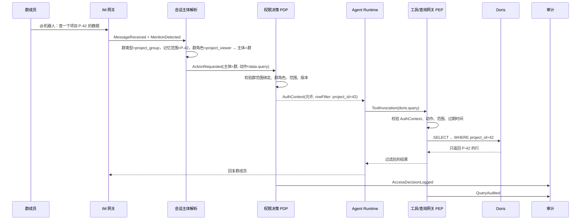
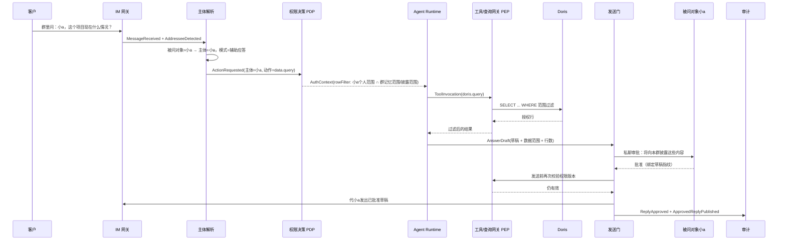
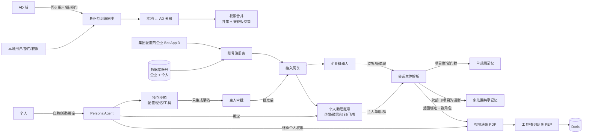

# 权限事件风暴 · 项目 / 部门授权与 Doris 行级权限

> 状态：**事件风暴评审稿（不含实现）**
> 评审进度：2026-10-22 已确认 AD/本地权限合并、机器人账号、监听边界、个人助理、跨部门/项目沟通群；敏感查询采用“本人明确同意 + 本人敏感授权”，Secret 不对机器人开放；日常总结可自动打标、人工修订。2026-10-27 已确认个人助理采用“一个 PersonalAgent + 多个平台账号 + 独立沙箱”，企业 Bot 由集团集中配置、个人账号由本人自助创建；同日确认异步 Agent 任务采用“开启时权限快照 + 每次工具调用复核”，完成后由原 BOT 回投调用方。共享边界与标注权限细节待确认（见 §14.2、§14.3）。
> 归属：DolphinMind · 权限与数据治理域
> 关联：[项目中心智能纲领](project-centric-intelligence.md) · [消息层 v0.1 实施方案](message-layer-plan.md)
> 关键词：主体、代理人、项目、部门、群绑定、群类型、跨范围群、共享记忆、个人权限、定时任务、被问对象、辅助应答、披露审批、机器人账号、个人助理、个人 Agent、助理沙箱、多平台账号、Agent 线程、Agent 任务、权限快照、完成回投、AD 同步、本地权限、Doris、行级权限

## 0. 一句话

**机器人没有自己的权限。** 每次干活前，先确定它这次代表谁——群、人还是定时任务——再按这个主体在项目或部门上的授权，决定它能调用什么工具、能查到 Doris 的哪些行。

**如果客户问的是人而不是机器人，主体就是那个被问的人。** 机器人用他的权限查数据、只起草答复，必须经他本人批准才能发出；草稿不能直接发到客户所在的会话里。

**人员类型是第一道权限天花板。** 内部人员可按角色获得项目/部门授权；外协人员只能拿项目级、有到期、有内部担保人的授权；外部人员（客户、消费者、线索）不是主体，不能持有 Grant，只能触发辅助应答或客户自助查询。

**机器人账号只是通道，个人助理是主人的代理人。** 企业 Bot 的 AppID 由集团集中配置；个人助理由本人在管理页创建，可绑定企业微信、微信、钉钉、飞书等多个平台账号。AppID/secret 决定“谁在说话”，不决定“代表谁”；账号背后的 `PersonalAgent` 才是“脑”，运行在独立沙箱，权限不超过主人，只读、只总结、只在主人批准后发言。企业 Bot 和个人助理 Bot 都可以为长任务开一个 Agent 线程：线程继承开启时的权限快照，每次工具调用复核当前权限，完成后由原 BOT 把结果回投调用方。

**群分三种：项目群、部门群、跨部门/项目沟通群。** 前两种只有一个记忆范围；跨范围沟通群可以绑定多个项目/部门，这些范围共享群记忆（例如对外连接方式）。默认只共享显式标记的跨范围内容，项目内部细节仍按来源范围隔离；共享范围必须审批，共享记忆不进入成员个人权限，也不等于可以对外披露。

**信息有保密等级，机器人默认不查敏感信息。** 每条数据、文档和记忆都要带保密等级和可选的敏感标签；群权限只覆盖常规等级，机密/绝密必须单独授权，未知等级按拒绝处理。

**群里查敏感信息要本人明确同意。** 触发人必须在消息里明确允许本次查询，并且他本人要有对应的敏感访问权限；群权限不能替代个人敏感授权。Secret 暂不对机器人开放。日常总结可按提示词自动打标，人工可以修订。

这直接对应 PCI 的主体论：群、人、定时任务都是主体；执行 AI 是代理人，只借用主体的权限，不拥有独立权限。

---

## 1. 范围与边界

### 1.1 本次要解决的问题

| # | 问题 | 期望结果 |
| --- | --- | --- |
| Q1 | 用户和权限如何对接 AD | AD 用户、AD 组、部门可同步；AD 组映射为本地角色 |
| Q2 | 群聊如何获得权限 | 按群类型绑定范围；普通群单记忆范围，跨范围群多范围共享记忆；群内机器人以群主体身份执行 |
| Q3 | 单聊如何获得权限 | 以发起人个人身份执行，使用个人权限 |
| Q4 | 定时任务如何获得权限 | 任务自身是主体，按任务配置的权限执行 |
| Q5 | 权限如何落到 Doris | 查询网关按主体注入行级过滤；必要时同步 Doris 角色/ROW POLICY |
| Q6 | 如何证明没有越权 | 每次决策与查询都有审计：主体、触发者、Agent、范围、过滤条件 |
| Q7 | 客户问的是人（如客服小a），不是机器人 | 以被问对象为主体查数据；只生成草稿，经本人批准后发送 |
| Q8 | 内部 / 外协 / 外部人员如何区分 | 人员类型作为授权上限；外协受限，外部人员不能成为主体 |
| Q9 | 本地用户、部门、权限如何与 AD 共存 | 本地可独立创建，也可与 AD 用户/部门关联；权限按“并集 + 天花板交集”合并 |
| Q10 | 企业机器人账号如何加载和刷新 | config 与 DB 启动时都读；DB 支持动态刷新；重复 AppID 禁用告警，secret 不落明文 |
| Q11 | 群记忆归到哪里、群权限能有多宽 | 普通群记忆归唯一范围；跨范围沟通群的多个绑定范围共享群记忆；查询权限与记忆共享分开配置 |
| Q12 | 个人助理如何授权、如何发言 | 本人自行创建 `PersonalAgent` 并绑定多平台账号；Agent 在独立沙箱运行；权限不超过主人；只读总结；任何发言必须主人批准 |
| Q13 | 跨部门/项目沟通群的记忆如何共享与隔离 | 绑定范围共享群记忆；默认共享对外连接类/显式内容；共享范围需审批；不进入个人权限，不自动对外披露 |
| Q14 | 敏感信息如何控制 | 群内敏感查询需本人明确同意且本人有敏感访问；Secret 不允许机器人查询；数据带保密等级和敏感标签 |
| Q15 | 数据分级如何维护 | 日常总结可按提示词自动打标；人工可修订；标签来源和置信度可追溯 |

### 1.2 暂不展开

- AD 的具体 LDAP 协议实现、Doris SQL 解析器、后台页面实现。
- 各 IM 平台（QQ/企微/飞书等）的 AppID 申请、Webhook 与合规审核流程；本文只定义账号注册与加载模型。
- 财务、人事类权限（按 PCI，AI 不介入，直接排除在权限集之外）。
- 多租户隔离、跨公司数据交换。
- 列级权限与数据脱敏可以作为下一阶段，但模型上预留。
- 本期假设“被问对象小a”是已绑定 AD 的人；如果小a是 AI 客服主体，需要先按 PCI 登记 AI 主体与兜底人，审批规则另算。

---

## 2. 统一语言

| 术语 | 英文/标识 | 定义 |
| --- | --- | --- |
| 主体 | Principal | 权利与责任的承载者。本期三种：人（内部/外协）、IM 群、定时任务；外部人员不是主体 |
| 人员类型 | Personnel Type | `internal` 内部 / `external_collab` 外协 / `external` 外部；决定主体资格与授权上限 |
| 内部担保人 | Sponsor | 外协人员必须挂靠的内部责任人；负责审批与兜底 |
| 主体资格 | Principal Eligibility | 能否作为执行主体持有 Grant；外部人员没有资格 |
| 角色适用范围 | Role Eligibility | 角色允许分配给哪些人员类型 |
| 代理人 | Agent | 机器人/执行 AI。没有自己的权限，只能代表某个主体行动 |
| 项目 | Project | 授权范围，也是数据归属标签；一个项目通常隶属于一个部门 |
| 部门 | Department | 授权范围，树形结构；来自 AD 或本地维护 |
| 授权范围 | Scope | `project` 或 `department`，是 Grant 的作用域 |
| 角色 | Role | 一组权限的命名集合 |
| 权限 | Permission | 可执行的动作，如 `data.query`、`data.export` |
| 授权 | Grant | 主体 + 角色/权限 + 范围 + 条件 + 有效期 + 审批人 |
| 群绑定 | Group Binding | IM 群与项目/部门的绑定关系；具体由“群类型 + 范围绑定”描述 |
| 群类型 | Group Type | `project_group` 项目群 / `department_group` 部门群 / `cross_scope_group` 跨部门、项目沟通群 |
| 范围绑定 | Scope Binding | 群与一个项目/部门的绑定，带 `memory_shared`、`query_enabled` 和群角色 |
| 共享记忆 | Shared Group Memory | 跨范围沟通群中按共享策略提升到共享池的记忆；不等于群内全部消息 |
| 记忆可见性 | Memory Visibility | `shared_to_scopes` 跨范围共享 / `scope_only` 只归来源范围 / `in_group` 仅群内 |
| 记忆范围集合 | Memory Scope Set | 一条群记忆写入时快照的共享范围集合 |
| 对外披露范围 | Disclosure Scope Set | 辅助应答允许对外披露的范围集合，独立于共享记忆范围 |
| 记忆类型 | Memory Kind | 项目事实、对外连接方式、决策、通用讨论等 |
| 对外连接记忆 | External Connection Memory | `memory_kind=external_connection` 的共享记忆，如对接流程、接口、联系人、话术 |
| 保密等级 | Confidentiality Level | `public` 公开 / `internal` 内部 / `confidential` 机密 / `secret` 绝密 |
| 敏感标签 | Sensitive Label | 敏感信息的类别标签，如个人信息、财务、客户名单、合同、密钥 |
| 敏感访问 | Sensitive Access | 单独授予的敏感数据访问权，带等级上限、范围、有效期与审批人 |
| 敏感查询同意 | Sensitive Query Consent | 触发人在消息里明确允许本次查询敏感信息；按次有效，不是群级开关 |
| 个人敏感授权 | Personal Sensitive Access | 触发人自己持有的敏感访问权；群权限不能替代 |
| 自动打标 | Auto Labeling | 日常总结按提示词给数据建议保密等级和敏感标签 |
| 标签修订 | Label Override | 人工修改自动标签；记录原因、操作人和版本 |
| 标签来源 | Label Source | `human` 人工 / `auto_daily_summary` 日常总结自动 |
| 标注访问 | Labeling Access | 只允许任务读取数据用于打标/总结、不允许对外披露的受限权限 |
| 可共享等级 | Shareable Level | 允许进入共享记忆池的最高保密等级，默认 `internal` |
| 数据分级 | Data Classification | 范围标签 + 保密等级 + 敏感标签的组合 |
| 个人权限 | Personal Permission | 用户通过 AD 组映射或本地显式授权获得的权限 |
| 任务权限 | Task Permission | 定时任务自身持有的授权，不等同于创建人的全部权限 |
| 授权上下文 | AuthContext | 运行时解析出的主体、角色、权限、行过滤、版本、过期时间 |
| 数据标签 | Data Scope Tag | 数据行上的 `project_id` / `department_id` 等归属字段 |
| 策略决策点 | PDP | 判断“能不能做” |
| 策略执行点 | PEP | 在工具/查询入口真正执行“允许或拒绝” |
| 审计主体 | Subject | 这次操作记在谁头上——群、人还是任务 |
| 触发者 | Actor | 谁触发了这次操作——群成员、单聊用户或系统 |
| 外部人员 | External Person | 客户、消费者、线索、渠道等；不是执行主体，不持有 Grant |
| 外部主体 | External Party | 外部人员在系统里的档案（CRM 联系人 / IM openid），不等同于权限主体 |
| 被问对象 | Addressee | 客户在群里点名提问、或在单聊里被辅助的人；辅助应答模式下的执行主体 |
| 辅助应答 | Assisted Reply | 机器人不直接回答，只以被问对象权限查询并起草 |
| 答复草稿 | Answer Draft | 待批准的回复，含将披露的原文、数据范围与行数 |
| 发送门 | Reply Gate | 草稿必须经被问对象批准才能发出的控制点 |
| 草稿指纹 | Draft Hash | 绑定批准与草稿内容；批准后任何编辑或重新查询都会失效 |
| 身份绑定 | Identity Link | IM 参与者（如 QQ openid）→ AD 用户 |
| 兜底人 | Fallback Owner | 任务/AI 主体背后必须挂的人；人不在时接续责任 |
| 行级过滤 | Row Filter | 注入到查询里的范围条件，如 `project_id = 42` |
| 本地身份 | Local Identity | 本地创建的用户/部门/角色，可关联 AD，也可独立存在 |
| 身份关联 | Identity Mapping | 本地用户 ↔ AD 用户、本地部门 ↔ AD 部门/OU 的显式映射 |
| AD 授权 | AD Grant | AD 组按映射规则投影出的角色授权，来源标记 `ad_group` |
| 本地授权 | Local Grant | 本地显式授予的角色/权限，来源标记 `local_explicit` |
| 权限合并 | Permission Merge | AD Grant 与本地 Grant 合并为有效权限的规则 |
| 机器人账号 | Bot Account | 企业机器人或助理通道账号；只是通道身份，不是权限主体 |
| 账号注册表 | Bot Account Registry | config 与数据库两个来源的机器人账号集合 |
| 企业机器人 | Enterprise Bot | 集团集中配置、监听群与单聊的机器人账号；没有 PersonalAgent |
| 个人助理 | Personal Assistant | 个人自助创建的助理账号 + PersonalAgent；账号只是嘴，Agent 才是脑；不能自主发言 |
| 个人 Agent | Personal Agent | 主人的唯一助理“脑”；配置、记忆、工具策略按 Agent 保存；不是权限主体 |
| 助理沙箱 | Assistant Sandbox | `PersonalAgent` 的运行实例；独立 workspace、资源配额与网络出口；不直连业务库 |
| 助理配置 | Agent Config | 版本化的模型/工具/记忆/审批/资源策略；沙箱启动时由核心下发 |
| 助理通道账号 | Assistant Channel Account（聚合 `PersonalAssistant`） | 个人助理的 IM 账号（AppID/secret）；一个 Agent 可绑定多个平台账号 |
| 助理主人 | Assistant Owner | 配置并授权个人助理的人；也是其唯一执行主体 |
| Agent 线程 | Agent Thread | 一个长任务的会话载体；可映射 IM 线程/话题或引用回复链；不产生新主体 |
| Agent 任务 | Agent Run | 线程中的一次执行；继承开启时的权限快照，绑定 `config_version` 与 AuthContext；不是新主体 |
| 权限快照 | Run Auth Snapshot | 开启任务时的主体、范围、等级、敏感授权、同意、权限版本；作为上限，不替代实时复核 |
| 完成回投 | Run Notification | 任务结束后由原 BOT 发回调用方的通知；受披露门与权限版本约束 |
| 群主范围 | Primary Scope | 普通群用于记忆归属的唯一项目/部门；跨范围群没有单一主范围，改用记忆范围集合 |
| 群授权 | Group Grant | 独立于记忆共享范围的群查询权限；可跨多个项目/部门 |
| 群记忆 | Group Memory | 按群类型和记忆范围集合归类的群消息、摘要与索引 |

> 注意：本文的“群”指 IM 群聊主体，不是 AD 安全组；“AD 组”会明确写成 AD 组。
>
> 记号：命令=蓝、领域事件=橙、聚合=黄、策略=紫、读模型=绿、外部系统=粉、热点=红。
>
> 与 PCI 的关系：PCI 里的 Project 是长期智能主体；本文的“主体”是执行时刻的权限主体（人/群/任务）。项目与部门在本文中作为**授权范围与数据归属**出现，项目自身的长期主体治理由 Project Core 承担。

---

## 3. 十六条硬规则

### R1 · 主体由会话与被问对象决定

| 会话场景 | 执行主体 | 权限来源 |
| --- | --- | --- |
| 群聊 @机器人（内部/外协触发） | IM 群 | 群类型 + 范围绑定；记忆范围、查询范围、对外披露范围分开 |
| 群聊里客户问人 | 被问对象（群配置的责任人，如小a） | 个人权限；普通群与记忆范围取交集，跨范围群与 `disclosure_scope_set` 取交集；只起草，须本人批准 |
| 单聊（内部/外协用户直接对机器人） | 发起人 | 个人权限（AD 组映射 + 显式授权） |
| 单聊（外部人员直接对机器人） | 客户自助（非主体） | `customer_id` / `external_party_id` 固定过滤，不持有 Grant |
| 单聊（客户对人，机器人辅助其中一方） | 被辅助的人（如小a） | 被辅助人的个人权限；只起草，须本人批准 |
| 定时任务 | 任务 | 任务自身配置并审批通过的权限 |

> 触发优先级：显式 @机器人 → 群主体直接应答（外部人员除外，见 R9）；只 @人 / 点名问人 → 辅助应答。两者同时出现时默认按 @机器人 处理（待确认，见 H17）。
>
> 单聊里机器人必须能区分“我是对话对象”还是“我是某一方的助手”：前者主体是发起人，后者主体是被辅助的人。客户自己的权限永远不参与判定。
>
> 触发资格也受人员类型约束：外部人员不能触发群主体动作，只能进入辅助应答或客户自助；外协只能在其被授权的项目范围内触发。
>
> 群内内部/外协成员默认获得“使用群助手”的资格，不需要个人 Grant；这只是可以用群主体发起动作，不等于成员个人拥有群权限。外部人员仍按 R9 禁止触发群主体。
>
> 常规查询用群主体权限；查询敏感信息时，额外要求触发人明确同意，并且触发人本人有对应的敏感访问权限；Secret 一律拒绝。

### R2 · Agent 是代理人

机器人、LLM、执行线程都不持有独立权限。任何一次工具调用都必须带一个服务端解析出的 `AuthContext`，不能由模型自己声明“我代表谁”。

### R3 · 默认拒绝

没有绑定、没有授权、没有数据标签、身份未绑定，都走拒绝；只有显式 Grant 才放行。不做“默认公开”或“默认继承管理员”。外部人员可以触发辅助应答或客户自助，但不能成为执行主体；当主体是人时，内部人员必须已绑定 AD，外协按 R9 可以是 AD 账号或本地账号。

### R4 · 项目/部门是授权范围

项目授权只看该项目；部门授权默认包含子部门（可配置）。数据行必须携带对应标签，否则无法行级过滤。

群类型决定记忆范围：普通群单范围；跨范围群多范围共享。记忆范围**不限制**群查询范围；查询权限由范围绑定/群 Grant 决定，每次查询仍逐条决议并审计；对外披露另用 `disclosure_scope_set`。

### R5 · 所有访问经过 PEP

Agent 不能直连 Doris、不能直连知识库。工具调用统一经过工具执行器，Doris 查询统一经过查询网关；LLM 只提交查询意图，不提交主体、范围或行过滤条件。

### R6 · 审计记在主体上，也记触发者

一条审计至少包含：主体（群/人/任务）、触发者（哪个成员）、Agent（哪个机器人/模型/运行）、动作、资源、范围、行过滤、决策、结果。辅助应答还要记录被问对象、审批人、草稿指纹和披露行数。换模型不换主体账本。

### R7 · 授权不能超过审批人的权限

群绑定、任务授权都必须由对该范围有授权权限的人审批；审批人不能授出自己都没有的权限。任务和群不能给自己扩权。

### R8 · 代答必须经被问对象批准

客户问的是人而不是机器人时，机器人只是这个人的代理人：用被问对象的 AuthContext 查询，只生成草稿，必须经被问对象本人（或其明确授权的兜底人）批准后才能发出。被问对象必须是内部或外协人员，不能是外部人员；兜底人必须是内部人员，外协的兜底人为其内部担保人。批准绑定草稿指纹、数据范围和权限版本；批准后草稿被编辑、重新查询或权限版本变化，批准即失效。机器人不能替被问对象批准，也不能把批准权转给客户。涉及敏感数据时，发送门同时校验被问对象本人的敏感访问权和保密等级，客户同意不能替代。

审批请求必须走私聊或仅被问对象可见的卡片，**不能把带数据的草稿发到客户所在会话**。无法私聊送达审批卡片时，辅助模式不可用，不能退回群内审批。不含业务数据的系统回执（如“已收到，稍后回复”）不受此限。

这道发送门管的是对外披露，不是 PCI 的制品门①/门②。

### R9 · 人员类型决定权限上限

角色不只是权限集合，还要标明“适用人员类型”。人员类型与角色适用范围必须匹配，否则授权直接拒绝。

| 人员类型 | 标识 | 身份来源 | 能否作为主体 | 可持有授权 | 默认范围 | 授权审批权 |
| --- | --- | --- | --- | --- | --- | --- |
| 内部人员 | `internal` | AD | 是 | 是 | 项目 / 部门 | 有，按角色 |
| 外协人员 | `external_collab` | AD（独立 OU）或本地账号 | 是（受限） | 是（受限） | 仅项目，必须有到期 | 无授权审批权 |
| 外部人员 | `external` | CRM / IM openid | 否 | 否 | 客户自助范围 | 无 |

三条硬约束：

- **外部人员不是主体。** 客户、消费者、线索只能触发辅助应答或客户自助查询，不能持有 Grant、不能被指派为任务主体、不能触发群主体动作。
- **外协只能拿受限授权。** 必须指定内部担保人和到期时间；默认只给项目范围，不给部门范围；不能审批群绑定、任务授权或他人的 Grant。外协发起定时任务时，审批人必须是内部担保人。部门绑定的群，外协不能触发群主体动作。
- **类型变化必须重算权限。** 内部转外协、外协到期、担保人离职，立即撤销不兼容 Grant 并失效活动上下文；未知类型默认不授权。

角色示例：

| 人员类型 | 可分配角色示例 | 禁止 |
| --- | --- | --- |
| 内部人员 | 员工、经理、部门管理员 | — |
| 外协人员 | 外包开发、外包项目管理、驻场支持 | 部门管理员、授权审批人 |
| 外部人员 | 无角色 | 任何 Grant、任何执行主体身份 |

> 人员类型是人的属性，`allowed_personnel_types` 是角色的属性；不要把同一角色按类型复制三份，授权时校验两者匹配即可。同一角色可以同时允许内部与外协，但外协的 Grant 仍受“项目级 + 到期 + 内部担保人”限制。

### R10 · 机器人账号是通道，不是主体

> 状态：已确认（2026-10-22）。

- AppID/secret 只决定消息从哪个账号收发，不提供任何权限。`BotAccount` 永远不能出现在 `subject` 字段里。
- 企业机器人可以监听群和单聊，但每条消息都要重新解析主体：群主体、发起人、被问对象或任务。
- 账号注册表有两个来源：`config` 与数据库。两者在启动时都加载；数据库来源支持动态刷新，config 来源只能重启生效。同一 `(platform, app_id)` 重复时视为配置错误，禁用该账号并告警，不做静默覆盖。
- secret 只以密文或引用保存；不写日志、不进读模型、不进审计正文；轮换后旧连接必须失效。
- 未登记的机器人不能接入；机器人被禁用、被移出会话或 secret 失效后，所有待发草稿与批准作废。
- 账号分两类：`enterprise`（集团集中配置）与 `personal_assistant`（本人自助创建）；类型只影响管理方式与主体解析，不改变“账号不是主体”。

### R11 · 个人助理是主人的代理人，不能自主发言

> 状态：已确认（2026-10-22）。

- 只能由本人配置和启用；必须验证账号归属（绑定码/OAuth），管理员不能代替本人开启。
- 权限永远等于主人当前个人权限，且不超过；每次运行重新校验主人状态、人员类型和 Grant 版本。主人被禁用、转外协、外协到期，助理立即停用。
- 只能读与总结；不能写、导出、审批、授权或代表主人做决定。
- 任何对外发言都必须由主人批准，批准绑定草稿指纹与会话；不能把批准权委托给助理、模型或第三方。
- 助理不能借用群权限：主人在群里时，它仍只代表主人个人，不自动获得群 Grant。
- 共享记忆按主人当前有效范围判定；助理不能因为主人在某个跨范围群而扩大可读范围。
- 敏感数据按主人当前等级上限和 `sensitive_access` 判定；助理不能自行获得敏感访问。
- 主人批准助理发言时，同时视为对本次敏感查询/披露的明确同意；不能延用到下一次。
- 外部人员没有 AD 个人权限，不能配置这种个人助理；只能走客户自助。
- 账号/沙箱拓扑按 R15：一个 `PersonalAgent` 可绑定多个平台账号；账号独立启停不改变主人权限；个人助理默认只服务主人单聊，群内使用必须显式开启且仍不代表群主体。

### R12 · 群类型决定记忆归属与共享范围

> 状态：已确认（2026-10-22）：新增“跨部门、项目沟通群”。共享记忆的可见边界、外部成员、解绑后的历史记忆等细节待确认（见 H37–H43）。

- 群类型三种：`project_group` 项目群、`department_group` 部门群、`cross_scope_group` 跨部门、项目沟通群。
- 普通群只绑定一个记忆范围，群记忆归该范围；跨范围沟通群显式绑定多个项目/部门，这些范围**共享群记忆**。
- 每个范围绑定有 `memory_shared` 和 `query_enabled` 两个开关：记忆共享范围与查询权限范围可以不同，但 `memory_shared=true` 必须同时 `query_enabled=true`。
- 跨范围群的共享记忆是“范围共享池”：绑定范围内的内部人员可以检索，外协默认不可读；共享记忆的授权对象是绑定 Scope，不是群成员个人；共享记忆不进入任何成员的个人权限，也不等于可以对外披露。
- 共享池不等于“群内所有消息默认全共享”。每条记忆带 `visibility`：`shared_to_scopes` 进入共享池，`scope_only` 只归来源范围；默认只把 `memory_kind=external_connection` 或显式标记共享的内容放进共享池，全量共享必须由群策略显式开启。
- 记忆写入时快照 `memory_scope_set`；读取时按**当前绑定**校验。解绑范围立即停止该范围的新检索，历史记忆按保留策略处理。
- 对外披露使用独立的 `disclosure_scope_set`，不能把共享记忆范围直接当成对外可披露范围；外部成员不能直接检索共享记忆，只能走辅助应答或客户自助。
- 共享记忆同时受保密等级约束：只有不高于 `shareable_level` 的内容可进入共享池（R13）。
- 普通群如果要让机器人查本范围之外的数据，可以增加 `query_enabled=true, memory_shared=false` 的范围绑定；这不改变记忆归属，也不产生共享记忆。

### R13 · 信息有保密等级，敏感数据默认不查

> 状态：已确认（2026-10-22）：四级保密等级、默认 `internal`、敏感查询需本人同意且本人有权限、Secret 不对机器人开放。审批与打标细节见 H44–H55。

- 每条数据、文档、消息记忆入库时必须带 `confidentiality_level`：`public` 公开 / `internal` 内部 / `confidential` 机密 / `secret` 绝密；可附加 `sensitive_labels`（个人信息、财务、客户名单、合同、密钥等）。
- 未打等级的数据按拒绝处理，进入隔离区；不允许“无标签即公开”。新数据默认 `internal`。
- 机器人默认只能查 `public` / `internal`。群内 @机器人 查询 `confidential` 必须同时满足三个条件：
  1. 触发人在消息里**明确同意**本次查询敏感信息；
  2. 触发人本人持有对应等级和标签的 `sensitive_access`；
  3. 数据在群的范围绑定和查询权限内。
- 单聊/个人助理查询 `confidential` 同样需要本人敏感授权，必要时二次确认；定时任务使用任务自己的敏感授权和审批，不继承个人同意。
- **群级敏感授权不能替代个人敏感授权。** 群里 @机器人 查敏感信息时，机器人以群范围确定能查哪些业务数据，再校验“@它的那个人”的个人敏感权限；只有群权限不够，只有个人敏感授权但数据不在群范围内也不够。
- **`secret` 暂不允许机器人查询。** 不给机器人发 `secret` 的 `sensitive_access`；即使触发人同意也拒绝。Secret 只能走人工流程/线下处理。
- 保密等级不是访问授权的替代：`public` 也要先满足主体、范围、身份等基本条件，只是不再额外受敏感等级限制。
- 群权限只覆盖常规等级，不自动包含敏感数据；成员入群默认能用群助手，但群助手仍受保密等级限制。
- 共享记忆只允许不高于 `shareable_level`（默认 `internal`）的内容进入共享池；`confidential` / `secret` 默认 `scope_only` 或禁止共享。
- 辅助应答涉及 `confidential` 时，必须在审批卡片上显示等级和敏感标签，默认脱敏/聚合；`secret` 不允许机器人读取或披露。
- 查询、导出、共享、代答都要审计保密等级、敏感标签、同意记录和敏感授权人。

### R14 · 自动打标可人工修订

> 状态：已确认（2026-10-22）：日常总结可按提示词自动打标，人工可以修改。

- 日常总结任务可以按提示词给数据建议保密等级和敏感标签，产出带 `label_source=auto_daily_summary`、置信度和建议理由。
- 自动打标可以**提升**等级或**增加**敏感标签；降低等级或移除敏感标签必须人工复核，避免自动误判放开数据。
- 人工可以修订标签，修订后 `label_source=human`，记录操作人、原因、前后值和版本。
- `secret` 可以由自动打标建议，但不会因此对机器人开放；`secret` 始终不进入机器人查询链路。
- 标签变更必须提升数据版本，并让相关授权上下文/检索缓存失效；不允许静默改标签。
- 自动打标任务需要单独的 `labeling_access`，只用于读取和打标，不允许把原始敏感内容输出给用户；`secret` 永远不在标注访问范围内。

### R15 · 个人助理 = 主人代理 + 独立 Agent 沙箱 + 多平台账号

> 状态：已确认（2026-10-27）。

- 个人助理不是“一个 Bot 账号”，而是 `PersonalAgent` + 一个或多个 `PersonalAssistant`（助理通道账号）；Agent 负责思考、记忆与工具，账号只负责收发。
- 每个主人最多一个 `PersonalAgent`；每个平台默认最多一个活动账号；可同时配置企业微信、微信、钉钉、飞书等平台账号。
- 企业 Bot 的 AppID/secret 由集团集中配置，`managed_by=enterprise_admin`，没有 owner/agent；个人助理账号由本人在管理页创建，`managed_by=owner`，必须绑定本人的 `PersonalAgent` 并验证归属。
- 一个 Agent 一个活动沙箱；沙箱有独立 workspace、记忆、资源配额和网络出口；不同 Agent 之间不能共享文件、记忆或运行上下文。
- 沙箱启动时由核心下发签名配置包（`agent_id`、`owner_id`、`config_version`、模型、工具白名单、记忆/审批策略、资源上限）和短时 token；沙箱不直连业务库、不持有 bot secret、不直接发送消息。
- 配置按 Agent 版本化保存；工具、网络、模型、权限等安全敏感字段变更必须重启沙箱；活动 Run 绑定 `config_version`，版本变更后旧 Run 失效或标记为旧版本。
- Agent 配置只能在天花板内选择：平台决定可用模型、工具白名单、网络出口与资源上限；主人不能把只读工具改成写/导出/审批工具。
- 所有工具调用经核心 PEP，使用主人短时 `AuthContext`；只读、总结、起草；写/导出/审批/授权与 `secret` 仍禁止。
- 账号类型决定主体解析：企业 Bot 在群里按群主体执行；个人助理账号无论单聊还是群聊都只代表主人，绝不使用群 Grant。个人助理默认只服务主人单聊；要在群里使用必须主人显式开启，并仍走披露审批。
- 审计同时记录 `owner_id`、`agent_id`、`bot_account_id`、`sandbox_id`、`config_version`；发言审批仍按 R11、P28。

### R16 · 异步 Agent 任务继承开启时权限，但每次调用复核

> 状态：已确认（2026-10-27）。

- 企业 Bot 与个人助理 Bot 都可以为长任务开一个 `AgentThread`；线程里的 `AgentRun` 不是新主体，主体仍是开启时的群/人/任务/主人。
- 企业 Bot 的 Run 使用共享 Agent 运行时；个人助理的 Run 使用主人专属沙箱；两者共用 `AgentRun` 模型和同一套权限快照规则。
- 开启任务时固化 `RunAuthSnapshot`：主体、范围、`max_confidentiality_level`、敏感授权、同意、`permission_version`、开跑时间；快照是上限，不是永久通行证。
- 每次工具调用仍由 PEP 校验当前权限版本、主体状态、范围绑定、同意有效期和显式拒绝；当前权限与快照取交集，任一不满足即拒绝。
- 任务运行期间主体被撤权、转外协/到期、被移出群、同意过期或范围解绑：`AgentRunInvalidated`，停止后续工具调用；已产生的中间结果按当前权限重新判定，不能继续使用旧快照。
- 任务不能因为运行时间长而获得新权限；主体在运行期间新增的权限也不会自动扩大本次任务，除非重新开启一个新 Run。
- 敏感同意按 Run 绑定；同意过期后不得继续查敏感数据；可以降级为非敏感部分继续，或终止并通知。
- 任务完成、失败、超时、取消都产生一次终态事件；由核心生成 `RunNotification`，经原 BOT 的 `OutboundIntent` 回投调用方。
- 完成通知本身是一次披露：必须按调用方当前权限与目标会话的披露范围过滤；结果不可展示时只回状态/摘要，不泄露内容。
- 辅助应答/个人助理对外发言：完成通知先发给审批人（被问对象/主人），不是直接发给客户；批准后才由 BOT 发送。
- 通知至少一次投递 + 幂等：同一 `run_id` 只产生一条终态通知；BOT 离线/被禁用时排队重试，必要时回落到主人/兜底人。
- 审计记录 `run_id`、`thread_id`、原消息、主体、Agent、BOT、`auth_snapshot_version`、每次工具调用的权限版本、通知状态。

---

## 4. 主链路

### 4.1 机器人被 @：群主体直接应答



两个检查点是有意设计的：

- **PDP 先判**：这次动作在这个主体、这个范围上是否被允许。
- **PEP 再判**：真正调用工具/查询前再次校验；权限在运行中被撤销时，下一次工具调用会被拒绝。

群权限只覆盖常规保密等级；敏感数据需要单独的 `sensitive_access`。成员入群默认能用群助手，不代表能查敏感数据。

### 4.2 客户问人：被问对象主体，起草后审批



三个检查点：

- **PDP 判查询**：按被问对象的个人权限决议，客户的身份不提供任何权限。
- **发送门判披露**：草稿只发给被问对象本人确认，客户看不到草稿；批准绑定草稿指纹。
- **PEP 判发送**：真正发出前再校验一次权限版本，撤权或改稿都会让批准作废。

### 4.3 典型流程总览：AD + 本地、企业机器人、个人助理



> 企业 Bot 在群里解析为群主体；个人助理账号无论单聊还是群聊都解析为主人主体，默认只服务主人单聊。

典型顺序：

1. 从 AD 同步用户、AD 组、部门；AD 组按映射规则投影为本地角色与 Grant。
2. 本地补充创建用户、部门、角色/权限；本地用户可关联 AD 用户，本地部门可关联 AD 部门/OU。
3. 合并权限：AD Grant 与本地 Grant 取并集，再受人员类型、角色适用范围、Scope 归属和显式拒绝约束（P23）。
4. 加载机器人账号：企业 Bot 由集团集中配置；个人助理账号由本人在管理页创建；启动时都进入注册表，数据库来源可动态刷新；重复 AppID 禁用并告警（P26、P41）。
5. 企业机器人监听群和单聊；个人助理账号只服务主人（默认单聊），不参与群主体动作。普通群绑定唯一记忆范围；跨部门/项目沟通群可绑定多个项目/部门，共享池默认只放对外连接类或显式共享内容（P24、P25、R15）。
6. 群内 @企业机器人 → 群主体；客户问人 → 被问对象主体 + 审批；单聊 → 发起人；外部人员 → 客户自助；个人助理账号 → 主人主体。
7. 个人在管理页创建 `PersonalAgent`，并绑定企业微信/微信/钉钉/飞书等账号；Agent 在独立沙箱启动，按版本化配置加载工具与记忆；任何发言先出草稿，经本人批准后由对应平台账号发送（P27、P28、R15）。

> 这七步是**配置与运行时**的完整链路，但事件风暴只建模状态变化：每一步在 §5 都有对应的命令、事件和聚合；不涉及具体 LDAP、IM SDK 或数据库实现。

---

## 5. 事件时间线

### 5.1 身份与组织同步

| 命令（蓝） | 聚合（黄） | 领域事件（橙） | 说明 |
| --- | --- | --- | --- |
| `SyncAdDirectory` | `DirectorySync` | `AdUserSynced`、`AdGroupSynced`、`AdDepartmentSynced` | 增量同步；`objectGUID` 为稳定键 |
| `MapAdGroupToRole` | `AdGroupMapping` | `AdGroupMapped` | AD 组 → 本地角色 + 可选范围 |
| `MapAdDepartment` | `AdDepartmentMapping` | `AdDepartmentMapped` | AD `department` / OU → 本地部门 |
| `LinkImIdentity` | `IdentityLink` | `ImIdentityLinked` | IM 参与者 → AD 用户；单聊个人权限的前提 |
| `ClassifyPersonnel` | `UserPrincipal` | `PersonnelTypeAssigned` | 判定 internal / external_collab；无法归类时不授权 |
| `ChangePersonnelType` | `UserPrincipal` | `PersonnelTypeChanged` | 类型变化触发 Grant 重算与不兼容授权撤销 |
| `RegisterExternalParty` | `ExternalParty` | `ExternalPartyRegistered` | 客户/消费者/线索/渠道；不产生 Grant |
| `LinkExternalIdentity` | `ExternalParty` | `ExternalIdentityLinked` | IM openid / CRM 联系人 → 外部主体 |
| `AssignCollabSponsor` | `UserPrincipal` | `CollabSponsorAssigned` | 外协必须挂内部担保人 |
| `ExpireCollabAccess` | `UserPrincipal` | `CollabAccessExpired` | 合同/账号到期自动撤权 |
| `DisableUser` | `UserPrincipal` | `UserDisabled` | 撤销会话、失效授权上下文、挂起相关任务 |

AD 字段的使用边界：

| AD 事实 | 本地用途 | 注意 |
| --- | --- | --- |
| `objectGUID` | 用户/组稳定主键 | 改名、移动 OU 不变 |
| `memberOf` | AD 组 → 本地角色 | 只含直接组；不含嵌套组和主组 |
| `department` / OU | 映射本地部门 | 建议用稳定部门编码，不直接用显示名 |
| `userAccountControl` | 账号状态 | 禁用/锁定要撤销授权 |
| `sAMAccountName` / UPN | 登录身份 | 不用于权限判断 |
| `manager` | 兜底人/审批人候选 | 可选，不作为唯一依据 |

> `department` / OU 只提供“组织归属”这个事实，不等于自动拥有该部门全部数据权限。是否把“用户所在部门”自动映射为部门范围 Grant，应在 AD 组映射规则里显式配置（例如 `scope_mode=subject_department`），并默认只授予只读角色。

人员类型的判定来源：

| 人员类型 | 主要判定 | 辅助信号 | 注意 |
| --- | --- | --- | --- |
| 内部人员 | `employeeType` = Employee/Manager 等，或内部 OU | `company` = 本公司 | 不靠显示名 |
| 外协人员 | `employeeType` = Contractor/Vendor 等，或独立 OU | `accountExpires`、`manager`、`company` | 必须有到期与内部担保人 |
| 外部人员 | 不在 AD；来自 CRM / IM | `ExternalParty` 联系人记录 | 不能持有 AD 账号与 Grant |

> 判定规则必须显式配置；`employeeType`、OU、`company` 冲突时以人工复核为准，未知类型默认不授权。外部人员不写入 AD，避免把客户当员工管理。
>
> 人员类型按**劳动关系 / 合同主体**判定，不按岗位名称：本公司的“外包管理”岗是内部人员，外包公司的驻场经理是外协人员。

#### 5.1.1 本地身份、权限与 AD 关联

| 命令（蓝） | 聚合（黄） | 领域事件（橙） | 说明 |
| --- | --- | --- | --- |
| `CreateLocalUser` | `LocalIdentity` | `LocalUserCreated` | 本地用户；可后续关联 AD，也可独立存在 |
| `CreateLocalDepartment` | `Department` | `LocalDepartmentCreated` | 本地部门节点，参与部门树与范围过滤 |
| `CreateLocalRole` / `CreateLocalPermission` | `Role` / `Permission` | `LocalRoleCreated` / `LocalPermissionCreated` | 本地权限码与角色；同样受人员类型适用性约束 |
| `LinkLocalUserToAdUser` | `IdentityMapping` | `LocalUserLinkedToAdUser` | 一对一关联；AD 用户已有关联时拒绝 |
| `LinkLocalDepartmentToAdDepartment` | `DepartmentMapping` | `LocalDepartmentLinkedToAd` | 本地部门 ↔ AD `department` / OU |
| `GrantLocalPermission` | `Grant` | `LocalGrantGranted` | 来源=`local_explicit`；审批与人员类型校验同 AD 来源 |
| `MergePermissionSources` | `UserPrincipal` | `PermissionSourcesMerged` | 计算有效权限；授权并集 + 天花板交集 |
| `UnlinkLocalIdentity` | `IdentityMapping` | `LocalIdentityUnlinked` | 解除关联；撤销 AD 来源 Grant，保留本地 Grant |
| `ResolveIdentityConflict` | `IdentityMapping` | `IdentityConflictDetected` / `IdentityConflictResolved` | 一人多账号、部门树冲突等人工复核 |

合并规则（默认值，待确认）：

| 维度 | 规则 | 说明 |
| --- | --- | --- |
| 身份与组织归属 | AD 优先 | 已关联时，姓名、部门、账号状态以 AD 为准；本地只保留扩展属性 |
| 授权来源 | **并集** | AD 组投影的 Grant 与本地显式 Grant 都生效，不要求两边同时存在 |
| 权限天花板 | **交集** | 人员类型上限 ∩ 角色 `allowed_personnel_types` ∩ Scope 有效性 ∩ 显式拒绝 |
| 冲突处理 | 显式拒绝优先 | 本地拒绝可以覆盖 AD 允许；反向不成立，避免本地静默提权 |
| 解绑/类型变化 | 重算 | 撤销 AD 来源 Grant，提升权限版本，失效活动上下文 |

> “交集”如果理解成“AD 和本地都必须有该权限”，本地为项目补授的 Grant 会全部失效，通常不可用。建议采用“**授权并集、天花板交集、拒绝优先**”；如果某类角色确实要求双源同时授权，用角色级 `merge_mode=intersection` 显式配置（见 H29）。

身份关联的硬约束：

- 本地用户与 AD 用户**一对一**；一个 AD 用户不能同时关联两个本地用户，反之亦然。重复关联进人工复核，不自动合并。
- 未关联 AD 的本地用户不能按内部人员成立，也不能作为项目/部门数据的执行主体；只能先关联 AD，或按外协规则（到期 + 内部担保人）成立。
- 关联前已经存在的本地 Grant 保留，但主体切换到关联后的统一身份；切换时提升权限版本。
- 解除关联后，AD 来源 Grant 立即撤销；本地 Grant 继续有效，但该人若失去 AD 身份，就不能再作为群/任务主体（按 R9 的人员类型规则）。
- 本地部门可以没有 AD 映射；一旦映射，部门树层级与父部门必须与 AD 一致，冲突时拒绝映射并告警。

### 5.2 项目、部门与群绑定

> 群类型与范围绑定已确认；共享记忆的可见边界、共享内容范围、外部成员、解绑后的历史记忆等待确认（见 H37–H43）。

| 命令（蓝） | 聚合（黄） | 领域事件（橙） | 说明 |
| --- | --- | --- | --- |
| `CreateProject` | `Project` | `ProjectCreated` | 项目建立，指定所属部门 |
| `AssignProjectToDepartment` | `Project` | `ProjectAssignedToDepartment` | 项目归属部门 |
| `CreateDepartment` / `SyncDepartment` | `Department` | `DepartmentCreated` / `DepartmentSynced` | 部门树 |
| `CreateGroup` | `GroupPrincipal` | `GroupCreated` | 声明群类型：`project_group` / `department_group` / `cross_scope_group` |
| `BindGroupToScope` | `GroupPrincipal` | `GroupBoundToScope` | 普通群绑定唯一记忆范围；跨范围群绑定第一个范围 |
| `BindGroupScope` | `GroupPrincipal` | `GroupScopeBound` | 追加范围绑定，设置 `memory_shared` / `query_enabled`；`memory_shared=true` 先进入待审批，批准后才生效 |
| `ApproveScopeSharing` | `GroupPrincipal` | `ScopeSharingApproved` / `ScopeSharingRejected` | 新增共享范围需该范围负责人审批，不能自批 |
| `ChangeGroupRole` | `GroupPrincipal` | `GroupRoleGranted` / `GroupRoleRevoked` | 调整某个范围绑定上的群角色 |
| `UnbindGroupScope` | `GroupPrincipal` | `GroupScopeUnbound` | 解除某范围绑定；停止未来共享与查询 |
| `ChangeGroupType` | `GroupPrincipal` | `GroupTypeChanged` | 普通群 ↔ 跨范围群；必须带记忆迁移方案 |
| `UnbindGroup` | `GroupPrincipal` | `GroupUnbound` | 解除全部绑定，立即失效相关上下文 |
| `ConfigureGroupMemory` | `GroupMemoryPolicy` | `GroupMemoryPolicyConfigured` | 保留期、敏感级别、共享内容策略（显式/全量）、维护责任人、是否生成摘要 |
| `ClassifyGroupMessage` | `GroupMemory` | `GroupMessageClassified` / `GroupMessageUnclassified` | 打记忆范围、保密等级与敏感标签；普通群按唯一记忆范围，跨范围群按共享绑定生成记忆范围集合；无法判定进隔离区 |
| `ReclassifyGroupMessage` | `GroupMemory` | `GroupMessageReclassified` | 人工纠正归类或共享范围；保留原分类审计 |
| `ShareGroupMemory` | `GroupMemory` | `GroupMemoryShared` | 将记忆提升为 `shared_to_scopes`；必须先检查保密等级不高于 `shareable_level`；必须指定维护责任人与有效期 |
| `UnshareGroupMemory` | `GroupMemory` | `GroupMemoryUnshared` | 撤回共享；不影响来源范围的 `scope_only` 记忆 |
| `PurgeGroupMemory` | `GroupMemory` | `GroupMemoryPurged` | 到期或合规删除 |
| `ArchiveProject` / `ArchiveDepartment` | `Project` / `Department` | `ScopeArchived` | 归档范围，撤销所有活动授权 |

### 5.3 会话、主体与被问对象解析

| 命令（蓝） | 聚合（黄） | 领域事件（橙） | 说明 |
| --- | --- | --- | --- |
| `ReceiveMessage` | `Message` | `MessageReceived` | 消息进入消息层 |
| `DetectMention` | `Message` | `MentionDetected` | 识别 `at.self=true` |
| `DetectAddressee` | `Message` | `AddresseeDetected` | 识别被 @ 的人或群配置的责任人；不做模糊姓名匹配 |
| `ResolveConversationPrincipal` | `ConversationContext` | `ConversationPrincipalResolved` | 群 @机器人 → 群主体，解析群类型、范围绑定与记忆范围集合；用户对机器人单聊 → 用户主体 |
| `ResolveEffectivePermission` | `UserPrincipal` | `EffectivePermissionResolved` | 合并 AD 与本地 Grant，应用人员类型与角色天花板；单聊、辅助应答、个人助理共用 |
| `ResolveAssistedPrincipal` | `ConversationContext` | `AssistedPrincipalResolved` | 客户问人且未 @机器人 → 主体=被问对象，模式=辅助应答 |
| `AuthorizeTrigger` | `ConversationContext` | `TriggerAllowed` / `TriggerDenied` | 按触发者人员类型与群类型/范围绑定判定能否使用群主体 |
| `SyncGroupMembership` | `GroupMembership` | `GroupMemberJoined` / `GroupMemberLeft` | 同步群成员；内部/外协成员默认获得使用群助手资格，不产生个人 Grant |
| `RequestSensitiveQuery` | `SensitiveQueryAuthorization` | `SensitiveQueryRequested` | 触发人请求查询敏感信息；必须携带明确同意意图 |
| `ConsentToSensitiveQuery` | `SensitiveQueryConsent` | `SensitiveQueryConsented` / `SensitiveQueryConsentExpired` | 触发人明确允许本次敏感查询；仅本次消息/任务有效 |
| `ExpireSensitiveQueryConsent` | `SensitiveQueryConsent` | `SensitiveQueryConsentExpired` | 超时、会话结束或查询完成后作废 |
| `AuthorizeSensitiveQuery` | `SensitiveQueryAuthorization` | `SensitiveQueryAllowed` / `SensitiveQueryDenied` / `SecretQueryDenied` | 校验触发人个人 `sensitive_access`、群范围、等级与标签；Secret 直接拒绝 |
| `RequireAssistedReply` | `ConversationContext` | `AssistedReplyRequired` | 对外群/含外部成员时强制辅助模式，禁止直接群应答 |
| `RequestAction` | `AuthRequest` | `ActionRequested` | 工具调用或数据查询请求进入 PDP |
| `RejectUnboundGroupAction` | `ConversationContext` | `ScopedActionDenied` | 未绑定群请求项目/部门数据时拒绝 |

### 5.4 授权决策与 Agent 执行

| 命令（蓝） | 聚合（黄） | 领域事件（橙） | 说明 |
| --- | --- | --- | --- |
| `EvaluateAccess` | `PolicyDecision` | `AccessGranted` / `AccessDenied` | 按 Grant、角色、范围、条件判定 |
| `IssueAuthContext` | `AuthorizationContext` | `AuthContextIssued` | 生成短时授权上下文 |
| `StartAgentRun` | `AgentRun` | `AgentRunStarted` | Agent 携带上下文开始执行 |
| `InvokeTool` | `AgentRun` | `ToolInvocationRequested` | LLM 请求调用工具 |
| `AuthorizeToolCall` | `AgentRun` | `ToolInvocationAllowed` / `ToolInvocationDenied` | PEP 校验动作、范围、版本、有效期 |
| `QueryDoris` | `QueryGateway` | `DorisQuerySubmitted` / `DorisQueryExecuted` / `DorisQueryDenied` | 注入行过滤后执行 |
| `SearchKnowledge` | `RetrievalGateway` | `KnowledgeSearchExecuted` | 知识检索使用同一套范围过滤 |
| `RetrieveSharedMemory` | `SharedMemoryGateway` | `SharedMemoryRetrieved` / `SharedMemoryDenied` | 校验主体范围与记忆范围集合相交；只允许内部人员（外协默认不可读）；审计来源群与范围集合 |
| `ExportData` | `QueryGateway` | `DataExportRequested` / `DataExportCompleted` / `DataExportDenied` | 导出单独授权 |
| `CompleteAgentRun` | `AgentRun` | `AgentRunCompleted` / `AgentRunFailed` | 结束并记录结果 |
| `RevokeAuthorization` | `AuthorizationContext` | `AuthorizationRevoked` | 授权失效、解绑、用户禁用时触发 |

> `StartAgentRun` 可以绑定 `AgentThread` 与 `RunAuthSnapshot`；企业 Bot 与个人助理共用同一 Run 模型，个人助理额外绑定 agent/sandbox/`config_version`。

### 5.5 数据进入 Doris

| 命令（蓝） | 聚合（黄） | 领域事件（橙） | 说明 |
| --- | --- | --- | --- |
| `IngestData` | `DataAsset` | `DataIngested` | 消息、文件、文档、项目资料入库 |
| `TagDataScope` | `DataAsset` | `DataScopeTagged` | 打上 `project_id` / `department_id` |
| `ClassifyConfidentiality` | `DataAsset` | `ConfidentialityClassified` | 打上 `public` / `internal` / `confidential` / `secret` |
| `LabelSensitiveData` | `DataAsset` | `SensitiveDataLabeled` | 附加敏感标签：个人信息、财务、客户名单、合同、密钥等 |
| `ReviewConfidentiality` | `DataAsset` | `ConfidentialityReviewed` | 定期复核、升级/降级；保留变更审计 |
| `AutoLabelData` | `DataAsset` | `DataAutoLabeled` | 日常总结按提示词建议等级/标签；来源 `auto_daily_summary`、带置信度 |
| `OverrideDataLabel` | `DataAsset` | `DataLabelOverridden` | 人工修订标签；来源 `human`、记录原因与前后值 |
| `ReviewAutoLabel` | `DataAsset` | `LabelReviewRequired` / `LabelReviewCompleted` | 低置信度或降级/移除敏感标签进入人工复核 |
| `RequestLabelingAccess` | `Grant` | `LabelingAccessGranted` / `LabelingAccessDenied` | 任务标注访问；只读、只用于打标/总结；Secret 永不授予 |
| `GrantSensitiveAccess` | `Grant` | `SensitiveAccessGranted` / `SensitiveAccessDenied` | 敏感访问单独授权，带等级上限、范围、有效期与审批人 |
| `ExpireSensitiveAccess` | `Grant` | `SensitiveAccessExpired` | 到期或撤销后下一次查询立即拒绝 |
| `QuarantineUntaggedData` | `DataAsset` | `DataQuarantined` | 无范围标签或保密等级的数据不进入可查询区 |
| `LoadToDoris` | `DataAsset` | `DataLoadedToDoris` | 进入 Doris 分析表 |
| `SyncDorisPolicy` | `DorisPolicyProjection` | `DorisRoleSynced` / `DorisRowPolicyApplied` | 同步角色与行级策略 |
| `VerifyScopeCoverage` | `DataAsset` | `ScopeCoverageVerified` / `ScopeCoverageViolated` | 校验所有可查数据都有范围标签和保密等级 |

### 5.6 定时任务与治理

| 命令（蓝） | 聚合（黄） | 领域事件（橙） | 说明 |
| --- | --- | --- | --- |
| `CreateScheduledTask` | `ScheduledTask` | `ScheduledTaskCreated` | 必须指定 owner、兜底人、范围 |
| `RequestTaskPermission` | `ScheduledTask` | `TaskPermissionRequested` | 申请任务所需权限 |
| `ApproveTaskPermission` | `ScheduledTask` | `TaskPermissionGranted` / `TaskPermissionRejected` | 审批人权限必须覆盖所授权限 |
| `RunScheduledTask` | `ScheduledTask` | `TaskRunStarted` | 调度器触发 |
| `RunDailySummary` | `ScheduledTask` | `DailySummaryStarted` / `DailySummaryCompleted` | 日常总结任务；读取范围内数据，生成摘要并按提示词打标；Secret 不参与 |
| `AuthorizeTaskRun` | `ScheduledTask` | `TaskRunAuthorized` / `TaskRunDenied` | 任务以自身主体身份授权 |
| `CompleteTaskRun` | `ScheduledTask` | `TaskRunCompleted` / `TaskRunFailed` | 记录结果与审计 |
| `RevokeTaskPermission` | `ScheduledTask` | `TaskPermissionRevoked` | 下一次运行立即生效 |
| `ReassignFallbackOwner` | `ScheduledTask` | `FallbackOwnerChanged` | 原兜底人离职/禁用时重挂 |
| `ChangeRolePermission` | `Role` | `RolePermissionChanged` | 角色变更，提升权限版本 |
| `ChangeGrant` | `Grant` | `GrantGranted` / `GrantRevoked` | 授权变更 |
| `DetectAnomaly` | `AuditRecord` | `AnomalyDetected` | 高频拒绝、异常导出、越权尝试 |

### 5.7 辅助应答与披露审批

| 命令（蓝） | 聚合（黄） | 领域事件（橙） | 说明 |
| --- | --- | --- | --- |
| `RequestAssistedAnswer` | `ReplyApproval` | `AssistedAnswerRequested` | 被问对象主体确定后，发起查询与起草 |
| `DraftAssistedAnswer` | `ReplyApproval` | `AnswerDrafted` | 用被问对象 AuthContext 查询并起草；记录范围、行数、敏感字段 |
| `RequestReplyApproval` | `ReplyApproval` | `ReplyApprovalRequested` | 草稿、披露范围、行数走私聊/仅本人可见卡片送给被问对象 |
| `EditAnswerDraft` | `ReplyApproval` | `AnswerDraftRevised` | 被问对象可改稿；产生新指纹，需重新批准 |
| `ApproveReply` / `RejectReply` | `ReplyApproval` | `ReplyApproved` / `ReplyRejected` | 只有被问对象本人或明确授权的兜底人可批 |
| `ExpireReplyApproval` | `ReplyApproval` | `ReplyApprovalExpired` | 超时作废，不发送 |
| `PublishApprovedReply` | `ReplyApproval` | `ApprovedReplyPublished` | 发送前校验草稿指纹与权限版本，再走 PEP |

### 5.8 机器人账号与个人助理

> 对应 R10、R11、R15，状态：已确认（2026-10-22 / 2026-10-27）；事件与字段名可在实施阶段细化。

| 命令（蓝） | 聚合（黄） | 领域事件（橙） | 说明 |
| --- | --- | --- | --- |
| `RegisterBotAccount` | `BotAccount` | `BotAccountRegistered` | 企业账号由集团注册（`config` 或 `db`）；个人助理账号走 `RegisterPersonalAssistant` |
| `LoadBotAccounts` | `BotAccountRegistry` | `BotAccountsLoaded` / `BotAccountConflictDetected` | 启动时双源加载；冲突禁用并告警 |
| `ReloadBotAccounts` | `BotAccountRegistry` | `BotAccountsReloaded` | 只刷新 DB 来源；config 变更需重启 |
| `RotateBotSecret` | `BotAccount` | `BotSecretRotated` | 新连接生效、旧连接失效；不记录明文 |
| `DisableBotAccount` | `BotAccount` | `BotAccountDisabled` | 停止收发；作废待发草稿与待批发言 |
| `EnableGroupListening` / `DisableGroupListening` | `BotAccount` | `GroupListeningEnabled` / `GroupListeningDisabled` | 监听策略；未绑定群只接收 @，不做数据动作 |
| `RegisterPersonalAssistant` | `PersonalAssistant` | `PersonalAssistantRegistered` | 本人发起，类型固定为 `personal_assistant` |
| `VerifyAssistantOwnership` | `PersonalAssistant` | `AssistantOwnershipVerified` / `AssistantOwnershipRejected` | 绑定码/OAuth；管理员不能代开 |
| `EnablePersonalAssistant` / `DisablePersonalAssistant` | `PersonalAssistant` | `PersonalAssistantEnabled` / `PersonalAssistantDisabled` | 主人启用/停用 |
| `RequestAssistantSpeech` | `AssistantSpeech` | `AssistantSpeechRequested` | 只生成草稿，不发送 |
| `RequestAssistantSpeechApproval` | `AssistantSpeech` | `AssistantSpeechApprovalRequested` | 草稿、披露范围、行数只发给主人 |
| `ApproveAssistantSpeech` / `RejectAssistantSpeech` | `AssistantSpeech` | `AssistantSpeechApproved` / `AssistantSpeechRejected` | 仅主人本人；绑定草稿指纹与会话 |
| `ExpireAssistantSpeech` | `AssistantSpeech` | `AssistantSpeechExpired` | 超时作废，不发送 |
| `InvalidateAssistantSpeech` | `AssistantSpeech` | `AssistantSpeechInvalidated` | 改稿、主人撤权、会话变化时作废 |
| `PublishAssistantSpeech` | `AssistantSpeech` | `AssistantSpeechPublished` | 发送前 PEP 校验主人权限版本与会话状态 |
| `SuspendAssistant` | `PersonalAssistant` / `PersonalAgent` | `AssistantSuspended` / `AssistantSandboxSuspended` | 主人禁用、转外协、外协到期、离职时挂起 Agent 与沙箱，并作废待批草稿 |

> `BotAccount` 负责账号与连接，`PersonalAssistant` 负责账号绑定、主人与权限边界，`PersonalAgent` 负责配置、记忆与沙箱；个人助理账号先以 `personal_assistant` 类型注册，再绑定并校验主人与 Agent。
>
> 个人助理的发言门与 R8 代答发送门遵循同一组约束（草稿指纹、目标会话、权限版本、发送前 PEP 复核），区别是审批人固定为主人本人，而不是被问对象或兜底人。

**个人 Agent、沙箱与多平台账号（2026-10-27 确认）**

| 命令（蓝） | 聚合（黄） | 领域事件（橙） | 说明 |
| --- | --- | --- | --- |
| `UpdatePersonalAssistant` | `PersonalAssistant` | `PersonalAssistantUpdated` | 仅本人；修改平台账号信息/默认账号；提升版本 |
| `RotateAssistantSecret` | `PersonalAssistant` | `AssistantSecretRotated` | 新密文生效、旧连接失效；不记录明文 |
| `ProvisionPersonalAgent` | `PersonalAgent` | `PersonalAgentProvisioned` | 每个主人最多一个；绑定已校验的账号 |
| `StartAssistantSandbox` / `StopAssistantSandbox` | `AssistantSandbox` | `AssistantSandboxStarted` / `AssistantSandboxStopped` | 一个 Agent 一个活动沙箱；启动时拉取配置包 |
| `RestartAssistantSandbox` | `AssistantSandbox` | `AssistantSandboxRestarted` | 配置变更、崩溃恢复或镜像升级 |
| `UpdateAgentConfig` | `AgentConfig` | `AgentConfigUpdated` / `AgentConfigActivated` | 版本化；安全敏感字段需重启沙箱 |

> `RegisterPersonalAssistant` 每个平台账号调用一次；同一 owner 可多次调用，绑定同一 `PersonalAgent`。企业 Bot 只有 `BotAccount`，没有 `PersonalAgent`；个人助理账号必须有 owner/agent。一个主人一个 `PersonalAgent`，可绑定多个平台账号；每个平台默认一个活动账号。
>
> 沙箱启动时由核心下发签名配置包与短时 token；沙箱不直连业务库、不持有 bot secret、不直接发送消息。配置版本变更后，旧 Run 失效或标记为旧版本。
>
> 个人助理 Run 复用 §5.4 的 `StartAgentRun` / `CompleteAgentRun`，额外绑定 agent/sandbox/`config_version`；企业 Bot 的 Run 不绑定 agent/sandbox。

### 5.9 异步 Agent 任务与完成回投

> `StartAgentRun`、`CompleteAgentRun` 与工具调用事件见 §5.4；本节补充线程、终态异常与通知。

| 命令（蓝） | 聚合（黄） | 领域事件（橙） | 说明 |
| --- | --- | --- | --- |
| `OpenAgentThread` | `AgentThread` | `AgentThreadOpened` | 长任务开启线程；绑定原会话/原消息/BOT/主体；不产生新主体 |
| `ProgressAgentRun` | `AgentRun` | `AgentRunProgressed` | 可选心跳/进度；不承诺完成时间 |
| `TimeoutAgentRun` / `CancelAgentRun` | `AgentRun` | `AgentRunTimedOut` / `AgentRunCancelled` | 超时/用户取消 |
| `InvalidateAgentRun` | `AgentRun` | `AgentRunInvalidated` | 撤权、主体失效、同意过期、范围解绑 |
| `QueueRunNotification` | `RunNotification` | `RunNotificationQueued` | 由核心生成，绑定原 BOT/会话/线程 |
| `SendRunNotification` | `RunNotification` | `RunNotificationSent` / `RunNotificationFailed` | 经网关发送；幂等；失败重试/回落 |
| `RequestRunResultApproval` | `ReplyApproval` / `AssistantSpeech` | `RunResultApprovalRequested` | 结果需对外披露时转审批，不直接回投 |

> 企业 Bot 的 Run 主体按会话解析（群/发起人/被问对象/任务）；个人助理的 Run 主体固定为主人。Run 不是新主体，`AgentThread` 也不产生新权限。
>
> BOT 不是执行者：Agent 完成后只发 `AgentRunCompleted`，由核心生成 `RunNotification` 和 `OutboundIntent`，网关再通过原 BOT 发给调用方。通知失败不影响 Run 终态，但必须可重试、可审计。
>
> 通知是披露：结果需审批时转 `RunResultApprovalRequested`；原会话是外部群或含外部成员时，按 R8/R13 走辅助审批或最小披露。

---

## 6. 关键策略

> P23、P26、P27、P28 对应 2026-10-22 已确认项；P2、P24、P25 的“群类型 + 共享记忆”已确认，共享边界细节待确认（H37–H43）；P31–P40 的“保密等级/敏感查询/自动打标”已确认，细节待确认（H44–H55）。

| # | 触发事件 | 策略 | 产出 |
| --- | --- | --- | --- |
| P1 | `AdGroupSynced` / `AdGroupMapped` | 按 AD 组映射给用户生成角色授权；范围可固定，或取用户所在部门；没有映射的组不产生权限 | `UserRoleGranted` / 无动作 |
| P2 | `GroupCreated` / `GroupBoundToScope` / `GroupScopeBound` / `GroupScopeUnbound` / `ChangeGroupType` | 群类型决定记忆范围：普通群恰好一个 `memory_shared` 绑定；跨范围群至少两个共享绑定，新增共享需该范围负责人审批；任何绑定变化提升版本并失效会话缓存；类型变更必须带记忆迁移方案 | `GroupCreated`、`GroupScopeBound`、`GroupScopeUnbound`、`PermissionVersionBumped` |
| P3 | `MessageReceived` + `MentionDetected` | 群聊 @机器人 → 群主体；用户对机器人单聊 → 发起人；客户问人 → 辅助模式（见 P13）；未绑定群的 scoped 动作直接拒绝 | `ConversationPrincipalResolved` / `AssistedPrincipalResolved` / `ScopedActionDenied` |
| P4 | `ActionRequested` | PDP 校验主体 Grant、角色权限、范围、保密等级、敏感标签、条件、有效期；默认拒绝 | `AccessGranted` / `AccessDenied` |
| P5 | `ToolInvocationRequested` | PEP 校验 AuthContext 的动作、范围、保密等级、版本、过期时间；版本失效则重新决策 | `ToolInvocationAllowed` / `ToolInvocationDenied` |
| P6 | `DorisQuerySubmitted` | 查询网关注入范围行过滤和保密等级过滤；只读、限行、限时；拒绝不允许的原生 SQL | `DorisQueryExecuted` / `DorisQueryDenied` |
| P7 | `DataLoadedToDoris` | 没有 `project_id` / `department_id` 或没有保密等级的数据不允许进入可查询区 | `DataQuarantined` |
| P8 | `CreateScheduledTask` / `RequestTaskPermission` | 任务必须有兜底人；授权需范围负责人审批；任务不能自批、不能授出审批人没有的权限 | `TaskPermissionGranted` / `TaskPermissionRejected` |
| P9 | `UserDisabled` / `GrantRevoked` / `RolePermissionChanged` / `ScopeArchived` | 提升主体权限版本，撤销活动上下文，挂起受影响任务 | `AuthorizationRevoked`、`PermissionVersionBumped` |
| P10 | `AuthorizationRevoked` | 运行中的 Agent 在下一次工具调用时被拒绝；长任务中断 | `ToolInvocationDenied`、`AgentRunInvalidated` |
| P11 | `KnowledgeSearchRequested` | 知识库/向量检索使用同一套 AuthContext 范围过滤，不允许先检索全量再后置过滤 | `KnowledgeSearchExecuted` / `KnowledgeSearchDenied` |
| P12 | 任何允许/拒绝/查询完成/答复发出 | 追加审计记录，不覆盖、不修改 | `AccessDecisionLogged`、`QueryAudited`、`ReplyAudited` |
| P13 | `AddresseeDetected` | 被问对象必须是身份有效的内部/外协人员（内部需绑定 AD，外协可为 AD 或本地账号）；未绑定或为外部人员则不进入辅助模式 | `AssistedPrincipalResolved` / `AddresseeUnresolved` |
| P14 | `AssistedAnswerRequested` | 普通群：个人范围 ∩ 群唯一记忆范围；跨范围群：个人范围 ∩ 群 `disclosure_scope_set`（默认空/最小，需显式配置）；共享记忆范围本身不自动用于对外披露；只生成草稿，不发送 | `AnswerDrafted` |
| P15 | `ReplyApprovalRequested` | 审批只能由被问对象本人或明确授权的兜底人完成；绑定会话 ID、最终草稿指纹、AuthContext 版本与数据快照时间 | `ReplyApproved` / `ReplyRejected` |
| P16 | `ApprovedReplyPublished` | 发送前再次 PEP 校验 `message.send`、机器人仍在会话、数据权限版本仍有效；撤权、被移出会话、改稿、批准过期任一发生即作废 | `ApprovedReplyPublished` / `ReplyApprovalInvalidated` |
| P17 | `AnswerDrafted`（对外群） | 最小披露：优先聚合值，敏感字段默认脱敏；审批卡片展示将披露的原文与范围 | `AnswerDrafted`（已脱敏） |
| P18 | `PersonnelTypeAssigned` / `PersonnelTypeChanged` | 应用人员类型上限；类型变化时撤销不兼容 Grant 与活动上下文；未知类型不授权 | `GrantRevoked`、`AuthorizationRevoked` |
| P19 | `GrantRequested` / `RoleAssigned` | 校验角色 `allowed_personnel_types` 与人员类型匹配；外协只允许项目范围、到期、内部担保人；外部人员直接拒绝 | `GrantGranted` / `GrantRejected` |
| P20 | `MessageReceived`（群） | 校验触发者人员类型；外部人员不能触发群主体动作，转入辅助应答或拒绝；外协只能在其项目范围内触发 | `TriggerAllowed` / `TriggerDenied` / `AssistedPrincipalResolved` |
| P21 | `CollabAccessExpired` / `SponsorDisabled` / `PersonnelTypeChanged` | 撤权、失效上下文、挂起任务、通知内部担保人 | `AuthorizationRevoked`、`TaskSuspended` |
| P22 | 群内含外部人员或群标记为对外群 | 默认辅助模式；任何对外披露走发送门，不允许直接群主体应答 | `AssistedReplyRequired` |
| P23 | `AdGroupMapped` / `LocalGrantGranted` / `LocalUserLinkedToAdUser` / `PersonnelTypeChanged` | 合并 AD 与本地授权：授权并集；人员类型、角色适用范围、Scope 有效性与显式拒绝取交集作为天花板；提升权限版本 | `PermissionSourcesMerged`、`EffectivePermissionChanged` |
| P24 | `GroupCreated` / `GroupBoundToScope` / `GroupScopeBound` / `ApproveScopeSharing` / `UnbindGroupScope` / `ChangeGroupType` / `ConfigureGroupMemory` | 普通群激活时恰好一个记忆范围；跨范围群激活时至少两个共享范围，每个共享范围需该范围负责人审批；记忆写入快照 `memory_scope_set`；解绑立即停止该范围的新检索；类型变更必须迁移；对外披露范围单独配置 | `GroupScopeBound`、`GroupScopeUnbound`、`GroupMemoryPolicyConfigured`、`GroupMessageReclassified`、`PermissionVersionBumped` |
| P25 | `MessageReceived`（已绑定群） | 普通群按唯一记忆范围打标；跨范围群按当前所有 `memory_shared` 绑定生成记忆范围集合快照，并标记 `memory_kind`（如 `external_connection`）与 `visibility`：默认 `scope_only`，只有 `external_connection` 或显式标记共享的内容进入 `shared_to_scopes`；全量共享必须由群策略显式开启；无法判定则进隔离区、不进入 RAG | `GroupMessageClassified` / `GroupMessageUnclassified` / `GroupMemoryShared` |
| P26 | 启动加载 / `ReloadBotAccounts` | config 与 DB 双源加载；`(platform, app_id)` 必须唯一，冲突禁用并告警；config 静态、DB 可动态刷新；secret 只保存密文/引用；账号永远不是主体 | `BotAccountsLoaded` / `BotAccountConflictDetected` |
| P27 | `RegisterPersonalAssistant` / `VerifyAssistantOwnership` / `EnablePersonalAssistant` | 仅本人可配置；主人必须是状态有效的内部/外协人员（内部需绑定 AD，外协按 R9 可为本地账号）；助理有效权限等于主人当前权限，不能写/导出/审批/授权；主人状态或类型变化立即停用 | `PersonalAssistantEnabled` / `AssistantOwnershipRejected` / `AssistantSuspended` |
| P28 | `RequestAssistantSpeech` / `ApproveAssistantSpeech` / `PublishAssistantSpeech` | 助理只生成草稿；审批只给主人本人，绑定草稿指纹、目标会话、主人权限版本；发送前 PEP 复核，改稿、撤权、会话变化、超时任一发生即作废；不能自主发言 | `AssistantSpeechApproved` / `AssistantSpeechPublished` / `AssistantSpeechInvalidated` |
| P29 | `SharedMemoryRetrievalRequested` | 主体必须是内部人员；外协默认不可读，除非单独授权；外部人员拒绝；主体有效范围与记忆的 `memory_scope_set` 相交；返回内容受 `shareable_level` 与主体等级上限约束；共享记忆不能反向扩大个人权限；审计来源群、范围集合与命中记忆数 | `SharedMemoryRetrieved` / `SharedMemoryDenied` |
| P30 | `ShareGroupMemory` / `UnshareGroupMemory` | 共享/撤回共享必须指定维护责任人、有效期和记忆范围集合；变更提升记忆版本并失效检索缓存；不允许把 `scope_only` 内容无声提升为共享 | `GroupMemoryShared` / `GroupMemoryUnshared` |
| P31 | `DataIngested` / `ConfidentialityClassified` | 入库必须同时具备范围标签、保密等级和敏感标签；默认等级 `internal`；无法判级或缺失等级则隔离，不进入可查询区 | `ConfidentialityClassified` / `DataQuarantined` |
| P32 | `ActionRequested` / `DorisQuerySubmitted` / `ExportData` | PDP/PEP 按 AuthContext 的等级上限过滤；机器人默认最高 `internal`；群内 `confidential` 需要“触发人明确同意 + 本人 sensitive_access”；单聊/助理需要本人敏感授权；任务使用任务授权；`secret` 一律拒绝；无等级标签直接拒绝；导出单独授权 | `AccessGranted` / `AccessDenied` / `SensitiveQueryDenied` / `SecretQueryDenied` |
| P33 | `ShareGroupMemory` / `GroupMessageClassified` | 只有不高于 `shareable_level`（默认 `internal`）的内容可进入共享池；`confidential` / `secret` 保持 `scope_only` 或禁止共享；共享变更提升版本 | `GroupMemoryShared` / `SensitiveMemoryShareDenied` |
| P34 | `AnswerDrafted`（含敏感信息） | 审批卡片显示保密等级与敏感标签；`confidential` 默认脱敏/聚合，必须由被问对象明确批准；`secret` 不允许机器人读取或披露 | `AnswerDrafted` / `ReplyApprovalRequested` / `SensitiveDisclosureDenied` |
| P35 | `GroupMemberJoined` / `MessageReceived`（群） | 内部/外协成员入群默认获得“使用群助手”的资格，不需要个人 Grant；这只是触发资格，不等于个人数据权限；外部人员按 R9 禁止触发群主体 | `TriggerEligibilityGranted` / `TriggerEligibilityDenied` |
| P36 | `SensitiveQueryRequested` / `ConsentToSensitiveQuery` | 敏感查询必须由触发人明确同意；同意按次有效，不能由群配置或历史同意代替；没有同意直接拒绝 | `SensitiveQueryConsented` / `SensitiveQueryDenied` |
| P37 | `SensitiveQueryConsented` / `AuthorizeSensitiveQuery` | 校验触发人个人 `sensitive_access`（等级、标签、范围、有效期）和群查询范围；群级敏感授权不能替代个人授权；`secret` 直接拒绝 | `SensitiveQueryAllowed` / `SensitiveQueryDenied` / `SecretQueryDenied` |
| P38 | `DailySummaryCompleted` | 按提示词自动打标；来源=`auto_daily_summary`、带置信度；自动打标只能提升等级/增加标签，降低或移除需人工复核；`secret` 只建议、不开放 | `DataAutoLabeled` / `LabelReviewRequired` |
| P39 | `OverrideDataLabel` | 人工修订标签；来源=`human`、记录原因与前后值；提升数据版本并重算相关授权上下文 | `DataLabelOverridden` / `PermissionVersionBumped` |
| P40 | `RequestLabelingAccess` | 标注访问只读、只用于打标/总结，带范围、到期和审批人；`secret` 永不授予 | `LabelingAccessGranted` / `LabelingAccessDenied` |
| P41 | `RegisterPersonalAssistant` / `ProvisionPersonalAgent` | 企业 Bot 只允许集团管理员配置；个人助理账号只允许本人创建；本人必须是内部/外协且状态有效；账号归属必须验证；同一 `(platform, app_id)` 唯一；每个主人最多一个 `PersonalAgent`；每个平台默认一个活动账号；secret 加密；外部人员拒绝 | `PersonalAssistantRegistered` / `PersonalAgentProvisioned` / `AssistantOwnershipRejected` |
| P42 | `StartAssistantSandbox` / `UpdateAgentConfig` | 启动时由核心下发签名配置包与短时 token；沙箱不直连业务库、不持有 bot secret；工具/网络/模型/权限等安全敏感变更必须重启；活动 Run 绑定 `config_version`，版本变更后旧 Run 失效或标记 | `AssistantSandboxStarted` / `AgentConfigActivated` / `AssistantSandboxRestarted` |
| P43 | `StartAgentRun` / `ToolInvocation` | 工具调用经核心 PEP；个人助理主体=主人；只读/总结/起草；写/导出/审批/授权与 `secret` 拒绝；审计记录 owner/agent/sandbox/bot_account/config_version | `AgentRunStarted` / `ToolInvocationAllowed` / `ToolInvocationDenied` / `AgentRunCompleted` |
| P44 | `RotateAssistantSecret` / `DisablePersonalAssistant` / `SuspendAssistant` | 轮换/停用只影响该账号；旧连接失效；该账号待批发言作废；停用最后一个账号时沙箱休眠但保留配置；主人失效时挂起 Agent 并作废全部待批草稿 | `AssistantSecretRotated` / `PersonalAssistantDisabled` / `AssistantSandboxSuspended` |
| P45 | `OpenAgentThread` / `StartAgentRun` | 主体按会话解析；固化 `RunAuthSnapshot`；快照不得超过开启时权限；每次工具调用取快照与当前权限交集；撤权/过期/解绑/主体失效即 `AgentRunInvalidated`；运行中不扩权 | `AgentThreadOpened` / `AgentRunStarted` / `AgentRunInvalidated` |
| P46 | `CompleteAgentRun` / `FailAgentRun` / `QueueRunNotification` | 终态只产生一次通知；通知经核心→网关→原 BOT；按调用方当前权限与目标会话披露范围过滤；需审批的结果转 `RunResultApprovalRequested`；BOT 离线/禁用时排队/回落；幂等重试 | `RunNotificationQueued` / `RunNotificationSent` / `RunNotificationFailed` / `RunResultApprovalRequested` |

---

## 7. 聚合与不变量

| 聚合 | 关键状态 | 不变量 |
| --- | --- | --- |
| `UserPrincipal` | AD 用户、人员类型、状态、角色、个人 Grant、内部担保人、到期 | 只有内部/外协人员；外协必须有内部担保人和到期；类型变化必须重算授权 |
| `LocalIdentity` | 本地用户、关联的 AD 用户、状态、扩展属性 | 本地用户与 AD 用户一对一；解绑必须撤销 AD 来源 Grant；本地身份不能绕过人员类型上限 |
| `IdentityMapping` | 本地用户 ↔ AD 用户、本地部门 ↔ AD 部门/OU | 映射唯一；部门树层级必须一致；冲突必须人工复核，不自动合并 |
| `ExternalParty` | 类型（客户/消费者/线索/渠道）、CRM ID、IM 身份、状态 | 不持有 Grant；不能作为执行主体；线索可以没有登录身份 |
| `GroupPrincipal` | IM 群、群类型、范围绑定列表（`scope`、`memory_shared`、`query_enabled`、角色、`approved_by`）、是否对外群、对外披露范围集合、触发策略、版本 | 普通群最多一个 `memory_shared` 绑定，激活时恰好一个；跨范围群激活时至少两个且每个共享范围已审批；`memory_shared=true` 必须同时 `query_enabled=true`；记忆范围集合写入时快照；解绑立即失效；外部成员不能触发群主体动作 |
| `GroupMembership` | 群、成员、人员类型、入群状态、触发资格 | 入群只授予“使用群助手”的触发资格，不授予个人 Grant；外部人员不能触发群主体动作 |
| `SensitiveQueryConsent` | 查询 ID、触发人、群、同意原文/时间、过期时间、状态 | 按次有效；必须由触发人本人作出；不能由群配置或历史同意替代；过期或改稿即失效 |
| `SensitiveQueryAuthorization` | 查询 ID、群、触发人、个人敏感授权、范围、等级/标签、决策 | 群权限 + 个人敏感授权双重校验；`secret` 永远拒绝 |
| `GroupMemory` | 群、消息、`memory_kind`、记忆范围集合快照、可见性、保密等级、敏感标签、分类依据、敏感级别、保留期、状态 | `memory_scope_set` 非空；共享记忆只属于 `cross_scope_group`；`shared_to_scopes` 必须显式标记且等级不高于 `shareable_level`；`scope_only` 必须保留来源范围；检索按当前绑定校验；删除保留审计 |
| `GroupMemoryPolicy` | 群、保留期、敏感级别、共享内容策略（显式/全量）、共享可见性、`shareable_level`、维护责任人、是否生成摘要、是否进入 RAG | 普通群不产生跨范围共享记忆；共享记忆必须有维护责任人和有效期；`shareable_level` 默认 `internal`；策略变更不追溯恢复已删除消息 |
| `BotAccount` | 平台、AppID、`account_type`（enterprise/personal_assistant）、`managed_by`（enterprise_admin/owner）、来源（config/db）、secret 引用、状态、监听策略、`owner_id`（仅个人助理）、`agent_id`（仅个人助理）、版本 | `(platform, app_id)` 唯一；secret 不落明文；账号不是主体；企业账号无 owner/agent；个人账号必须有已校验的主人并绑定 PersonalAgent；账号类型决定主体解析 |
| `BotAccountRegistry` | config 集合、DB 集合、加载版本、冲突列表 | 双源启动加载；config 不可动态刷新；冲突账号禁用并告警，不静默覆盖 |
| `PersonalAssistant` | 主人、`PersonalAgent`、平台、AppID、归属校验状态、启用状态、版本 | 一个主人可绑定多个平台账号；同一平台默认一个活动账号；账号只是嘴；权限不超过主人；不能写/导出/审批 |
| `PersonalAgent` | 主人、状态、`config_version`、`sandbox_id`、账号绑定列表、版本 | 每个主人最多一个；没有自己的 Grant；不能写/导出/审批/自主发言；主人状态变化立即挂起 |
| `AssistantSandbox` | Agent、主人、状态、镜像、`config_version`、资源配额、网络策略、endpoint、心跳、最后错误 | 一个 Agent 一个活动沙箱；不直连业务库、不持有 bot secret；配置包由核心下发；独立 workspace/记忆 |
| `AgentConfig` | Agent、版本、模型策略、工具白名单、记忆策略、审批策略、网络策略、资源上限、系统提示引用、状态、审批人 | 安全敏感字段变更必须重启沙箱；活动 Run 绑定版本；版本变更失效旧 Run/草稿 |
| `AgentThread` | 原会话、原消息、BOT、主体、Agent（个人助理可空）、状态、创建时间 | 不产生新主体；一个线程可多次 Run；可见性受原会话约束；线程不等于新群/新授权 |
| `AgentRun` | 线程、主体、Agent（个人助理可空）、BOT、沙箱（个人助理可空）、`auth_snapshot`、`config_version`、状态、开始/结束时间 | 快照是上限；每次工具调用复核当前权限；撤权/过期/解绑即失效；不能自主发送 |
| `RunNotification` | Run、原 BOT、目标会话/线程、通知类型、内容引用、状态、重试次数、最后错误 | 每个 Run 只一条终态通知；发送前披露门校验；幂等；BOT 离线/禁用可排队/回落 |
| `AssistantSpeech` | 助理/Agent、主人、目标会话、`bot_account_id`、`sandbox_run_id`、`config_version`、草稿指纹、披露范围、状态、过期时间 | 只有主人可批；一次有效；改稿/权限版本/配置版本变化即失效；不能自主发送 |
| `ScheduledTask` | owner、兜底人、范围、权限、`task_type`（含 `daily_summary`）、`labeling_access`、调度、状态 | 兜底人必须是内部人员；不能自批；授权不能超过审批人权限；外协任务必须由内部担保人审批；标注访问只读且 Secret 永不授予 |
| `Project` | 所属部门、负责人、状态 | 归档项目不能新增 Grant；已有 Grant 必须撤销 |
| `Department` | 父部门、AD 映射、状态 | 部门树不能成环；子部门范围可配置包含 |
| `Grant` | 主体、角色、范围、来源、审批人、有效期、`max_confidentiality_level`、允许的敏感标签、版本 | 必须指定 Scope；角色适用类型必须匹配主体类型；外协 Grant 必须有到期和内部担保人；外部人员不能有 Grant；同一主体同一范围不能有冲突的重复活动 Grant；超过 `internal` 的等级必须有独立的 `sensitive_access` |
| `Role` / `Permission` | 权限集合、适用人员类型 | 权限码稳定；角色变更必须提升版本；外部人员不可被分配任何角色 |
| `DataAsset` | 来源、项目、部门、保密等级、敏感标签、标签来源、置信度、分类依据、复核时间、Doris 表 | 没有范围标签或保密等级不能进入可查询区；`secret` 默认不可被机器人查询；等级变更必须保留审计；自动标签必须有来源和置信度 |
| `AuthorizationContext` | 主体、触发者、Agent、范围、过滤、`max_confidentiality_level`、允许的敏感标签、`sensitive_authorizer`、`consent_id`、版本、过期时间 | 主体和范围由服务端解析；短时有效；每次工具调用校验；默认最高等级 `internal`；个人敏感授权与同意记录必须存在 |
| `ConversationContext` | 会话类型、群类型、范围绑定、记忆范围集合、被问对象、应答模式 | 主体由服务端解析；记忆范围、查询范围与对外披露范围三者分离；辅助应答模式不能自动发送 |
| `ReplyApproval` | 会话 ID、草稿指纹、披露范围、数据行数、最高保密等级、敏感标签、审批人、状态、过期时间 | 只有被问对象本人/授权兜底人可批；草稿变更即失效；一次有效；含 `confidential` / `secret` 时必须显式确认等级 |
| `AuditRecord` | 追踪 ID、主体、触发者、Agent、动作、决策、结果、保密等级、敏感标签、同意记录、敏感授权人 | 追加写；允许和拒绝都要留痕；敏感访问与拒绝必须记录等级、标签、同意和授权人 |

### 7.1 Grant 的概念结构

```text
grant(
  id,
  subject_type,      -- user | group | task（bot / assistant 永远不出现）
  subject_id,
  personnel_type,    -- internal | external_collab（subject=user 时必填，external 不允许）
  role_id,           -- 或 permission_id（细粒度授权）
  scope_type,        -- project | department
  scope_id,
  conditions_json,   -- 是否包含子部门、时间窗、数据敏感级别等
  max_confidentiality_level, -- public | internal | confidential | secret
  sensitive_labels_allowed,  -- 允许访问的敏感标签列表
  labeling_only,     -- true 时只用于打标/总结，不返回原始内容
  source,            -- ad_group | local_explicit | group_binding | group_scope | task_approval
  source_ref,        -- AD 组 DN / 本地角色 ID / 群绑定 ID，用于回溯来源
  approved_by,
  valid_from,
  valid_to,
  version
)
```

- 群的范围绑定不单独生成 Grant；绑定记录在 `GroupPrincipal.scope_bindings`，承载 `memory_shared` / `query_enabled` 与群角色。群的可查询权限仍来自 `subject=group` 的 Grant。
- 一个群可以有多条不同 Scope 的 Grant，但每条 Grant 只对应一个 Scope；跨范围查询由 PDP 解析为多个行过滤条件的并集。
- 共享记忆不是 Grant；它是记忆可见性，读取时按记忆的 `memory_scope_set` 与主体有效范围相交判定，不能反向扩大个人权限。
- `sensitive_access` 是独立 Grant：即使普通角色有 `data.query`，也不能越过 `max_confidentiality_level`；敏感标签必须单独列出。
- 个人助理没有自己的 Grant；`PersonalAgent` 和 `AssistantSandbox` 运行时使用主人的 `AuthContext`，审计仍记在主人头上。
- 机器人账号不产生 Grant；它只是消息通道。企业 Bot 与个人助理账号都不产生 Grant；账号类型只影响主体解析：企业 Bot 在群内=群主体，个人助理账号=主人主体。
- 沙箱不是权限主体，也不是授权来源；它只能消费核心下发的短时 `AuthContext`，不能自行声明主体、范围或敏感等级。
- `AgentRun` 的 `RunAuthSnapshot` 是开启时的上限；每次工具调用仍按当前权限版本与快照取交集，撤权/过期/解绑立即失效。

业务代码只检查**权限码**，不直接判断 AD 组名；AD 组到权限的变化只影响 Grant 投影。

---

## 8. 读模型

| 读模型 | 回答的问题 |
| --- | --- |
| `ConversationAuthView` | 这个群/单聊当前代表谁、群类型是什么、范围绑定与记忆范围集合、对外披露范围、有哪些群 Grant |
| `EffectivePermissionView` | 某个主体最终有哪些角色、权限、范围和行过滤，以及每个权限来自 AD 还是本地 |
| `TaskAuthView` | 某定时任务能做什么、范围是什么、兜底人是谁 |
| `DataScopeCatalog` | 哪些数据属于哪个项目/部门、保密等级是什么、是否已进 Doris |
| `DataClassificationCatalog` | 每类数据的范围、保密等级、敏感标签、标签来源与置信度、分类依据与复核时间 |
| `SensitiveAccessView` | 谁拥有哪些范围、哪些等级的敏感访问权，有效期和审批人是谁 |
| `ConfidentialityCoverageView` | 哪些数据缺少保密等级或敏感标签、哪些等级分布异常 |
| `SensitiveQueryConsentView` | 哪些敏感查询已由谁明确同意、针对什么范围/等级、何时过期 |
| `AutoLabelReviewView` | 哪些自动打标等待人工复核、置信度多少、建议等级/标签是什么 |
| `LabelHistoryView` | 某条数据的标签变更历史、来源（人工/自动）、操作人、原因 |
| `DorisPolicyView` | 某个 Doris 角色/用户对应哪些权限和 ROW POLICY |
| `PermissionDiffView` | 待审批的授权变更，改前/改后是什么 |
| `AuditTrailView` | 谁以什么主体身份、查了什么、过滤条件是什么、结果多少行、涉及什么保密等级和敏感标签 |
| `DenialReport` | 哪些主体/范围频繁被拒绝，是否存在配置错误或越权尝试 |
| `AdSyncHealthView` | AD 同步延迟、未映射组、禁用用户、未绑定 IM 身份 |
| `IdentityLinkView` | 哪些 IM 参与者还没有绑定 AD 用户 |
| `PendingReplyApprovalView` | 哪些草稿等待谁批准、将向哪个会话披露什么范围和数据 |
| `AnswerDisclosureView` | 某条已发答复用了谁的权限、查了哪些行、涉及什么保密等级/敏感标签、经谁批准、草稿指纹是什么 |
| `PersonnelTypeView` | 每个人的人员类型、判定来源、最后一次同步时间 |
| `RoleEligibilityView` | 每个角色允许哪些人员类型、当前分配了多少内部/外协 |
| `PrincipalEligibilityView` | 某个人/外部主体能否作为执行主体、能持有哪类 Grant |
| `CollabExpiryView` | 哪些外协即将到期、内部担保人是谁、到期会影响哪些授权与任务 |
| `ExternalPartyView` | 客户/消费者/线索的 CRM 与 IM 身份、关联会话 |
| `TriggerEligibilityView` | 某个群成员能否触发群主体动作，还是只能走辅助应答 |
| `IdentityMergeView` | 本地用户/部门是否已关联 AD、关联到谁、AD 与本地权限分别贡献了什么 |
| `PermissionSourceView` | 某人的有效权限按来源拆分：AD 组、本地授予、群 Grant、任务授权 |
| `BotAccountRegistryView` | 哪些机器人来自 config、哪些来自 DB、是否冲突、监听策略与最后刷新时间 |
| `GroupScopeView` | 某个群的类型、全部范围绑定、`memory_shared` / `query_enabled`、共享记忆范围、对外披露范围 |
| `GroupMemoryCatalog` | 群记忆按记忆范围集合、`memory_kind`、保留期、敏感级别、是否进入 RAG 的分布 |
| `SharedMemoryCatalog` | 哪些 `shared_to_scopes` 记忆按 `memory_kind`、保密等级被哪些项目/部门共享、维护责任人是谁、最后一次验证时间 |
| `CrossScopeGroupView` | 跨范围群的绑定范围、共享审批记录、外部成员情况、类型变更历史 |
| `ScopeSharingApprovalView` | 哪些范围共享或解绑正在等待哪个范围负责人审批 |
| `AssistantRegistryView` | 谁配置了哪个 `PersonalAgent`、绑定了哪些平台账号、账号归属与启用状态、沙箱状态、配置版本、主人当前是否仍有资格 |
| `AssistantRuntimeView` | 每个 Agent 的沙箱状态、心跳、资源使用、当前配置版本、活动 Run |
| `AssistantConfigView` | 每个 Agent 的配置版本、模型/工具/记忆/审批策略、生效时间与审批人 |
| `AssistantSpeechApprovalView` | 哪些助理草稿等待主人批准、将由哪个平台账号发往哪个会话、披露什么、基于哪个 `config_version` |
| `AgentRunView` | 每个 Run 的线程、主体、Agent、BOT、权限快照版本、当前状态、耗时、结果等级、是否失效 |
| `RunNotificationView` | 哪些完成通知待发/已发/失败、目标会话、重试次数、是否需要审批 |

---

## 9. 上下文边界

| 上下文 | 职责 | 对外契约 |
| --- | --- | --- |
| 身份与组织 | AD 用户/组/部门同步、本地用户/部门、身份关联、部门树、人员类型、外部主体、权限合并投影 | `UserRef`、`AdGroupRef`、`DepartmentRef`、`IdentityLink`、`LocalIdentityRef`、`PersonnelType`、`ExternalPartyRef`、`EffectivePermission` |
| 项目域 | 项目、所属部门、项目负责人/成员 | `ProjectRef`、`ProjectOwner` |
| 会话域 | IM 群/单聊、群类型与范围绑定、共享记忆、消息与 @、被问对象、代答草稿与批准 | `ConversationPrincipal`、`GroupType`、`ScopeBinding`、`GroupMemoryTag`、`DisclosureScopeSet`、`Addressee`、`ReplyApproval` |
| 机器人与助理 | 企业/个人机器人账号注册表、监听策略、PersonalAgent、AgentConfig、归属与启用、助理发言审批 | `BotAccountRef`、`BotAccountRegistry`、`PersonalAgentRef`、`AgentConfigRef`、`AssistantSpeech` |
| 访问控制 | Role、Permission、Grant、PDP、AuthContext、敏感查询同意与个人敏感授权 | `AuthorizationRequest`、`AuthContext`、`SensitiveQueryConsent` |
| Agent 运行时 | AssistantSandbox、AgentThread、AgentRun、RunNotification、配置包、工具注册与执行 | `AgentThreadRef`、`AgentRunRef`、`SandboxRef`、`RunNotificationRef`、`ToolInvocation`、`ToolResult` |
| 数据治理 | 数据分级（范围/保密等级/敏感标签）、Doris 查询网关、共享记忆检索网关、角色/行策略投影 | `DataClassification`、`SensitiveAccess`、`ScopedQuery`、`RowFilter`、`SharedMemoryQuery`、`DorisPolicy` |
| 调度域 | 定时任务、审批、兜底人、运行记录 | `TaskPrincipal`、`TaskGrant` |
| 审计 | 采集决策、查询、拒绝、导出、异常 | `AuditEvent` |

依赖方向：

```text
机器人/助理（账号、配置） ──→ Agent 运行时（沙箱 + PEP）
AD / IM / 项目 / 调度
        ↓
身份、会话主体与个人助理解析
        ↓
     访问控制（PDP）
        ↓
 Agent 运行时（PersonalAgent 沙箱 + PEP）
        ↓
数据治理（查询网关 / Doris / 知识检索 / 共享记忆）
        ↓
      审计
```

访问控制不反向依赖 Agent 或数据治理；审计只订阅事件，不参与放行决策。沙箱只拿核心下发的配置包与短时 `AuthContext`，不直连业务库；工具调用必须经 PEP。`RunNotification` 由核心生成，经机器人上下文与网关发送；Agent 不直接调用 BOT。

---

## 10. 场景走查

### 场景 A · 群聊挂在项目上

前置：群 `G-123` 类型为 `project_group`，记忆范围是项目 `P-42`，群角色为 `project_viewer`；成员 `U-7` 已绑定 AD 用户。

| # | 发生什么 | 权限/事件 | 结果 |
| --- | --- | --- | --- |
| 1 | 群成员 @机器人：“查一下这个项目的缺陷数” | `MessageReceived`、`MentionDetected` | 消息入库 |
| 2 | 解析会话主体 | 群有记忆范围与群角色 → `ConversationPrincipalResolved`：主体=群，记忆范围=项目 `P-42` | 不使用 `U-7` 的个人权限 |
| 3 | 请求数据查询 | `ActionRequested` → `AccessGranted` | AuthContext：`subject=group:G-123`、`rowFilter: project_id=42` |
| 4 | LLM 调用 Doris 查询工具 | `ToolInvocationRequested` → PEP 校验通过 | 查询网关注入 `project_id=42` |
| 5 | Doris 返回 | `DorisQueryExecuted` | 只返回 P-42 的行 |
| 6 | 回复群成员并审计 | `AccessDecisionLogged`、`QueryAudited` | 主体=群，触发者=`U-7`，Agent=机器人 |

边界：

- 群未绑定任何范围：`ScopedActionDenied`，机器人只能做不涉及项目/部门数据的对话。
- 群绑定被解除：`GroupUnbound` → 活动 AuthContext 失效 → 下一次工具调用被拒绝。
- 群内成员的个人权限不参与判定；这是“群是集体主体”的直接结果，也是需要重点审计的风险点。
- 如果群另配了“只查不共享”的范围（如 `P-77`），PDP 解析为多条查询权限的并集；记忆仍只归 `P-42`，且这条查询权限不会增加任何成员的个人权限。

### 场景 B · 两个人单聊

前置：`U-7` 的 IM 身份已绑定 AD 用户；AD 组映射为 `data_analyst`，个人授权范围为部门 `D-10`；另有项目 `P-42` 的显式 Grant。

| # | 发生什么 | 权限/事件 | 结果 |
| --- | --- | --- | --- |
| 1 | `U-7` 单聊 @机器人：“查一下我部门的销售额” | `MessageReceived`、`MentionDetected` | 消息入库 |
| 2 | 解析主体 | 单聊 → `UserPrincipal(U-7)` | 使用个人权限 |
| 3 | 汇总个人授权 | 角色 `data_analyst` + 部门 `D-10` + 项目 `P-42` | 范围取并集 |
| 4 | 查询 Doris | 行过滤：`department_id IN (D-10 子树) OR project_id = 42` | 只返回个人可见行 |
| 5 | 审计 | 主体=`U-7`，触发者=`U-7` | 记在个人主体账上 |

边界：

- IM 身份未绑定 AD：`ImIdentityUnlinked`，机器人提示绑定；项目/部门数据动作一律拒绝。
- 用户被禁用：`UserDisabled` → 撤销上下文；下一次请求拒绝。
- 用户属于多个部门：默认取并集；如果业务要求“主部门优先”，需要额外配置。

### 场景 C · 定时任务

前置：`U-7` 创建任务 `T-9`“每天 9 点生成项目 P-42 周报”，范围为 `P-42`，审批人是项目负责人；兜底人为 `U-8`。

| # | 发生什么 | 权限/事件 | 结果 |
| --- | --- | --- | --- |
| 1 | 创建任务 | `ScheduledTaskCreated` | 任务有 owner、兜底人、范围 |
| 2 | 申请查询权限 | `TaskPermissionRequested` → `TaskPermissionGranted` | 审批人权限必须覆盖所授权限 |
| 3 | 到点触发 | `TaskRunStarted` | 主体=`task:T-9` |
| 4 | 授权 | `TaskRunAuthorized` | 使用任务权限，不继承 `U-7` 的全部权限 |
| 5 | 查询并发送到目标群 | 查询行过滤 `project_id=42`；发送需要 `message.send` Grant | 结果写入群/文档 |
| 6 | 完成审计 | `TaskRunCompleted`、`QueryAudited` | 主体=任务，触发者=系统/owner |

边界：

- 任务权限被撤销：下一次运行 `TaskRunDenied`，通知 owner。
- owner 离职：任务挂起，直到兜底人重挂；不能因为 owner 的 AD 组变化而自动扩权。
- AI 创建任务：必须指定兜底人并走审批，不能由模型自己给自己授权。

### 场景 D · 人/大模型查 Doris 行级权限

| 路径 | 主体 | 执行点 | 行级过滤 |
| --- | --- | --- | --- |
| 人在应用内查询 | AD 用户 | 应用查询网关 | 按个人 Grant 注入 |
| 人直连 BI 查 Doris | AD 用户/Doris 角色 | Doris ROW POLICY / Ranger | 按 Doris 角色策略 |
| 大模型通过 Agent 查询 | 群/人/任务 | Agent 工具 → 查询网关 | 按 AuthContext 注入 |
| 大模型检索知识库 | 群/人/任务 | 检索网关 | 按同一 AuthContext 预过滤 |

硬约束：

1. 模型不能自己传 `subject_id`、`scope_id`、`row_filter`；这些字段由服务端从会话和 Grant 解析。
2. 查询网关不接受无 AuthContext 的查询。
3. 直连 Doris 的账号不能绕过网关；v0 阶段建议 Doris 只对网关网络开放。
4. 导出、写入、跨范围查询是独立权限，不包含在 `data.query` 里。
5. 检索和查询都要记录行数/结果摘要，便于发现异常导出。

### 场景 E · 客户在群里问客服小a

前置：客户群 `G-200` 已开启全量接收，绑定项目 `P-42`；客服 `U-9`（小a）已绑定 AD，个人授权包含 `P-42` 的 `data.query`；群配置小a为责任人。客户在群里发“小a，这个项目现在什么情况？”，没有 @机器人。

| # | 发生什么 | 权限/事件 | 结果 |
| --- | --- | --- | --- |
| 1 | 客户消息入群 | `MessageReceived`、`AddresseeDetected` | 识别被问对象=`U-9`，主体不是客户 |
| 2 | 解析主体 | `AssistedPrincipalResolved` | 主体=小a，模式=辅助应答；不走群主体自动回复 |
| 3 | 用个人权限查询 | `ActionRequested` → `AccessGranted` | AuthContext：subject=`U-9`，rowFilter=`project_id=42`（个人范围 ∩ 群记忆范围） |
| 4 | 生成草稿 | `AnswerDrafted` | 草稿 + 数据范围 + 行数 + 敏感字段 |
| 5 | 请求批准 | `ReplyApprovalRequested` | 只给小a私聊发审批卡片，群里看不到草稿 |
| 6 | 小a批准 | `ReplyApproved` | 批准绑定最终草稿指纹与权限版本 |
| 7 | 发送前再校验 | PEP 校验 `message.send`、权限版本与草稿指纹 | 机器人仍在群、小a未撤权、草稿未变、批准未过期 |
| 8 | 代发并审计 | `ApprovedReplyPublished`、`ReplyAudited` | 主体=小a，触发者=客户，审批人=小a，Agent=机器人 |

边界：

- 小a未绑定 AD 或无 `P-42` 权限：`AddresseeUnresolved` 或 `AccessDenied`，不生成含项目数据的草稿。
- 小a没有可用的私聊通道：审批卡片无法安全送达，辅助模式不可用；不能改为在群里发草稿。
- 小a一直不批或超时：`ReplyApprovalExpired`，不发送；只允许发不含数据的系统回执（如果配置了）。
- 小a批准后权限被撤销：发送前 PEP 拒绝，草稿作废并通知小a。
- 小a批准后又改稿：`AnswerDraftRevised` 产生新指纹，原批准失效，必须重新批准。
- 客户后来直接 @机器人：触发者仍是外部人员，`TriggerDenied`；按对外群策略继续走辅助应答，不会切到群主体直接应答（见 H21）。
- 群未绑定记忆范围：辅助模式不做项目/部门数据查询，避免个人权限把群范围外的数据带进客户群。
- 单聊版本：客户与小a单聊、机器人作为小a的助手时，同样以“机器人被谁授权辅助”确定主体，而不是以客户为发起人确定主体。

### 场景 F · 三类人员的触发资格

同一个群可能同时有内部员工、外协和外部客户，触发资格不同：

| 触发者类型 | 例子 | @机器人让群主体查数据 | 实际结果 |
| --- | --- | --- | --- |
| 内部人员 | 员工、经理 | 可以，限群类型与范围绑定 | 群主体直接应答 |
| 外协人员 | 外包开发、驻场支持 | 仅其被授权的项目 | 允许；不能审批授权 |
| 外部人员 | 客户、消费者、线索 | 不可以 | `TriggerDenied`，转入辅助应答或客户自助 |

**例子 1：客户在混合群 @机器人**

客户群 `G-300` 含外部客户 `X-1` 和内部客服 `U-9`，绑定项目 `P-42`。`X-1` @机器人“查一下 P-42 的数据”：

1. `MessageReceived` + `MentionDetected`
2. `AuthorizeTrigger`：触发者=`X-1`，类型=`external` → `TriggerDenied`
3. 不执行群主体查询；按群策略转入辅助应答，被问对象=`U-9`
4. 后续走场景 E：小a的权限查询、草稿、私聊审批、代发
5. 审计记：触发者=外部客户，决策=`TriggerDenied`（未使用群主体）；后续辅助应答另记主体=小a

**例子 2：外协到期**

外协 `U-20` 在项目 `P-42` 有 `external_collab` Grant，到期日 2026-12-31，内部担保人 `U-8`。到期后：

1. `CollabAccessExpired`
2. `GrantRevoked`：撤销 P-42 的 Grant
3. `AuthorizationRevoked`：活动上下文失效
4. 下一次工具调用 `ToolInvocationDenied`
5. 关联定时任务 `TaskSuspended`，通知内部担保人 `U-8`

边界：

- 外协转内部：`PersonnelTypeChanged` → 重新按内部角色评估；不能自动继承部门范围。
- 内部转外协：撤销部门范围与审批权，只保留项目级、有到期的授权。
- 外部人员永远不写入 AD；客户/线索的档案在 `ExternalParty`，与 AD 用户分开。

### 场景 G · AD 与本地权限合并

前置：本地用户 `U-30` 已关联 AD 用户 `U-30-AD`；AD 组映射为角色 `data_analyst`，范围为部门 `D-10`；本地又显式授予项目 `P-42` 的 `project_viewer`，并显式拒绝 `data.export`。

| # | 发生什么 | 权限/事件 | 结果 |
| --- | --- | --- | --- |
| 1 | 创建本地用户并关联 AD | `LocalUserCreated`、`LocalUserLinkedToAdUser` | 身份统一，AD 为组织归属权威 |
| 2 | AD 组同步并映射 | `AdGroupMapped` → `UserRoleGranted` | 来源=`ad_group`，范围到 `D-10` |
| 3 | 本地补授项目权限 | `LocalGrantGranted` | 来源=`local_explicit`，范围 `P-42` |
| 4 | 计算有效权限 | `PermissionSourcesMerged` | 角色取并集；人员类型/角色适用性为天花板；`data.export` 被显式拒绝 |
| 5 | 单聊查询 | `AccessGranted` | 行过滤：`department_id IN (D-10 子树) OR project_id = 42` |
| 6 | 解除本地与 AD 的关联 | `LocalIdentityUnlinked` | AD 来源 Grant 撤销；本地 `P-42` Grant 保留；权限版本提升 |
| 7 | 人员类型转为外协 | `PersonnelTypeChanged` | 部门范围与导出权限撤销；项目 Grant 必须补到期与内部担保人，否则撤销 |

边界：

- 未关联 AD 的本地用户不能作为内部人员主体；本地 Grant 不能让它绕过 R9。它要么关联 AD，要么按外协规则（到期 + 内部担保人）成立。
- 解绑后该人失去 AD 身份，不能再触发群主体动作；已发出的批准与待发草稿按 P16 作废。
- 本地部门映射到 AD 部门后，若层级与父部门不一致，拒绝映射并进入人工复核，不做自动挂接。
- “并集 + 天花板交集”是默认值；若某角色配置为 `merge_mode=intersection`，AD 与本地必须同时授权才生效。

### 场景 H · 普通群附加查询范围

前置：群 `G-400` 类型为 `project_group`，记忆范围是项目 `P-42`；另绑定 `P-77` 作为“只查不共享”的查询范围；群内有内部成员 `U-7`，也有客户 `X-1`。

| # | 发生什么 | 权限/事件 | 结果 |
| --- | --- | --- | --- |
| 1 | 创建项目群并绑定记忆范围 | `GroupCreated`、`GroupBoundToScope` | 类型=`project_group`，记忆范围=`P-42` |
| 2 | 追加查询范围 | `BindGroupScope(memory_shared=false, query_enabled=true)` → `GroupScopeBound` | 群可以查 `P-77`，但 `P-77` 不进入群记忆 |
| 3 | 内部成员 @机器人查两个项目 | `ConversationPrincipalResolved` → `AccessGranted` | 主体=群；行过滤=`project_id IN (42,77)` |
| 4 | 群消息入库 | `GroupMessageClassified` / `GroupMessageUnclassified` | 默认归入 `P-42`；明确属于 `P-77` 的内容标记为未归类/待复核，不写入 `P-42` 记忆 |
| 5 | 客户问小a `P-77` 的情况 | `AssistedPrincipalResolved` | 只用“小a个人 ∩ 群 `disclosure_scope_set`”；默认只含 `P-42`，`P-77` 不对外披露 |
| 6 | 解除 `P-77` 查询绑定 | `UnbindGroupScope` → `PermissionVersionBumped` | 活动上下文失效；`P-42` 记忆不受影响 |
| 7 | 解绑群 | `UnbindGroup` | 全部范围绑定失效；群记忆按保留策略处理 |

边界：

- “只查不共享”的范围不会产生共享记忆，也不会进入其他范围的检索。
- 群查询权限不进入成员个人权限；成员单聊仍只看个人 Grant。
- 辅助应答看 `disclosure_scope_set`，不看群查询范围；两者不能混用。

### 场景 I · 跨部门、项目沟通群

前置：群 `G-500` 类型为 `cross_scope_group`，绑定部门 `D-10`、项目 `P-42`、项目 `P-77`，三个范围都 `memory_shared=true`、`query_enabled=true`，并由各自范围负责人审批。`U-7` 属于 `P-42`，客户 `X-1` 也在群里。

| # | 发生什么 | 权限/事件 | 结果 |
| --- | --- | --- | --- |
| 1 | 创建跨范围群 | `GroupCreated` | 类型=`cross_scope_group`，明确用于跨部门/项目沟通 |
| 2 | 绑定三个范围 | `GroupScopeBound`、`ScopeSharingApproved` | 每个共享范围都有该范围负责人的批准记录 |
| 3 | 群里沉淀“对外连接方式” | `GroupMessageClassified` | `memory_kind=external_connection`、`visibility=shared_to_scopes`，`memory_scope_set={D-10,P-42,P-77}` |
| 4 | 群里讨论 `P-42` 的报价细节 | `GroupMessageClassified` | `visibility=scope_only`，只归 `P-42`；`D-10`、`P-77` 检索不到 |
| 5 | `U-7` 单聊问“对外连接客户的流程” | `SharedMemoryRetrieved` | `P-42` 与共享记忆的范围集合相交，返回共享记忆；不返回 `scope_only` 的报价细节 |
| 6 | 客户 `X-1` 在群里问小a | `AssistedPrincipalResolved` | 只用“小a个人 ∩ 群 `disclosure_scope_set`”；共享记忆不直接对客户披露 |
| 7 | 外部成员尝试直接检索共享记忆 | `SharedMemoryDenied` | 外部人员不是主体，只能走辅助应答或客户自助 |
| 8 | 解绑 `P-77` | `UnbindGroupScope` | `P-77` 成员立即失去后续检索；`D-10`、`P-42` 继续共享；历史记忆按保留策略处理 |
| 9 | 改为普通项目群 `P-42` | `GroupTypeChanged` + 迁移方案 | 未来消息只归 `P-42`；历史共享记忆按迁移方案处理，不能静默丢失或扩散 |

边界：

- 共享记忆不进入个人权限：`U-7` 能检索，是因为 `P-42` 在共享记忆的范围集合里，不是因为他加入了群。
- 共享池只放显式共享的内容；群内的项目报价、客户名单等 `scope_only` 内容不会因为群是跨范围群就自动扩散。
- 范围被解绑或归档后，该范围成员在下一次检索时即被拒绝；历史记忆仍保留给其余范围，直到保留期结束。
- 外部成员永远不能直接读取共享记忆；对外披露只走辅助应答，并且只使用 `disclosure_scope_set`。
- “对外连接方式”这类共享记忆必须带维护责任人和有效期；过期内容要提示复核，避免多个项目一起使用过期话术（H42）。

### 场景 J · 群内提问遇到敏感数据

前置：群 `G-500` 是跨范围沟通群，群助手的 `AuthContext` 默认最高等级为 `internal`；数据目录里“对外连接方式”是 `internal`，“P-42 客户名单”是 `confidential + 客户名单`，“接口密钥”是 `secret`。

| # | 发生什么 | 权限/事件 | 结果 |
| --- | --- | --- | --- |
| 1 | `U-7` 在群里 @机器人“把客户名单发我” | `ActionRequested` → `SensitiveQueryDenied` | 没有明确同意，直接拒绝；不返回任何原始行 |
| 2 | `U-7` 说“我允许查询敏感信息，把客户名单发我” | `SensitiveQueryConsented` → `SensitiveQueryDenied` | 有同意了，但 `U-7` 本人没有 `confidential + 客户名单` 的 `sensitive_access`，仍然拒绝 |
| 3 | 群本身有 `P-42` 客户名单的群级敏感授权 | `SensitiveQueryDenied` | 群级敏感授权不能替代个人敏感授权；`U-7` 依然查不了 |
| 4 | `U-9` 说“我允许查询敏感信息”，且本人有对应敏感访问 | `SensitiveQueryAllowed` | 主体=群，触发人=`U-9`，敏感授权人=`U-9`；范围=群查询范围 ∩ `U-9` 个人敏感范围；记录同意记录 |
| 5 | `U-9` 要求查接口密钥 | `SecretQueryDenied` | `secret` 暂不允许机器人查询，即使本人同意也不放行 |
| 6 | 日常总结任务自动打标 | `DataAutoLabeled` | “客户名单”被建议为 `confidential + 客户名单`，来源=`auto_daily_summary`；人工发现误标可修订 |
| 7 | 人工修订某个自动标签 | `DataLabelOverridden` | 来源改为 `human`，记录原因、前后值和操作人；数据版本提升 |
| 8 | 群里沉淀“对外连接方式”、`P-42` 报价、接口密钥 | `GroupMemoryShared` / `SensitiveMemoryShareDenied` | `internal` 的对外连接方式可共享；`confidential` 报价保持 `scope_only`；`secret` 密钥禁止共享 |
| 9 | 新成员入群后直接 @机器人查常规数据 | `TriggerEligibilityGranted` | 内部/外协成员默认可使用群助手；外部人员仍 `TriggerDenied` |
| 10 | 敏感访问到期 | `SensitiveAccessExpired` → `AccessDenied` | 下一次查询立即拒绝；历史审计保留 |

边界：

- “成员入群默认能用群助手”只代表触发资格，不代表成员个人拥有群权限，也不代表能查敏感数据。
- 敏感查询必须“本人明确同意 + 本人有敏感授权 + 群范围覆盖”，三者缺一不可；群级敏感授权不能替代个人授权。
- `secret` 永远不进入机器人查询链路；自动打标可以建议 `secret`，但不会因此开放。
- 自动打标可以提升等级/增加标签；降低或移除敏感标签必须人工复核。
- 群共享池只接受不高于 `shareable_level` 的内容；`confidential` / `secret` 不会因为群是跨范围群就进入共享。
- 无保密等级的数据按拒绝处理，先隔离再补标。

### 场景 K · 个人助理（多平台账号 + 独立沙箱）

前置：`U-7` 已绑定 AD，个人授权包含部门 `D-10` 与项目 `P-42`；他在管理页创建 `PersonalAgent A-7`，并绑定企业微信账号 `WX-7` 与飞书账号 `FS-7`，两个账号都完成归属校验。

| # | 发生什么 | 权限/事件 | 结果 |
| --- | --- | --- | --- |
| 1 | 创建 Agent 并绑定两个平台账号 | `PersonalAgentProvisioned`、`PersonalAssistantRegistered`、`AssistantOwnershipVerified` | 一个 Agent，两个账号；`managed_by=owner` |
| 2 | 启动沙箱 | `AssistantSandboxStarted` | 核心下发配置包 v1（模型/工具/记忆/审批/资源）；沙箱不拿 bot secret |
| 3 | 主人在飞书单聊让助理总结 P-42 | `StartAgentRun`、`AgentRunStarted` | 主体=`U-7`；AuthContext 绑定 `A-7`、`FS-7`、沙箱、`config_version=v1` |
| 4 | 查询并生成草稿 | `ActionRequested` → `AccessGranted` → `AnswerDrafted` | 只读查询；草稿 + 披露范围 + 行数；`secret` 拒绝 |
| 5 | 请求主人批准 | `AssistantSpeechApprovalRequested` | 审批卡片只发到 `U-7` 的已验证私聊（如企业微信 `WX-7`） |
| 6 | 主人改稿后批准 | `AssistantSpeechApproved` | 绑定新草稿指纹、目标会话、`FS-7`、`config_version=v1` |
| 7 | 发送前复核 | `PublishAssistantSpeech` → PEP 校验 | 主人未撤权、草稿未变、会话有效、配置版本未变 |
| 8 | 发出并审计 | `AssistantSpeechPublished`、`ReplyAudited` | 主体=`U-7`，Agent=`A-7`，账号=`FS-7`，沙箱、`config_version` 一并记录 |

边界：

- 停用 `WX-7`：`FS-7` 仍可用；该账号待批草稿作废（P44）。
- 停用最后一个账号：沙箱休眠但保留配置；重新启用账号后可唤醒。
- 修改工具/网络/模型/权限：`AgentConfigActivated` 新版本，`AssistantSandboxRestarted`；旧 Run 失效或标记，待批草稿作废（P42）。
- 主人禁用、转外协、外协到期或离职：`AssistantSuspended` + `AssistantSandboxSuspended`；全部待批草稿作废。
- 助理尝试写数据、导出、审批他人授权：直接拒绝，不属于助理能力集。
- 主人是外部人员：不能注册这种助理；只能走客户自助。
- 个人助理在群里发言：默认关闭；开启后仍不代表群主体，且必须主人审批。
- 审批卡片无法送达主人（无可用已验证私聊）：`AssistantSpeechExpired`，不发送。

### 场景 L · 群内长任务：权限快照 + 完成回投

前置：群 `G-42` 绑定项目 `P-42`；`U-9` 在群里 @企业 Bot，让它跑一个长任务；群主体有 P-42 的查询权限，`U-9` 是内部人员。

| # | 发生什么 | 权限/事件 | 结果 |
| --- | --- | --- | --- |
| 1 | `U-9` @Bot 发起长任务 | `AgentThreadOpened`、`AgentRunStarted` | 主体=群 `G-42`；快照=群权限 + 触发人 `U-9`；绑定原消息与 BOT |
| 2 | Bot 立即回执 | `OutboundIntent` | 「已受理，任务号 `R-1`，完成后在这里回复」 |
| 3 | 运行中查询 | `ToolInvocation` → PEP 复核 | 快照 ∩ 当前群权限；仍在范围内则允许 |
| 4 | 管理员撤销群范围绑定 | `AgentRunInvalidated` | 下一次工具调用被拒；已产生中间结果按当前权限重判 |
| 5 | 任务结束 | `AgentRunCompleted` / `AgentRunInvalidated` | 结果/状态写 Run；生成 `RunNotification` |
| 6 | 完成回投 | `RunNotificationQueued` → `RunNotificationSent` | 经原 BOT 发到原群/线程；不可展示时只回状态/摘要 |
| 7 | 审计 | `ReplyAudited` | 记录群、触发人、Run、快照版本、每次工具调用权限版本、通知状态 |

边界：

- 任务运行中 `U-9` 离职或转外协：`AgentRunInvalidated`；后续工具调用全部拒绝，不能继续使用旧快照。
- 任务运行中群范围解绑：同上；已完成部分的结果按当前权限重新判定。
- 原群是外部群或含外部成员：完成结果先走辅助审批，不直接回投客户。
- 个人助理的 Run 以主人为主体；完成通知回主人私聊；要发到群里必须先经主人审批。
- 原 BOT 被禁用/离线：`RunNotification` 排队重试；个人助理可换绑定的其他平台账号，仍失败则回落主人/兜底人。
- 同一 `run_id` 的重推事件只产生一条终态通知；已发送的通知不重复。
- 结果含 `confidential` 且目标权限已降级：只回「任务已结束，结果不可展示」，不泄露内容。

---

## 11. 项目与部门的范围语义

| Scope | 数据标签 | 默认过滤 | 典型绑定 |
| --- | --- | --- | --- |
| 项目 | `project_id` | `project_id = :project_id` | 项目群 |
| 部门 | `department_id` | `department_id IN (:dept_subtree)`，默认含子部门 | 部门群 |

- 一个项目隶属一个部门；项目数据同时带 `project_id` 和所属 `department_id`。
- 项目群：一个项目作为唯一记忆范围；可以追加 `memory_shared=false` 的查询范围，但不会产生共享记忆。
- 部门群：一个部门作为唯一记忆范围；记忆是否包含子部门由 `GroupMemoryPolicy` 配置，查询范围是否包含子部门由 Grant 的 `conditions` 配置，两者互不替代。
- 跨部门、项目沟通群：可以绑定多个项目/部门；`memory_shared=true` 的绑定范围共享群记忆，每个共享范围必须由该范围负责人审批。共享池默认只收 `external_connection` 或显式共享内容，其余按来源范围 `scope_only`。
- 绑定项目不会自动把所属部门加入共享范围；需要部门参与时单独绑定，并由部门负责人审批。
- 数据分级与范围标签正交：范围决定“哪条业务线的数据”，保密等级决定“机器人能不能碰”；两者都满足才放行。
- 共享记忆的授权对象是绑定 Scope，不是群成员个人；成员入群只获得使用群助手的资格，不获得共享记忆的个人所有权。
- 机器人默认最高等级 `internal`；`confidential` 查询需要“触发人明确同意 + 本人 `sensitive_access` + 群范围覆盖”；`secret` 禁止机器人查询；没有保密等级的数据拒绝查询。
- 日常总结可以按提示词自动打标（来源 `auto_daily_summary`、带置信度）；人工可以修订；降低等级或移除敏感标签必须复核。
- 记忆共享范围、查询范围、对外披露范围是三件事：`memory_shared` 决定谁能检索群记忆，`query_enabled` 决定群主体能查哪些数据，`disclosure_scope_set` 决定能对客户披露什么。前两者可以不同，但 `memory_shared=true` 必须同时 `query_enabled=true`。
- 单聊个人：个人 Grant（AD 组映射 + 本地显式授权）取并集，再受人员类型/角色天花板约束；只有映射规则选择“用户所在部门”时，才自动包含部门范围。默认不因“认识某个项目成员”而获得项目权限。
- 辅助应答：普通群取“被问对象个人 Grant ∩ 群唯一记忆范围”；跨范围群取“被问对象个人 Grant ∩ 群 `disclosure_scope_set`”，该集合默认空/最小，需显式配置。共享记忆范围本身不自动用于对外披露（H34）。
- 个人助理：使用主人当前个人 Grant，范围与单聊一致；不继承群 Grant，也不因主人所在群而扩权。
- 外部人员：不是主体，没有 Grant；客户自助查询使用 `customer_id` / `external_party_id` 固定过滤，由会话身份解析，不能复用 AD 角色。
- 数据没有标签：归入隔离区，不进入 Doris 可查询表，避免“无标签即公开”。

> 部门不是执行主体，也不持有 Grant；它是 Scope。AD 中“挂在部门上的权限”通过 AD 组/OU 映射为对该部门的角色 Grant，最终落在具体人、群或任务上。这样每次数据访问都有明确主体，行级过滤不会悬空。

---

## 12. Doris 行级权限落地

### 12.1 关键判断

用户场景里的主体不只有内部人员，还有 **外协人员、IM 群、定时任务**；外部人员不是主体，只走客户自助。Doris 原生的 LDAP 组映射只能覆盖 AD 组，不能直接覆盖外协、群和任务。因此：

- **AD 组 → Doris 角色** 只适合内部人员；
- **外协/群/任务 → Doris 角色** 需要额外的投影/同步，或由应用层查询网关统一过滤；
- 外部人员不进入 AD；客户自助走预置数据集与 `customer_id` 过滤；
- 不能把“AD 组映射”当成完整的权限方案。

### 12.2 三种执行方式

| 方式 | 谁执行行级过滤 | 适合 | 主要问题 |
| --- | --- | --- | --- |
| 应用层查询网关 | 网关按 AuthContext 注入过滤条件 | LLM、应用内人类查询 | 直连 Doris 可绕过；SQL 解析困难 |
| Doris 原生 RLS | Doris 按角色/用户执行 ROW POLICY | 人直连 BI、需要数据库层强制 | 动态主体多、角色膨胀、身份透传 |
| Ranger / 中央策略 | Ranger 管策略，引擎插件执行 | 多引擎（Hive/Spark/Trino） | 组件多、运维重 |

### 12.3 推荐路径

| 阶段 | 做法 | 目的 |
| --- | --- | --- |
| v0 | 只允许通过查询网关访问 Doris；网关做语义查询 + 行过滤注入；Doris 网络隔离 | 先保证 LLM/应用的权限一致，不依赖 Doris 角色爆炸 |
| v1 | 对人直连 BI 的场景，把“范围 + 角色”投影成 Doris 角色/ROW POLICY；AD 组只映射内部人员角色 | 数据库层兜底，支持 BI |
| v2 | 多引擎统一治理时接 Ranger | 跨 Hive/Spark/Trino 一致 |

### 12.4 查询网关的硬约束

- 只接受**语义查询**（数据集、指标、维度、过滤、行数上限），默认不接受任意 SQL。
- 必须携带 AuthContext；网关注入 `project_id` / `department_id` 行过滤，并追加 `LIMIT` 与超时。
- 网关注入保密等级过滤：默认最高 `internal`；`confidential` 需要同意记录 + 个人 `sensitive_access`；`secret` 直接拒绝；没有等级标签直接拒绝。
- 日常总结自动打标只产生标签/摘要，不向用户输出原始敏感内容；标签来源与置信度入库，供人工复核。
- 只读账号；不允许系统表、跨租户表、未登记数据集。
- 对 LLM 只暴露“可用数据集/字段/指标”的工具，不暴露底层连接串。
- 外部人员不直连 Doris；客户自助查询只允许预置数据集，行过滤绑定 `customer_id` / `external_party_id`。
- 所有查询记录：主体、触发者、Agent、数据集、过滤条件、返回行数、耗时。
- 写操作单独授权，并经过命令门/审批；v0.1 Agent 默认只读。

### 12.5 Doris 原生策略的注意点

- `ROW POLICY` 绑定的是 Doris 用户/角色，不是 AD 组；AD 组只是人类角色的来源之一。
- 动态群/任务主体如果每个都建 Doris 角色，会角色膨胀；优先用范围级角色（如 `dm_project_42_viewer`），不要把每个群都建成角色。
- 统一服务账号会破坏行级权限：BI/应用必须透传终端用户身份，或用网关代理；否则 Doris 只看到服务账号。
- 外部 Catalog（Hive/Iceberg 等）的原生行级策略支持有限，通常要依赖 Ranger 或对应引擎治理。
- 具体语法与版本能力以实际 Doris 版本为准；不要把 4.x 的 LDAP 组映射能力默认套到旧版本。

### 12.6 代答场景的查询与披露

- 查询仍用被问对象的 AuthContext 与行过滤，不因“要发给客户”而放宽。
- 辅助应答涉及 `confidential` 时，被问对象本人必须持有对应敏感授权；批准动作同时作为本次披露的明确同意。
- 草稿阶段只取回答所需的最小列/行，优先聚合值；敏感字段默认脱敏。
- 审批卡片必须展示：将披露的原文、数据范围、行数、查询时间、使用的模型、最高保密等级与敏感标签。
- 含 `confidential` 的草稿默认脱敏/聚合，必须由被问对象明确批准；`secret` 不允许机器人读取或披露；客户群只披露批准后的最小内容。
- 批准后发送前再走一次 PEP；撤权、改稿、批准过期都作废。
- 客户群按“对外披露”处理，审计保留草稿指纹、批准人和披露行数。
- 审批卡片只发给被问对象，不能发到客户所在会话；否则发送门形同虚设。
- 普通群的查询范围、跨范围群的共享记忆范围，都不等于对外披露范围；对外披露只看 `disclosure_scope_set`，并在审批卡片逐条展示。
- 共享记忆检索走独立网关：主体必须是内部人员，且有效范围与记忆的 `memory_scope_set` 相交；外部人员拒绝；审计来源群、范围集合与命中数。
- 共享记忆按 `memory_scope_set` 建索引；绑定范围的普通 RAG 检索可以命中，但仍需通过 P29 的内部/外协与范围校验。
- 个人助理走同一查询网关：主体=主人，Agent=助理；助理不能声明范围，也不能获得主人之外的 Grant。
- 群记忆进入 RAG 前必须带记忆范围集合、保密等级与敏感标签；检索时按主体 AuthContext 预过滤，不允许先全量检索再过滤。

---

## 13. 热点与待确认

> H1、H18、H34、H37–H43 与“跨范围群共享记忆”相关；H44–H55 与“保密等级/敏感数据/自动打标”相关。核心模型已确认，细节待确认。

| # | 热点 | 影响 | 建议默认 |
| --- | --- | --- | --- |
| H1 | 群类型与记忆范围 | 单范围/多范围共享混用会导致记忆串范围或权限不足 | 项目群/部门群单记忆范围；跨范围沟通群多范围共享，共享需审批；记忆、查询、披露三者分离 |
| H2 | 群未绑定记忆范围时怎么办 | 可能误用个人权限或直接拒绝 | 默认拒绝项目/部门数据，不产生群记忆；基础对话可用 |
| H3 | 群内所有成员都能触发吗 | 低权限成员或外部客户可借用群权限 | 内部/外协成员入群默认可用群助手；这只是触发资格，不是个人权限；外部人员不得触发群主体动作 |
| H4 | 部门范围是否含子部门 | 影响可见数据量 | 默认含子树，可在 Grant 条件里关闭 |
| H5 | 项目与部门的包含关系 | 部门授权是否覆盖项目数据 | 项目数据带部门标签；部门 Grant 默认覆盖，项目 Grant 只看本项目 |
| H6 | 个人权限和群权限的关系 | 群内是否还看个人权限 | 群内 @机器人只看群权限；入群不等于个人获得群权限；辅助应答看被问对象个人权限；单聊对机器人只看发起人个人权限 |
| H7 | IM 身份如何绑定主体 | 单聊个人权限无法解析 | 内部绑 AD；外协绑 AD 或本地账号；外部绑 CRM 联系人；未绑定则拒绝 scoped 动作 |
| H8 | 谁有权绑定群/审批任务 | 防止自我扩权 | 项目负责人/部门管理员；不能自批，不能授出自己没有的权限 |
| H9 | 权限撤销时正在运行的任务 | 可能继续使用旧权限 | 每次工具调用校验版本；撤销后下一次调用即拒绝 |
| H10 | Doris 访问方式 | 直连绕过网关 | v0 网关唯一入口；v1 再做原生 RLS/BI |
| H11 | 数据标签谁负责 | 无标签数据无法过滤，无保密等级无法判断敏感度 | 入库即打范围标签、保密等级和敏感标签；缺失即隔离，不进入可查询区 |
| H12 | 知识库/RAG 是否同一套权限 | 检索可能泄露未授权内容 | 同一 AuthContext 预过滤，不允许全量检索后置过滤 |
| H13 | 群里接入第三方机器人 | 第三方可借群权限 | 只允许已登记/已批准的机器人；审计机器人身份 |
| H14 | 多项目文档/跨部门数据 | 单值标签不够 | 用多对多标签表；Doris 侧展开或建桥接表 |
| H15 | 审计保留与查看权限 | 审计本身可能泄露 | 审计只追加；`audit.read` 单独授权，敏感字段脱敏 |
| H16 | 用户所在部门是否自动变成个人数据范围 | 部门普通成员可能看到整个部门数据 | 默认不自动；由 AD 组映射显式选择 `subject_department` 范围 |
| H17 | 如何识别“被问对象” | 误判会把别人的权限用错 | 只认显式 @人 或群配置责任人，不做模糊姓名匹配；同时 @机器人 时按机器人优先 |
| H18 | 辅助应答的数据范围 | 个人权限可能带出群范围外的数据 | 普通群用“个人 ∩ 唯一记忆范围”；跨范围群用“个人 ∩ `disclosure_scope_set`”（默认空/最小）；共享记忆范围不直接披露 |
| H19 | 小a不在时谁批准 | 无人批准会卡住客户 | 配值班人/兜底人，权限不低于小a；外协的兜底人必须是内部担保人；无人可批则不发送 |
| H20 | 批准后群绑定或成员变化 | 披露对象与批准时不一致 | 批准绑定群 ID、范围绑定版本与草稿指纹；绑定变化时作废或重新确认 |
| H21 | 对外群/含外部成员的群是否强制辅助 | 外部客户可能借 @机器人 触发群权限 | 默认强制辅助；@机器人也不走群主体直接应答 |
| H22 | 对外披露的脱敏与标注 | 客户直接看到敏感数据或误以为是人工答复 | 默认最小披露 + 脱敏；是否对外标注“AI代拟、本人确认”由业务定 |
| H23 | 人员类型的判定来源 | 判错会导致权限越界 | `employeeType` + OU 双源；冲突人工复核；未知类型不授权 |
| H24 | 外协是否允许部门范围 | 外包可能看到整个部门数据 | 默认只允许项目范围，必须有到期与内部担保人 |
| H25 | 外协能否审批授权/对外答复 | 可能自我扩权或披露超范围 | 不能审批授权；对外答复仅限其被授权范围，敏感披露由内部担保人复核 |
| H26 | 外部人员能否触发群主体动作 | 客户可借群权限查数据 | 禁止；只能辅助应答或客户自助范围 |
| H27 | 客户/线索身份如何绑定 | 外部主体无法关联会话与数据 | CRM 联系人 + IM openid；不写入 AD，不产生 AD Grant |
| H28 | 人员类型变化后的存量授权 | 内部转外协后仍保留部门权限 | 立即重算，撤销不兼容 Grant，失效上下文 |
| H29 | AD 与本地权限如何合并 | 严格交集会让本地项目授权失效；纯并集可能扩大权限 | **已确认**：授权并集 + 天花板交集 + 显式拒绝优先；严格交集只按角色配置 |
| H30 | 本地用户/部门与 AD 关联冲突 | 一人多账号、部门树错位导致权限串号 | **已确认**：用户/部门一对一或同层级；冲突人工复核；解绑先撤 AD 来源 Grant |
| H31 | 未关联 AD 的本地用户能否作为主体 | 可能绕过 AD 身份与人员类型 | **已确认**：不能作为内部人员主体；只能关联 AD 或按外协规则成立 |
| H32 | config 与 DB 机器人账号重复 / 动态刷新 | 抢连接、secret 混用、旧连接继续生效 | **已确认**：`(platform, app_id)` 唯一；冲突禁用告警；刷新提升版本并断开旧连接；secret 密文保存 |
| H33 | 企业机器人监听所有群/单聊的隐私与合规 | 全量消息入库、客户对话被留存 | **已确认**：消息可全量接入；只有已绑定群和已绑定身份的单聊能做数据动作；记忆按群类型生效 |
| H34 | 共享记忆范围能否直接对外披露 | 共享范围不等于披露范围，客户可能看到跨项目数据 | 不能；对外只用 `disclosure_scope_set`，并逐条审批 |
| H35 | 个人助理的权限边界与主人状态 | 助理可能比主人看得多，或主人变化后仍可用 | **已确认**：权限始终等于主人当前权限；只读总结；主人禁用/转外协/到期/离职立即停用并作废待批草稿 |
| H36 | 个人助理的审批通道与外部人员 | 审批卡片可能外泄；客户可能获得 AD 权限 | **已确认**：只允许主人可见通道审批，无法送达则不发言；外部人员不能注册个人助理，只走客户自助 |
| H37 | 跨范围群共享记忆对谁可见 | 绑定范围成员都能检索会扩大知识面，也可能造成跨范围泄露 | 仅内部人员；外协默认不可读、需单独授权；主体有效范围与 `memory_scope_set` 相交即可检索；共享池只含 `shared_to_scopes`，`scope_only` 不跨范围 |
| H38 | 外部成员或外部群 | 客户可能直接读到跨项目共享记忆 | 外部成员不能直接检索；只能辅助应答/客户自助；对外群默认辅助模式 |
| H39 | 解绑/归档范围后的历史共享记忆 | 已共享内容可能继续被访问 | 解绑立即停止该范围的新检索；历史记忆保留给其余范围至保留期；来源范围可要求清理 |
| H40 | 跨范围群新增共享范围的审批 | 一个范围可能被拉进不想共享的群 | 该范围负责人审批，不能自批；绑定项目不自动带入所属部门；新增范围默认只共享加入后的新记忆，历史回填需单独审批；审批记录绑定群 ID、范围集合与版本 |
| H41 | 群类型变更 | 普通群 ↔ 跨范围群会改变记忆归属 | 必须带迁移方案和双范围审批；不能静默改类型 |
| H42 | 共享记忆的时效与责任人 | 过期的“对外连接方式”会误导多个项目 | 每条共享记忆带 `memory_kind`、维护责任人、`last_verified_at`；过期提醒复核 |
| H43 | 共享内容是全量还是显式 | 全量共享会泄露项目细节；显式共享需要人维护 | 默认只共享 `external_connection` / 显式标记内容；全量共享需群策略显式开启 |
| H44 | 保密等级如何划分 | 等级太少控不住，太多没人愿意标 | `public` / `internal` / `confidential` / `secret` 四级；默认 `internal`；未知拒绝 |
| H45 | 群权限是否自动包含敏感数据 | 群权限可能被误当成“什么都能查” | 不包含；`confidential` 查询需触发人明确同意 + 本人 `sensitive_access`；群级敏感授权不能替代个人授权 |
| H46 | 共享记忆的可共享等级 | 机密/绝密进入共享池会跨范围泄露 | 默认 `shareable_level=internal`；`confidential` / `secret` 保持 `scope_only` 或禁止共享 |
| H47 | 敏感信息披露审批 | 客户群可能看到机密/绝密内容 | `confidential` 默认脱敏/聚合，被问对象明确批准；`secret` 不允许机器人读取或披露 |
| H48 | 成员入群默认使用群助手 | 可能被误解为成员个人获得群权限 | 内部/外协成员默认获得触发资格；权限仍在群主体；外部人员按 R9 禁止 |
| H49 | 数据分级责任人 | 没人打标或等级过期会导致误放行 | 入库打标 + 日常总结自动打标 + 定期复核；人工可修订；无等级拒绝 |
| H50 | 敏感查询同意如何表达 | 口头/模糊表述可能误判 | 只认明确语句或按钮（如“允许查询敏感信息”）；按次有效；不能群级默认或沿用历史同意；无法识别则拒绝 |
| H51 | 敏感查询记在谁头上 | 群主体与个人授权混在一起难审计 | 主体=群，触发人和敏感授权人=@人；审计同时记录群、个人、同意记录 |
| H52 | Secret 如何处理 | 机器人可能绕过限制 | `secret` 永不进入机器人查询；自动打标只建议；只能走人工/线下流程 |
| H53 | 自动打标准确率 | 误标可能导致泄露或过度封锁 | 自动只能提升等级/增加标签；降低/移除需人工复核；低置信度进入复核队列 |
| H54 | 日常总结任务的标注权限 | 任务可能读到过多数据 | 单独 `labeling_access`，只读、只用于打标/总结；能否读 `confidential` 待定；`secret` 永不授予 |
| H55 | 标签修订后的影响 | 旧上下文/缓存继续使用旧标签 | 修订提升数据版本，失效相关上下文和检索缓存，重算权限 |
| H56 | 个人助理沙箱隔离 | Agent 可能越权读别的 Agent 或业务库 | **已确认**：一 Agent 一沙箱；独立 workspace/网络；不直连业务库；工具经 PEP；短时 token |
| H57 | 个人助理账号归属验证 | 只填 AppID/secret 可能绑定别人的 Bot | **已确认**：绑定码/OAuth 验证；管理员不能代开；可疑账号可禁用但不能读取 secret |
| H58 | 多平台账号与连接规模 | 每个员工多个平台账号，网关连接数爆炸 | 网关按平台/账号分片；个人账号池化；按需启用；v1 默认每平台一个活动账号 |
| H59 | 沙箱冷启动与成本 | 大量个人 Agent 常驻成本高、响应慢 | 空闲休眠 + 唤醒；预热池；按活跃用户配额；冷启动指标单独监控 |
| H60 | 配置变更与运行中任务 | 半状态配置或旧 Run 用新权限 | **已确认**：配置版本化；安全敏感变更重启；Run 绑定 `config_version`；旧 Run 失效/标记 |
| H61 | 自助页面的身份与密钥 | 单管理员口令无法安全支撑每个人自建 | 自助页走 AD/SSO 或绑定码；个人只能管自己的账号；secret 加密、只写不读；管理员仅可禁用 |
| H62 | 长任务期间权限被撤销 | 旧快照继续读数据 | **已确认**：快照是上限；每次工具调用复核当前权限；撤权/过期/解绑即 `AgentRunInvalidated` |
| H63 | 权限快照与实时权限不一致 | 运行中扩权或降权处理不清 | 取交集；不扩权；降权导致动作不满足即拒绝；新增权限不自动进入旧 Run |
| H64 | 完成通知泄露结果 | 原会话已变化/对外群/机器人被禁用 | **已确认**：通知前披露门校验；不可展示只回状态/摘要；需审批转审批队列；重试/回落 |
| H65 | 通知重复或丢失 | 用户收到多条或永远收不到 | `run_id` 幂等；每个 Run 一条终态通知；网关失败重试/死信；BOT 离线排队 |

---

## 14. 决策状态与下一步

### 14.1 已确认（2026-10-22 / 2026-10-27）

| 范围 | 决策编号 | 结论 |
| --- | --- | --- |
| AD + 本地身份与权限 | 18–20 | 授权并集 + 天花板交集 + 显式拒绝优先；本地/AD 用户一对一、部门同层级；未关联 AD 的本地用户不能作为内部主体 |
| 机器人账号 | 21–22 | config 与 DB 启动双读；DB 可动态刷新；重复 `(platform, app_id)` 禁用告警；刷新断开旧连接 |
| 机器人监听边界 | 23 | 消息可全量接入；只有已绑定群/已绑定身份的单聊能做数据动作；群记忆按群类型生效 |
| 群类型与共享记忆 | 1、24 | 新增 `cross_scope_group`：多项目/部门绑定并共享群记忆；普通群仍单记忆范围；共享范围需审批；记忆、查询、披露分别配置 |
| 成员入群默认 | 44 | 内部/外协成员入群默认可用群助手；这只是触发资格，不是个人权限；外部人员仍按 R9 禁止 |
| 信息分级与敏感查询 | 37–43、45–47 | 四级保密等级，默认 `internal`；`confidential` 需本人明确同意 + 本人敏感授权；`secret` 不对机器人开放；共享上限 `internal`；自动打标可人工修订 |
| 个人助理 | 26 | 本人配置；权限不超过主人；只读 + 总结；主人审批后发言；不能写/导出/审批/自主发言；外部人员不可用 |
| 个人助理 Agent/沙箱 | 55–60 | 一人一个 `PersonalAgent`；可绑定多平台账号；企业 Bot 集团集中配置、个人账号本人自助创建；Agent 独立沙箱、配置版本化、工具经 PEP；审计记录 owner/agent/account/sandbox/`config_version` |
| 异步 Agent 任务 | 63–65 | 新线程继承开启时权限快照；每次工具调用复核、不扩权；完成后由原 BOT 回投；通知是披露，需过滤/审批；`run_id` 幂等 |

### 14.2 跨范围群共享记忆：待确认边界

核心模型已经确定：`cross_scope_group` 可以绑定多个项目/部门，这些绑定范围共享群记忆。还需要确认的是共享边界：

1. **共享记忆对谁可见**：仅群成员，还是绑定范围内的内部主体都可检索？外协是否可读？（建议仅内部人员；外协单独授权；外部拒绝，H37）
2. **共享内容范围**：群内所有消息都进入共享池，还是只共享 `external_connection` / 显式标记的内容？（建议后者；全量共享需群策略显式开启，H43）
3. **外部成员**：跨范围群是否允许外部成员？允许时只能辅助应答，不能直接检索共享记忆（建议允许但限制，H38）。
4. **解绑/归档**：立即停止该范围的新检索；历史记忆保留给其余范围至保留期，来源范围可要求清理（建议，H39）。
5. **新增共享范围**：必须由该范围负责人审批，不能自批；默认只共享加入后的新记忆，历史回填需单独审批（建议，H40）。
6. **群类型变更**：必须带迁移方案和双范围审批，不能静默改类型（建议，H41）。
7. **对外披露**：使用独立的 `disclosure_scope_set`，默认空/最小；共享记忆范围不能直接当成可对外披露范围（建议，H34）。
8. **共享记忆时效**：每条共享记忆带维护责任人、`last_verified_at`，过期提醒复核（建议，H42）。

> 不需要再在“单 Scope / 主 Scope + Grant”之间二选一：普通群默认单范围；跨部门、项目沟通群按“多范围共享记忆”执行，查询和披露分别配置。

### 14.3 其余待确认

- 基础模型：决策 2–7
- 代答场景：决策 8–12
- 人员类型：决策 13–17
- 部门 Scope 定位：决策 27
- 跨范围群共享/披露边界：决策 25、28–36
- 保密等级/敏感查询：决策 37–47
- 自动打标/标注权限：决策 48–54
- 个人助理自助页身份与同平台多账号：决策 61–62
- 长任务撤权/降权后的处理：决策 66

### 14.4 决策清单

1. 【已确认】群类型：项目群/部门群单记忆范围；新增跨部门、项目沟通群，可绑定多个项目/部门并共享群记忆。
2. 【待确认】未绑定群是否默认拒绝所有项目/部门数据动作？未绑定记忆范围是否不产生群记忆？（建议都是）
3. 【待确认】部门授权是否默认包含子部门？
4. 【待确认】内部成员是否默认允许只读触发；外协限项目范围、外部禁止；写/导出是否只允许管理员？
5. 【待确认】Doris v0 是否接受“查询网关唯一入口、Doris 不直连”的方案？
6. 【待确认】内部/外协的 IM 身份绑定流程，是自助绑定码还是管理员映射？
7. 【待确认】用户所在部门是否自动作为个人数据范围，还是必须由 AD 组映射显式授予？
8. 【待确认】被问对象如何识别：只认 @人 + 群配置责任人，还是允许按显示名匹配？（建议前者）
9. 【待确认】辅助应答的数据范围：普通群用“个人 ∩ 唯一记忆范围”，跨范围群用“个人 ∩ `disclosure_scope_set`”？（建议是）
10. 【待确认】小a不在时谁批准：值班人/兜底人，还是直接不发送？（建议兜底人，权限不低于小a）
11. 【待确认】对外群/含外部成员的群，@机器人 是否一律走辅助审批？（建议是；外部人员不能触发群主体）
12. 【待确认】对外客户群是否默认最小披露 + 脱敏，并对客户标注“AI代拟、本人确认”？（建议是）
13. 【待确认】人员类型以哪个字段为准：`employeeType`、OU、`company`、扩展属性还是人工标记？（建议 `employeeType` + OU 双源，冲突人工复核）
14. 【待确认】外协是否只允许“项目级 + 有到期 + 内部担保人”的授权，且没有授权审批权？（建议是）
15. 【待确认】外部人员是否禁止触发群主体动作，只能走辅助应答或客户自助？（建议是）
16. 【待确认】人员类型变化时，是否立即撤销不兼容 Grant 并失效活动上下文？（建议是）
17. 【待确认】外部人员的身份主键用 CRM 联系人还是 IM openid？（建议 CRM 联系人为主，IM 身份作为关联）
18. 【已确认】AD 与本地权限合并是否采用“授权并集 + 天花板交集 + 显式拒绝优先”？（严格交集只按角色配置）
19. 【已确认】本地用户与 AD 用户、本地部门与 AD 部门是否强制一对一/同层级关联，冲突人工复核？
20. 【已确认】未关联 AD 的本地用户，是只能按外协规则成立，还是允许作为内部人员主体？（只允许关联 AD 或按外协规则）
21. 【已确认】config 与 DB 机器人账号重复时，是否禁用并告警，而不是覆盖？
22. 【已确认】DB 账号动态刷新时，是否立即断开旧连接，运行中任务下一次调用重新解析？
23. 【已确认】企业机器人是否监听所有群/单聊，还是只监听已启用群？（消息可全量接入，但只有已绑定群/已绑定身份的单聊能做数据动作，群记忆按群类型生效）
24. 【已确认】群消息是否按群类型归类：普通群按唯一记忆范围，跨范围群按共享绑定生成记忆范围集合？（是）
25. 【待确认】辅助应答是否按群类型确定披露范围：普通群用唯一记忆范围，跨范围群用 `disclosure_scope_set`？（建议是）
26. 【已确认】个人助理是否只允许内部/外协人员配置，且只读 + 总结 + 主人审批后发言，禁止写/导出/审批/自主发言？（外部人员只走客户自助）
27. 【待确认】部门是否只作为 Scope、不作为 Grant 主体？（建议是；部门权限通过给人/群/任务的 department Grant 落地）
28. 【待确认】跨范围群共享记忆对谁可见：仅群成员，还是绑定范围内的内部主体都可检索？外协是否可读？（建议仅内部人员；外协单独授权；外部拒绝）
29. 【待确认】跨范围群是否允许外部成员？允许时是否只能辅助应答、不能直接检索共享记忆？（建议是）
30. 【待确认】解绑/归档范围后，历史共享记忆如何处理？（建议立即停止该范围新检索；其余范围保留至保留期）
31. 【待确认】新增共享范围是否必须由该范围负责人审批且不能自批？（建议是）
32. 【待确认】群类型变更是否需要迁移方案和双范围审批？（建议是）
33. 【待确认】跨范围群的辅助应答是否使用独立 `disclosure_scope_set`，默认空/最小？（建议是）
34. 【待确认】共享记忆是否必须带维护责任人、`last_verified_at` 和过期复核？（建议是）
35. 【待确认】跨范围群是全量共享消息，还是默认只共享 `external_connection` / 显式标记的内容？（建议后者；全量共享需群策略显式开启）
36. 【待确认】新增共享范围时，历史记忆是否自动回填给新范围？（建议默认不回填；回填需单独审批和迁移记录）
37. 【已确认】保密等级采用 `public` / `internal` / `confidential` / `secret` 四级；新数据默认 `internal`；未知等级拒绝。
38. 【已确认】机器人默认最高可查 `internal`；`confidential` 需要本人明确同意 + 本人 `sensitive_access`；`secret` 不对机器人开放。
39. 【已确认】敏感标签与保密等级并存；标签覆盖个人信息、财务、客户名单、合同、密钥等类别。
40. 【已确认】共享记忆的 `shareable_level` 默认 `internal`；`confidential` / `secret` 不进入共享池。
41. 【已确认】敏感访问由数据负责人/安全管理员审批，不能自批，并带有效期。
42. 【已确认】敏感信息披露默认脱敏/聚合，由被问对象明确批准；`secret` 不允许机器人读取或披露。
43. 【已确认】数据分级采用入库打标 + 日常总结自动打标 + 人工修订 + 定期复核；无等级数据拒绝查询。
44. 【已确认】成员入群默认可用群助手：内部/外协成员默认可触发，但只是触发资格、不是个人权限；外部人员仍禁止触发群主体。
45. 【已确认】群内敏感查询必须由触发人明确同意，并且触发人本人有对应敏感授权；数据还必须落在群范围内；群级敏感授权不能替代个人授权。
46. 【已确认】Secret 暂不允许机器人查询；即使触发人同意也不放行。
47. 【已确认】日常总结可以按提示词自动打标，人工可以修订。
48. 【待确认】自动打标是否只能提升等级/增加标签，降低或移除敏感标签必须人工复核？（建议是）
49. 【待确认】日常总结的 `labeling_access` 是否可读 `confidential`？（建议按任务单独授权；`secret` 永不授予）
50. 【待确认】敏感查询同意如何识别：只认明确语句/按钮、按次有效、不能沿用历史同意？（建议是）
51. 【待确认】敏感查询审计是否同时记录群主体、触发人和敏感授权人？（建议是）
52. 【待确认】标签修订是否立即失效相关上下文/缓存并重算权限？（建议是）
53. 【待确认】低置信度自动标签是否进入人工复核队列？（建议是）
54. 【待确认】Secret 的人工流程与留存策略？（建议受控线下流程，不进入群机器人）
55. 【已确认】个人助理是否采用“一个主人一个 `PersonalAgent` + 多个平台账号”的模型？
56. 【已确认】企业 Bot 的 AppID 是否由集团集中配置，个人助理账号是否由本人在管理页创建并绑定多个平台？
57. 【已确认】个人助理 Agent 是否运行在独立沙箱，配置按 Agent 版本化保存，启动时由核心下发配置包？
58. 【已确认】沙箱是否不直连业务库、不持有 bot secret，工具调用经核心 PEP？
59. 【已确认】工具/网络/模型/权限等安全敏感配置变更是否必须重启沙箱，旧 Run/草稿失效？
60. 【已确认】审计是否同时记录 owner、agent、bot_account、sandbox 和 `config_version`？
61. 【待确认】个人助理自助页的身份方案：AD/SSO、平台 OAuth 绑定码，还是两者都支持？（建议内部 AD/SSO，外协绑定码）
62. 【待确认】同一平台是否允许配置多个活动账号？（建议默认一个，特殊场景显式开启）
63. 【已确认】企业 Bot/个人助理 Bot 是否为长任务开 Agent 线程，Run 继承开启时权限快照，但每次工具调用复核当前权限？
64. 【已确认】任务完成后是否由核心生成通知、经原 BOT 回投调用方，而不是 Agent 直接调用 BOT？
65. 【已确认】完成通知是否按调用方当前权限与目标会话披露范围过滤，需审批时转审批队列？
66. 【待确认】任务运行中撤权/降权时，是立即终止整个 Run，还是允许非敏感部分继续？（建议敏感调用立即拒绝，Run 可降级完成并标注；无法降级则终止）

共享边界与保密等级确认后，再决定：是并入 [消息层方案](message-layer-plan.md)，还是单独形成《权限与数据治理域》方案。
